# EXTAS E-commerce: Backend and Admin Architecture (DRAFT for review)

> **25 Oct 2026 (CN-028):** §7.9 and decisions D1 and D4 are partly superseded by `docs/RETAIL-ERP-MODEL.md`: the shop no longer checks returns itself (the ERP counts the return list), the month-end push becomes a daily summary and monthly fixed costs, selling price is fully the shop's own, and cost is the ERP's buying price only. Books, the match engine and the switch-over are PR 607–621.

| | |
|---|---|
| **Document** | `EXTAS-BACKEND-ARCHITECTURE-DRAFT.md`, one self-contained file |
| **Status** | **APPROVED by the owner on 23 Oct 2026, 19:22, after the third-party review (CN-022). It now controls the admin and the backend design. The owner's answers to Q1–Q8 and D6–D12 are the recommended defaults (see CN-022).** |
| **Date** | 23 Oct 2026 · **revision 2** (after the third-party review; history in §21) |
| **Evidence base** | Repository `extas-ecommerce-site`, branch `main` at **`80e6c1e`** (pulled 23 Oct after the review notes). The v1 audit was made at `dbb60c3`; what landed since (storefront home, category page, the bag) and what was re-checked is in §2.6. |
| **Inputs reconciled** | The backend architecture coverage addendum (sections 1–8); an evidence-based audit of the current code, schema, routes, tests and CI; the page-level admin architecture (161 pages); `docs/ADMIN-ARCHITECTURE.md`; owner decisions CN-012 to CN-021 in `docs/MASTER-REGISTER.md`; `docs/ERP-API-CONTRACT.md` (CN-005); `docs/qa/SIMULATION-REPORT.md` (57 findings); `CLAUDE.md`; `docs/BLUEPRINT.md` sections A3, B3.7–B3.10, E3; the owner's answers of 23 Oct 10:17 (§16.0); the third-party review notes of 23 Oct (decision log `REVIEW-DECISION-LOG.md`); the three admin pictures `docs/owner/admin-arch/00-sitemap.png`, `01-shell.png`, `02-dashboard.png` (viewed; §19). |
| **Readers** | The owner (Bengali summary, section 0, and the question list in §16.2) and an independent technical reviewer (everything). |
| **What it is not** | Not an edit of the Main Blueprint or the register. Not an implementation plan that overrides the register's stage order. Where it disagrees with the blueprint or the code, section 15 lists the conflict and the options; it does not resolve them. |

**Status codes used throughout:** **IV** verified implemented (code plus tests passing in CI) · **IN** implemented,
needs improvement · **PI** partially implemented · **UI** UI-only, mock or placeholder · **SO** schema/API-only · **PL**
documented/planned only · **PROP** proposed recommendation (needs approval) · **NV** not verified (was NI) · **MN**
missing but necessary · **OF** optional/future · **NR** not required. The mapping to the review's seven labels and the
evidence limits are in **§2.5**. A demo screen, a mock-up picture or a document is never counted as implementation.

**Release marks for admin pages** (revised, §5.0): **Gate** (needed before the first real order) · **Plan** (in scope,
built in the current plan, not a go-live gate) · **Deferred** (S17 multi-store) · **Parked** (S26).

**The 14 admin sections** (one naming, used everywhere in this file): **Dashboard · Orders · Products · Customers ·
Delivery · Messages · Support · Marketing · Website · Money · Reports · AI Center · Settings · Help & Build.**
(`docs/ADMIN-ARCHITECTURE.md` and the sitemap picture count 12 work sections + Settings = 13; the shell picture shows
15 sidebar links because Help & manual and Build progress are separate. This draft keeps 14; the difference is
conflict C20 and recommendation R12. Counts verified in §19.0.)

**Where to find each topic** (the review's suggested outline mapped onto this file's existing numbering, kept so that
cross-references stay valid): status and non-approval — header · executive summary and evidence limits — §1, §2.5 ·
current state — §2, §2.6 · data ownership and ERP integration — §6.1–6.2, §7.3, **§7.9** · order, courier, payment and
return/refund lifecycle — **§6.5.0**, §6.5.1–6.5.6, **§6.5.7** · financial definitions — **§10.2**, §10.5 · background
jobs and recovery — §9.4, §11 · security, permissions and audit — §9.1–9.2, **§9.10** · admin design review — **§19** ·
usability test — **§19.8** · risk register — **§20** · decisions, questions, gaps, recommendations, scope — **§16** ·
phasing — §13 · conflicts — §15 · evidence — §17, §18 · revision history — **§21**.

---

## 0. বাংলা সারাংশ (মালিকের জন্য, এক পাতা)

**এটা কী:** অনলাইন দোকানের পেছনের পুরো নকশা — কোন কাজ কোন অংশ করবে, কোন তথ্য কার, টাকা আর স্টক কীভাবে ঠিক থাকবে,
আর অ্যাডমিনের প্রতিটা পাতায় কী থাকবে। এটা শুধু খসড়া। এর জন্য কোনো কোড, ডাটাবেস, ব্লুপ্রিন্ট বা রেজিস্টার বদলানো হয়নি।
আপনি "হ্যাঁ" না বলা পর্যন্ত কিছুই বানানো হবে না।

**এবার কী বদলাল (বাইরের একজন রিভিউয়ারের নোট দেখে, 23 অক্টোবর):**
1. আপনার 23 অক্টোবরের উত্তরগুলো এখন পুরো খসড়ায় এক রকম: দাম আর কেনা দাম ERP থেকে; মাস শেষে সব খরচ ERP-তে;
   "বিক্রি" মানে শুধু ডেলিভারি হওয়া অর্ডার; ফেরত পণ্য দোকানে হাতে দেখে পরীক্ষা — বিক্রি করা গেলে ERP-তে, না গেলে লস;
   কুরিয়ার বুক হওয়ার পর বদল চাইলে অর্ডার বাতিল আর নতুন অর্ডার। আগে কয়েক জায়গায় পুরোনো কথা ("পার্সেল নতুন করে
   বুক হবে") রয়ে গিয়েছিল, সেগুলো ঠিক করা হয়েছে।
2. অর্ডার, কুরিয়ার, পেমেন্ট আর ফেরত-রিফান্ড — চারটার অবস্থা এখন আলাদা আলাদা লেখা, যাতে একটার সাথে আরেকটা গুলিয়ে না যায়।
3. বুক হওয়া অর্ডার বাতিলের পুরো নিয়ম লেখা হয়েছে: কারণ লিখতে হবে, কুরিয়ারকে ফোন করে বাতিল হয়েছে কি না নিশ্চিত করতে
   হবে, নতুন অর্ডার পুরোনোটার সাথে জোড়া থাকবে, আর পুরোনো পার্সেল বাতিল নিশ্চিত না হওয়া পর্যন্ত নতুনটা কুরিয়ারে যাবে
   না — যাতে একই জিনিস দুবার না যায়। কাস্টমার দুটো মেসেজই পাবে।
4. ERP-র সাথে প্রতিটা আদান-প্রদান (দাম, স্টক, অর্ডার, ফেরত, মাস শেষের খরচ) এখন একটা টেবিলে: কখন যায়, কীভাবে নিশ্চিত হয়,
   আটকে গেলে স্টাফ কোথায় দেখবে, আর কোনটা বানানো, কোনটা বাকি। ERP থেকে কেনা দাম না এলে লাভ "আনুমানিক" দেখাবে,
   কখনো শূন্য ধরবে না।
5. বিক্রি, ফেরত, রিফান্ড, ডেলিভারি চার্জ, কুরিয়ার খরচ, বিজ্ঞাপন, কেনা দাম, মোট লাভ, নিট লাভ আর মাস শেষের খরচ — প্রতিটার
   একটাই মানে লেখা হয়েছে। যেগুলো আপনি এখনো ঠিক করেননি, সেগুলো আমরা নিজে ঠিক করিনি; নিচে প্রশ্ন হিসেবে আছে।
6. অ্যাডমিনের 3টা ছবি (পুরো মানচিত্র, কাঠামো, ড্যাশবোর্ড) দেখে রিভিউ করা হয়েছে। কাঠামো ভালো, রাখা যায়। কিন্তু
   ড্যাশবোর্ডের ছবিতে বিক্রির চার্টে "ডেলিভারি আর বুক করা অর্ডার" লেখা, আর "আজকের আনুমানিক লাভ" আছে — আপনার নিয়মে
   বিক্রি মানে শুধু ডেলিভারি, তাই বানানোর আগে এগুলো বদলাতে হবে। বাকি 158টা পাতার ছবি নেই, শুধু লেখা আছে — তাই
   সেগুলো আসল স্টাফ দিয়ে পরীক্ষা করা বাকি (পরীক্ষার প্রস্তাব §19.8-এ; এখনো করা হয়নি)।
7. প্রত্যেক স্টাফের আলাদা শুরুর পাতার প্রস্তাব: প্যাকার → প্যাকিং, অর্ডার ডেস্ক → কনফার্ম, সাপোর্ট → ইনবক্স, অ্যাকাউন্টস → টাকা।
8. ঝুঁকির তালিকা (§20), আর কোন সিদ্ধান্ত হয়ে গেছে, কোন প্রশ্ন বাকি, কোনটা শুধু কারিগরি কাজ — আলাদা আলাদা তালিকা (§16)।

**AI, বিজ্ঞাপন আর স্টুডিও:** এগুলো বাদ পড়েনি। পুরো নকশা করা আছে, আর এখনকার পরিকল্পনাতেই বানানো হবে। শুধু আলাদা করে
দেখানো হয়েছে: প্রথম আসল অর্ডারের আগে কোনগুলো অবশ্যই লাগবে (টাকার হিসাব, কুরিয়ার, ফেরত, ব্যাকআপ), আর কোনগুলো ঠিক
পরে এলেও চলে। এটা আপনি ঠিক করবেন — নিচে প্রশ্ন 1।

**এখন কোথায় আছি:** 600টার মধ্যে 120টা PR বানানো (এর মধ্যে দোকানের হোম পেজ, ক্যাটাগরি পাতা আর ব্যাগ এসেছে)। চেকআউট,
অর্ডার, পেমেন্ট, কুরিয়ার, ফেরত আর রিফান্ড এখনো বানানো হয়নি।

**অ্যাডমিন:** 14টা সেকশন, 161টা পাতা (আবার গুনে মিলিয়ে দেখা হয়েছে)। এর মধ্যে 133টা প্রথম আসল অর্ডারের আগে লাগবে;
26টা এই পরিকল্পনাতেই বানানো হবে, কিন্তু দোকান চালু এগুলোর জন্য বসে থাকবে না; 1টা একাধিক দোকানের (পরে); 1টা তোলা রাখা।

**চালুর আগে সবচেয়ে বড় ঝুঁকি:**
1. পেছনে নিজে নিজে চলা কাজের ব্যবস্থা (worker) এখনো নেই — স্টক আপডেট, ERP-তে অর্ডার পাঠানো কিছুই নিজে চলে না।
2. ERP থেকে দাম আর কেনা দাম আনার অংশ এখনো বানানো হয়নি (সিদ্ধান্ত হয়ে গেছে, কাজ বাকি)। ERP-র দিকের কাজ "চালু" বলে
   জানানো হয়েছে, কিন্তু এই দোকান থেকে এখনো মিলিয়ে দেখা যায়নি; আপনি আসল ERP জুড়লে তখন পরীক্ষা হবে।
3. মাস শেষের খরচ আর রিফান্ড ERP-তে পাঠানোর রাস্তা ERP-র চুক্তিতে এখনো নেই — দুই দিকেই যোগ করতে হবে।
4. একই রিফান্ড দুবার হওয়া, একই পার্সেল দুই পেমেন্টে গোনা — ডাটাবেসে আটকানোর তালা এখনো নেই।
5. বাইরের ব্যাকআপ (Blob, Drive) আপনার চাবি না দেওয়া পর্যন্ত বন্ধ।

**আপনার উত্তর লাগবে — শুধু হ্যাঁ/না।** প্রতিটার পাশে আমাদের পরামর্শ আছে। সবগুলোতে পরামর্শ মানলে শুধু লিখুন
**"সব পরামর্শ মতো"**।
1. AI এজেন্ট, বিজ্ঞাপনের পুরো নিয়ন্ত্রণ আর ছবি-ভিডিও স্টুডিও — এর কোনোটা কি প্রথম আসল অর্ডারের **আগেই** চালু থাকতে
   হবে? পরামর্শ: **না**, এগুলো ঠিক পরেই আসুক। চালুর আগে আসল দরকার টাকার হিসাব, কুরিয়ার, ফেরত আর ব্যাকআপ।
2. ছাড়ের দাম, কুপন আর কম্বোর দাম কি দোকানেই ঠিক হবে (মূল দাম আর কেনা দাম ERP থেকে আসবে)? পরামর্শ: **হ্যাঁ**।
3. বিক্রি করা যায় না এমন ফেরত পণ্যের লস কি মাস শেষের খরচের সাথে ERP-তে যাবে — শুধু খরচ হিসেবে, ERP-র স্টক না বদলে?
   পরামর্শ: **হ্যাঁ**।
4. প্রোডাক্টের কেনা দাম কি অর্ডার নেওয়ার সময়ের ERP দাম ধরে হিসাব হবে (ডেলিভারির দিনের দাম নয়)? পরামর্শ: **হ্যাঁ**।
5. মাস বন্ধ করে ERP-তে পাঠানোর পরে কোনো রিফান্ড হলে, সেটা কি পরের খোলা মাসে দেখাবে (বন্ধ মাস আর খোলা হবে না)?
   পরামর্শ: **হ্যাঁ**।
6. বদলের (exchange) পার্সেল আনা আর আবার পাঠানোর কুরিয়ার খরচ কি লাভের হিসাবে আলাদা লাইনে খরচ হবে, ফেরতের (RTO)
   খরচের সাথে না মিশিয়ে? পরামর্শ: **হ্যাঁ**।
7. ক্ষমা চেয়ে বা ভালো ব্যবহারের জন্য দেওয়া ওয়ালেট ক্রেডিট কি দেওয়ার দিনেই খরচ ধরা হবে (কাস্টমার খরচ করার দিনে নয়)?
   পরামর্শ: **হ্যাঁ**।
8. অগ্রিম পেমেন্টের পুরস্কার (prepaid reward) কি অর্ডারের ছাড় হিসেবে ধরা হবে (মার্কেটিং খরচ হিসেবে নয়)? পরামর্শ: **হ্যাঁ**।

**আগের বাকি প্রশ্ন (হ্যাঁ/না, §16.2):** আংশিক ডেলিভারি কি সফল ডেলিভারি ধরা হবে (পরামর্শ: হ্যাঁ, আলাদা করেও দেখাবে);
কাস্টমার তার তথ্য মুছতে বললে পুরোনো অর্ডারে নাম-ফোন লুকিয়ে টাকা আর স্টকের হিসাব রাখা হবে কি না (পরামর্শ: হ্যাঁ);
রিফান্ড অনুমোদন ম্যানেজারকে দেওয়া যাবে কি না (পরামর্শ: না, শুধু আপনি — পরে চাইলে বদলানো যাবে); চেকআউটের বাইরে
পাওয়া টাকা (বিকাশ, ব্যাংক) শুধু আপনি আর অ্যাকাউন্টস লিখবেন কি না (পরামর্শ: হ্যাঁ)।

---

## 1. Executive summary and design principles

### 1.1 Summary

EXTAS is a Bangladeshi menswear brand moving its shop from WordPress to a custom Next.js + PostgreSQL platform on one
Azure VM, with the owner's own EXTAS ERP as master of SKUs, stock, base prices, cost (D1) and the books. After 120 of
600 active register PRs (at `80e6c1e`; v1 counted 97 at `dbb60c3`) the **platform foundation is strong and tested** (auth and roles, settings registry, vault, adapters with mock/sandbox/
live modes, media pipeline, catalogue, ERP stock mirror with cart holds and an order-push outbox, Smart Rules and
coupons, combos, delivery zones, blue/green deploy with smoke tests and automatic rollback, WAL backups and restore
drills), and the storefront has started (home, category page and the bag, §2.6). The **entire money path is
unbuilt**: checkout placement, orders, payments, courier, returns, refunds, messaging, CRM, reports and AI exist only
as a 334-model Prisma skeleton (≈ 246 models schema-only at `dbb60c3`).

The architecture proposed here keeps everything that works and the register's build order. It adds what the money
path needs before it is written, so that it is built right the first time:

1. **One background worker process** on the Redis already provisioned (PR 6 specified BullMQ; it is not installed),
   driving the job functions that already exist and the new ones (hold expiry, ERP outbox relay, stock pull,
   reconcile, courier tracking, message sends, report refresh).
2. **A single order service with an explicit state machine** (commands, guards, permissions, audit), used by the
   checkout, the admin "Create order" page and chat orders alike.
3. **Additive schema refinements** so the money invariants can be represented (refund idempotency and order link,
   return lifecycle and restock link, settlement-line and shipment-event dedupe, "received as", money status, gift
   fields, an advance-awaiting state, courier exception states).
4. **One inbound webhook receiver** (ERP, couriers, payments, messaging) that verifies, stores and deduplicates before
   any processing.
5. **One metrics registry** that Dashboard, Money and Reports all read, replacing KPI logic currently embedded in
   materialized-view SQL.
6. **Append-only audit at the database level**, structured logs with correlation ids, and a readiness check.
7. **The owner's 23 Oct decisions carried through every flow**: ERP-fed price and cost with "missing is never zero"
   (§7.9), a month-end expense push (§7.9 E), delivered-only Sales (§10.2), return disposition with ERP-confirmed
   restock or a shop loss (§6.5.4), and cancel-and-replace after courier booking (§6.5.7).

It is a **modular monolith**: one web app, one worker, shared packages per domain, one database. No microservices,
no event bus beyond the transactional outbox, no new infrastructure beyond starting the worker.

### 1.2 The owner's standing rules (binding on every module)

| # | Rule | Source | How the architecture enforces it |
|---|---|---|---|
| R1 | **Nothing hardcoded.** Every name, number, price, policy, text, key or limit is a setting; every optional feature and perk is **off by default**; the owner is asked only whether a system should exist, never for a number. | `CLAUDE.md` hard rule 1; CN-018 standing rule; CN-014 | Settings registry (`packages/settings`, IV) with defaults and Reset; CI hardcode guard (`tools/hardcode-guard.mjs`); every page's "More options" is a Settings card (§5). Customer texts live only in Templates/Words (MSG-03, WEB-05). |
| R2 | **Simple admin.** About ten plain sections, settings inside their section, rare options folded, one search, roles. | CN-018, CN-019 (2) | 14 sidebar entries with ≤ 6 tabs each, Ctrl K palette over pages, settings and records, role-filtered menus (§5). The count vs "about 10" is listed as conflict C6. |
| R3 | **The ERP is master of SKU, stock, base price and cost** (and of the books). The shop mirrors, holds briefly, pushes business documents, never journal lines, never adjusts ERP stock. | Blueprint A3.3–A3.6; CN-005; owner D1, D4 | Stock and price/cost mirror only from ERP pull/webhook; cart holds local and never pushed; restock is a Return document to the ERP for sellable items only, confirmed by the ERP; unsellable returns are a shop loss (§6.5.4); `assertNoJournal` on pushes. |
| R4 | **Nothing deleted; everything reversible.** Remove = archive; corrections are reversing or adjusting entries. | Hard rule 3 | `archivedAt` everywhere (guarded by `schema-guard.test.ts`); ledgers are append-only (wallet, cost, stock movement, audit); refunds and settlements corrected by new rows (§6). |
| R5 | **No auto-blocking.** The system may propose (block, "COD off for this number"); a person decides. | Hard rule 6; CN-018 (2); CN-021 P12 | Risk engine outputs levels and proposals only; `risk.block.confirm` is owner-only; no code path blocks a customer (§8.7). |
| R6 | **Money, prices, discounts, COD and ad-budget changes need the owner.** | Hard rule 6 | `[confirm]` preview-then-commit commands with a reason, the approval queue, and owner-only permission keys (§7.1, §9.1). |
| R7 | **Every pause has a tested resume; every integration runs on a mock until its key arrives.** | Hard rules 2, 7; A1.3 | Adapter modes MOCK/SANDBOX/LIVE (IV); "mock" state on every page fed by a mock; master switches for messages and AI. |
| R8 | **AI is off until the owner turns it on; buyer-facing sends are always "Ask".** | CN-015/019; AI governance | AI Center master switch; approval queue; AI-off fallbacks on every page (§9.9). |

### 1.3 Design principles

1. **One source per figure.** Every money or stock figure is computed by one service and stored or read from one
   place (the simulation's root cause for F-001, F-003, F-004 was the same figure computed in seven places).
2. **Commands, not status edits.** State changes are named commands (`confirm`, `book`, `record-outcome`) checked by
   a server-side state machine; there is no "PATCH status".
3. **Idempotent by default.** Every write that can be repeated (checkout, booking, payment, refund, settlement,
   webhook, ERP push, message send, bulk action) carries a deterministic key backed by a unique constraint.
4. **Outbox for side effects.** A business write and the record of its side effect commit in one transaction; the
   worker performs the side effect and retries safely.
5. **Missing is never zero, failure is never silent.** Unknown cost, stale stock or an unreachable provider is shown
   as such ("not checked", "data up to 09:40"), never as 0 or "clean".
6. **Provider details stay in adapters.** Couriers, gateways and message providers sit behind small internal
   interfaces with status mapping tables.
7. **Store-scoped everywhere.** `storeId` on every store table (IV, enforced by test); multi-store (S17) is later,
   but nothing is built that blocks it.
8. **Operational money, not accounting.** The shop reports operational sales, contribution and profit with explicit
   status (estimated, provisional, reconciled, final); the ERP keeps the books.
9. **Simplest reliable design.** A queue is introduced only because hold expiry, outbox relay and stock pull already
   need a scheduler; caching only where freshness rules are written down.

### 1.4 Business invariants (addendum §5) and how each applies

| # | Invariant | Applies as | Mechanism in this draft | Today |
|---|---|---|---|---|
| 1 | One owner per critical field | Field ownership table §6.2 | Owner column per field; ERP fields read-only in the shop | PI (D1 decided; price/cost mirror not built, G3) |
| 2 | Historical price and item traceable | Order snapshot §6.4 | `OrderItem` snapshot fields, written once at placement | PI (schema only) |
| 3 | No duplicate orders, refunds, bookings, settlements | Unique keys §7.7 | Per-model uniques + HTTP idempotency store | PI (missing on Refund, ReturnRecord, SettlementLine, ShipmentEvent) |
| 4 | Valid, authorised, audited transitions | State machines §6.5 | Transition tables in code, permission per command, `OrderEvent` + `AuditLog` | PI (catalogue/rules only) |
| 5 | Returned ≠ refund approved ≠ refund completed ≠ restocked ≠ loss | Separate records and states §6.5.0, §6.5.4 | ReturnRecord status, item disposition (D4), Refund status, restock via ERP return document | MN |
| 6 | Stock/money never silently diverge | Reconcile jobs §9.4 | Scheduled reconcile with named differences; COD matching | PI (never runs automatically) |
| 7 | Shared metric definitions | Metrics registry §10 | One registry used by Dashboard, Money, Reports | MN |
| 8 | Missing ≠ zero / success | Partial states §5.0 | "partial" band, coverage %, excluded-and-listed lines | PI |
| 9 | Integration failures visible and recoverable | Integration registry, job runs §9.4 | Last success/error per integration, DEAD jobs with replay, alerts | IN (ERP only) |
| 10 | Server-side auth, store-scoped | `guardAdmin` + service re-check | Unchanged pattern extended to new modules | IV |
| 11 | Webhooks authenticated and deduplicated | Receiver §7.6 | Signature check, `WebhookEvent` unique, async processing | PI (no receiver) |
| 12 | High-impact changes audited and recoverable | Audit §9.2, `[confirm]` | Append-only audit at DB level, reversing entries, PITR backups | PI |

Justified exception: **invariant 1 for stock reservations** has two owners by design (Blueprint A3.5 rule 2): the
shop owns short cart holds; from order confirmation the ERP's `reserved` owns it. The handover point is explicit in
§8.2.

---

## 2. Evidence-based current-state inventory

### 2.1 Headline facts

| Fact | Evidence |
|---|---|
| **120 / 600** active register PRs built at `80e6c1e`: S0A 12/12, S00 19/19, S01 22/22, S09 17/17, S10 12/12, S02 13/58, S03 9/22, S04 10/41, S06 6/33 (v1: 97 at `dbb60c3`). | `docs/MASTER-REGISTER.md` progress line; `PROGRESS.md` |
| Storefront home, category page and the bag are on `main` (S02, S04 PR 105–114, `@extas/cart`, `/api/bag/*`). **No checkout placement, order, payment, courier, return, refund, messaging, CRM, reports or AI code**; `/checkout` is an empty-bag placeholder. | `apps/web/src/app/(shop)/**`, `apps/web/src/app/(shop)/(checkout)/checkout/page.tsx`; §2.6 |
| Prisma schema: 334 models, 68 enums, 6 migrations (`0001_init` … `0006_bag`); at `dbb60c3` 88 models were used by code and 246 were schema-only (not recounted). | `packages/db/prisma/schema.prisma` |
| CI on `main` green: jobs `infra`, `web`, `db` (PostgreSQL 17), `device-gate`, `commits`, `readme-guard`; ≈ 2,408 tests incl. 140 infra shell tests at `dbb60c3` (not recounted for `80e6c1e`). | `.github/workflows/ci.yml`; CI run 39869754193; deploy reports on `main` |
| **No background worker or scheduler.** Job functions exist; BullMQ is not a dependency; the `redis-queue` container is idle. | `packages/inventory/src/jobs.ts`, `packages/rules/src/jobs.ts`, `packages/media/src/jobs.ts`; no `bullmq` in any `package.json` |
| Live staging `new.extas.com.bd` serves `/status` and the admin; ERP on the practice mock (owner keys not entered); Blob/Drive backups not connected. | `docs/reports/smoke/latest/README.md` (36 pages pass); README; BLOCKED 12 |

### 2.2 Capability matrix: business modules (addendum §3)

| # | Capability | Status | Evidence | Main gap |
|---|---|---|---|---|
| 3.1 | Storefront and checkout | **PI** (home, category page, bag on `main`; checkout placement **PL**) | `rules/src/public.ts` (`quoteCart`), `combos/src/bag.ts` (`addSetToBag`), `inventory/src/reservations.ts`, `delivery/src/quote.ts`; public APIs `app/api/delivery/*`, `app/api/back-in-stock`; tests `combos.db`, `stock-flow.db`, `delivery-resolve.db` | No checkout or order placement; re-check, double-submit guard, guest vs registered, tracking unbuilt |
| 3.2 | Catalogue and merchandising | **IV** | `packages/catalogue/src/*`; 27+ routes `app/api/admin/catalogue/**`; `/admin/products/*`, `/admin/size-charts`; 105 catalogue tests | Reviews schema-only; price owned by shop (C1) |
| 3.3 | Inventory and ERP sync | **IN** | `packages/inventory/src/*`, `packages/adapters/src/erp/*`; 12 routes; 61 inventory + 89 adapter tests incl. last-piece race | Nothing runs automatically; no webhook receiver; negative stock clamped to 0 (`inventory/src/stock.ts:26`) |
| 3.4 | Orders and lifecycle | **PL** (schema) | `Order` (unique number, unique idempotency key, snapshots), `OrderItem`, `OrderEvent`; only writer is the seed | No state machine, permissions, locks, advance state |
| 3.5 | Delivery and courier | **PI**: zones **IV**, courier **PL** | `packages/delivery/src/*` (183 tests); `Shipment`, `ShipmentEvent`, `CourierAccount` schema-only | No courier adapter; no exception states; events not deduped |
| 3.6 | Returns, exchanges, refunds | **PL** (schema) | `Exchange`, `ReturnRecord`, `ReturnItem`, `Refund` | Refund without idempotency/order relation; ReturnRecord without lifecycle/restock link |
| 3.7 | Customers, CRM, support | **PI** (auth functions, phone lookup) / **PL** | `auth/src/customer-auth.ts` (no route uses it), `delivery/src/phone-area.ts` | No customer API/screens; guest account password issue (F-039) |
| 3.8 | Marketing and promotions | **PI**: coupons/rules **IV**; ads **PL** | `packages/rules/src/*` (concurrency-safe coupon use, `@@unique([couponId, orderId])`), 59 tests; `Coupon.audience` (migration `0006_bag`) | First-order rule; no attribution |
| 3.9 | Website content / CMS | **PI** (product SEO, redirects) / **PL** | `catalogue/src/naming.ts`, `redirects.ts` | Pages, blog, menus, revisions unbuilt |
| 3.10 | Messaging and notifications | **PL** | 14 seeded `NotificationTemplate`s (`seed/src/pack.ts`); `NotificationLog @@unique([storeId, dedupeKey])` | No sender, adapter or consent enforcement |
| 3.11 | Money and financial ops | **PL** (schema) | `Payment`, `Refund`, `WalletEntry`, `CourierSettlement(+Line)`, `CostEntry`, `OrderProfit`, `MonthClose` | No money status model; no "received as"; settlement lines not unique per shipment |
| 3.12 | Reports and analytics | **PL**; 4 materialized views **IN** | `0001_init/migration.sql` (`mv_sales_daily`, `mv_style_profit_monthly`, `mv_ad_performance_daily`, `mv_district_sales_monthly`) | KPIs inconsistent in SQL (§10.4); no refresh job, no consumer |
| 3.13 | Dashboard and operational control | **PL**; ERP sync health panel **IV** | `/admin` redirects to products; `inventory/src/sync-health.ts` | No queue, alert lifecycle, KPI service |

### 2.3 Capability matrix: platform (addendum §4)

| # | Capability | Status | Evidence | Main gap |
|---|---|---|---|---|
| 4.1 | Identity, roles, authorization | **IV** | `packages/auth/src/*`; `apps/web/src/lib/admin-auth.ts` (`guardAdmin`: idle/total session, forced password change, 2FA, per-store permission, same-origin CSRF); 36 permission keys | Customer auth not wired; no order/money/customer keys |
| 4.2 | Audit trail | **IN** | `AuditLog` written in-transaction by every built module; `SettingChange`, `SecretAccessLog`, `SmartRuleVersion`, `PriceHistory` | Append-only by convention only; no retention policy |
| 4.3 | Idempotency, concurrency | **PI** | `StockMovement.idempotencyKey @unique`; `ErpPush` deterministic key + header + claim-before-send; `SELECT … FOR UPDATE` holds with deadlock retry; coupon conditional update | Order/payment/courier unbuilt; 4 missing uniques |
| 4.4 | Background jobs | **PI → effectively MN** | Job definitions and schedules from settings; `ScheduledJob`, `JobRun`, `OutboxEvent` unused | No worker, no scheduler, no lag monitoring |
| 4.5 | Integrations and secrets | **IV** (framework) | `adapters/src/{define,connections,catalogue}.ts`; `packages/vault/src/*`; `/admin/integrations`; HMAC util `adapters/src/erp/signature.ts` | No courier, SMS, WhatsApp, payment or AI adapters; no webhook receiver |
| 4.6 | Errors and observability | **PI** | Envelope `{ok:false,error,details}`; `/api/health` (liveness); smoke after deploy and nightly; `extas-monitor` | No structured logs, correlation ids, metrics or readiness |
| 4.7 | Data lifecycle and privacy | **PI** | Owner-data register and export guard (`seed/src/owner-data-check.ts`, `export.ts`); `archivedAt` guard; `Order.piiExpiresAt` | No retention job, no erasure workflow; legal basis unconfirmed |
| 4.8 | Files and media | **IV** | `packages/media/src/*` (settings-driven limits, hashed names, 5 sizes × 3 formats, orphan archive), 37 tests | Processing inline; no scanning |
| 4.9 | Search, filters, exports | **PI** | Product search and pg_trgm indexes; CSV export with permission | No storefront or global search; export audit **NI** |
| 4.10 | Configuration | **IV** | `packages/settings/src/*` (registry v15, resolver, zod validation, `SettingChange`), 1,308 tests | Settings write UI not built |
| 4.11 | API compatibility | **PI** | ERP contract + zod validation in `adapters/src/erp/http-client.ts` | No `openapi.yaml`; no contract test against the real ERP |
| 4.12 | Performance | **IN** | Index pack + MVs (PR 603), PgBouncer, tuned Postgres, k6 baseline, Lighthouse budget, zero-downtime test (4,953 requests, 0 failed) | Checkout untested under load |
| 4.13 | Deployment and recovery | **IV** (caveats) | `infra/deploy/deploy.sh` blue/green, migrate-first, smoke, rollback; `extas-backup` daily + WAL each minute; monthly `extas-restore test` | Offsite copies inactive; no pre-migration snapshot |
| 4.14 | Testing | **IV** for built scope | ≈ 2,408 tests; PG17 DB tests; e2e login; device gate (341 checks); smoke | Nothing for orders, payments, refunds, webhooks yet |
| 4.15 | Admin UX as backend requirement | **PI** | Built admin APIs return permission and validation codes; `admin-i18n.ts` | Most sections absent |
| 4.16 | AI governance | **PL** (schema) | `AiAgent`, `AgentPermission`, `AiUsageLedger`, `AiApprovalRequest` | Nothing coded |

**Count (41 items):** IV 8 · IN 5 · PI 20 · PL 6 · MN 2 (invariants 5 and 7) · NI 3 sub-items at v1 (price/cost ownership —
since decided by D1 —, vault master-key custody, CSV export audit; now NV G15, G16).

### 2.4 Schema spot-checks made for this draft (read-only)

| Model / enum | Finding | Consequence |
|---|---|---|
| `Refund` | Has `orderId` column but no relation, no idempotency key, no unique | Double refund not prevented by the database |
| `ReturnRecord` | `kind`, `receivedAt`, `mismatch`; no status, no restock link | "Returned" and "restocked" cannot be told apart |
| `CourierSettlementLine` | `shipmentId`/`consignmentId` optional, no unique | Same parcel can be counted in two payouts |
| `ShipmentEvent` | No provider event id, no unique | Duplicate tracking events create duplicate rows |
| `Payment` | `reconciliationStatus String?`; methods COD, BKASH, NAGAD, CARD, CASH, WALLET, BANK_TRANSFER; purposes incl. `ADVANCE_DELIVERY_CHARGE`, `FULL_ADVANCE`, `PREORDER_ADVANCE` | Advances are representable; "received as" is not |
| `Order` | `advanceRequirement` (NONE / DELIVERY_CHARGE / FULL_AMOUNT), `shipAfter`, `paidMinor`, `codAmountMinor`, `flags`, no `version` | No gift receiver fields; no optimistic-lock column |
| `OrderStatus` | DRAFT … CANCELLED (12 values) | No "awaiting advance" |
| `ShipmentStatus` | BOOKING … BOOKING_FAILED (12 values) | No failed attempt, address problem, lost, damaged |
| `StockMovement` | `reason`, `referenceType/Id`, `idempotencyKey @unique`, `erpRef` | Suitable for ERP-confirmed restock records |
| `ReturnItem` | `qcStatus` (enum `QcStatus`: GOOD, B_GRADE, DAMAGED) exists; no disposition, scanned SKU or restock link | D4's sellable/unsellable and loss need additive fields (S3, S19) |
| `Order` (cancel) | `cancelReasonCode`, `cancelledAt` exist; no link to a replacement order | D5 needs `replacesOrderId` (S18) |
| `RetailExpense`, `MonthClose` | `RetailExpense.erpPushId`; `MonthClose @@unique([storeId, month])` with `pushedToErpAt` | the month-end push (D2) has its records; no code, no contract endpoint |

---
### 2.5 Evidence status labels and evidence limitations

Every status claim in this file uses one of the labels below. The short codes used since v1 map onto the review's
labels; nothing is counted as implemented because a demo screen, a mock-up picture, a register row or this draft
describes it.

| Label | Code(s) | Meaning | Evidence that supports it |
|---|---|---|---|
| **Verified implemented** | **IV** (works, tested) · **IN** (works, needs improvement) | Code on `main` and tests passing in CI | path, test name or CI job |
| **Partially implemented** | **PI** | Some code on `main`; the missing part is named | path plus the named gap |
| **UI-only / mock / placeholder** | **UI** | A screen, a placeholder route or a mock adapter, without the real behaviour | route or adapter mode |
| **Schema/API-only** | **SO** | A Prisma model/enum or a contract line exists; no code writes or calls it | schema model or contract line |
| **Documented/planned only** | **PL** | A register PR, blueprint section, CN note or this draft; no code and no schema | document reference |
| **Proposed recommendation** | **PROP** | Proposed by this draft; needs approval before it is built (§16.4) | — |
| **Not verified** | **NV** (was NI, "needs investigation") | Cannot be checked from this repository; what would verify it is named | — |

**Evidence limitations (read before relying on any verdict):**
1. **Visual evidence exists for 3 admin screens only**: `docs/owner/admin-arch/00-sitemap.png`, `01-shell.png` (command
   palette open) and `02-dashboard.png`. They are desktop renders of static mock-ups with sample figures
   (`docs/ADMIN-ARCHITECTURE.md` §10). The other 158 of 161 admin pages are **written specifications only** (§5,
   `02-admin-pages.md`). No phone or tablet picture of any unbuilt admin page exists. The storefront demo
   (`docs/demo/EXTAS-demo-V12.2.html`) was not opened in a browser for this revision.
2. **No running application was used** for this review (no browser). Built admin pages are covered by CI's device
   gate at 390 / 768 / 1366 / 1920 px and by the post-deploy smoke test; those results are read from reports, not
   re-run. Test totals (≈ 2,408) are from CI run 39869754193 at `dbb60c3` and were not recounted for `80e6c1e`.
3. **The ERP side is not in this repository.** The ERP project reports its side of the CN-005 API as LIVE (23 Oct,
   its `cn005-readiness.md`). That is **reported, not verified** here: no contract test has run against the real ERP,
   and the shop still runs on the practice ERP mock until the owner connects the real ERP in Keys & connections.
4. **The owner's answers D1–D5 and the 23 Oct scope move** come from the owner's chat answer of 23 Oct 10:17 and are
   recorded in §16.0. They are not yet filed as a CN note in `docs/MASTER-REGISTER.md` (the newest note there is
   CN-021). Filing them is a register action outside this documentation review (§16.4 R1).
5. No server, live database or logs were accessed (by design); open pull requests were not inspected.

### 2.6 What changed on `main` since the v1 evidence base (`dbb60c3` → `80e6c1e`)

`git pull` on 23 Oct after the review notes: 43 commits (8 of them deploy reports). Built since v1:

| Area | Register PRs | What landed | Effect on this draft |
|---|---|---|---|
| Storefront foundation and home | S02 PR 40, 41, 42, 43, 82, 84, 85, 501, 503 | store shell, themes, branding, `/bn` language, home page, sliders | 3.1 storefront moves from PL to PI |
| Category page | S02 PR 45–48 | `/collections/[slug]`, filters, sort | as above |
| The bag | S04 PR 105–114 | new package `@extas/cart`, migration `0006_bag` (`CartItem.removedAt`, `Cart.sizeAnswers`, `Coupon.audience`), `/bag`, `/api/bag/*` | `Coupon.audience` covers CN-018 (9) / F-009 in the engine; cart holds now have a real bag |
| Follow-ups | PR 4, 11, 214, 508 | nightly smoke on the live version, ESLint everywhere, Eid order-by engine (off and empty), admin session e2e | MKT-01 Eid card engine now PI |

**Unchanged, re-checked on `80e6c1e`:** `/checkout` is an empty-bag placeholder (`apps/web/src/app/(shop)/(checkout)/checkout/page.tsx`);
the only `order.create` writer is the seed (`packages/seed/src/sample.ts`); no `bullmq` in any `package.json`; no
webhook route under `apps/web/src/app`; 36 permission keys (`packages/auth/src/catalogue.ts`); 334 models and 68 enums;
the stock clamp at `packages/inventory/src/stock.ts:26`. **Every money-path finding of v1 still stands.** Register
progress: S0A 12/12 · S00 19/19 · S01 22/22 · S09 17/17 · S10 12/12 · S02 13/58 · S03 9/22 · S04 10/41 · S06 6/33 ·
**total 120/600**.

---
## 3. System context and component architecture

### 3.1 System context

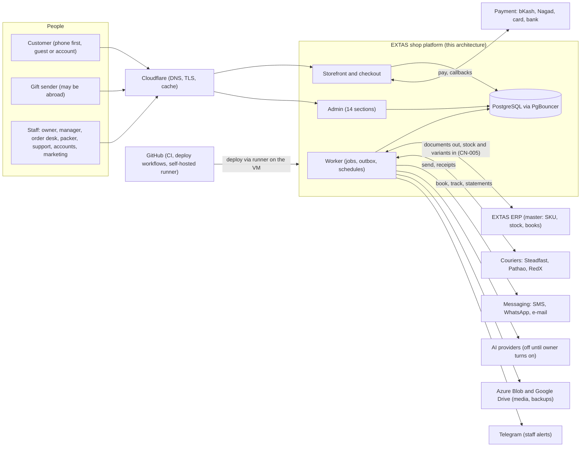

### 3.2 Runtime components on the VM

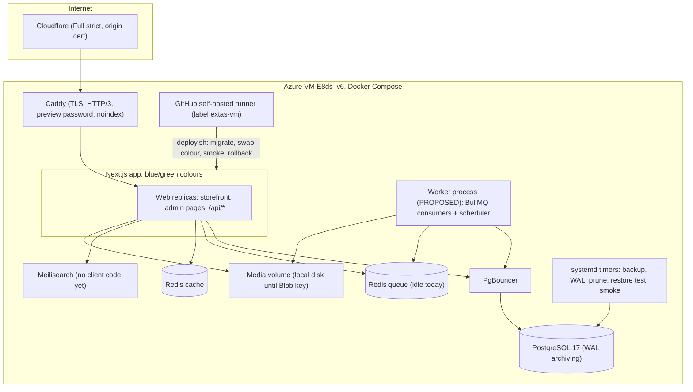

| Component | State | Notes |
|---|---|---|
| Caddy, Cloudflare, preview gate | IV | PR 7; preview cookie fix (CN-007) |
| Next.js web (blue/green) | IV | `infra/deploy/deploy.sh`; one image per colour |
| **Worker** | **MN** | Proposed: the same image started with a worker entry point, one container per colour or a single active worker guarded by a Redis lock so blue and green never both run schedules (§9.4) |
| PostgreSQL + PgBouncer | IV | Tuned from hardware profile (`extas-profile`) |
| Redis (queue, cache) | IV containers; queue idle | PR 6 |
| Meilisearch | Container only | Used when storefront search (PR 72) lands |
| Backups | IV locally; offsite inactive | `infra/server/bin/extas-backup`; Blob/Drive need owner keys |
| Smoke and monitor | IV | `infra/deploy/smoke.sh`, `smoke.yml`, `extas-monitor` |

### 3.3 Code structure (existing and proposed packages)

The repository is a pnpm workspace. Domain logic lives in packages; `apps/web` holds routes and screens only. This
draft keeps that rule and adds packages for unbuilt domains.

| Package | State | Proposed role |
|---|---|---|
| `@extas/db` | IV | Prisma schema, migrations (expand-only), guards |
| `@extas/settings` | IV | Registry, resolver, validation, change log |
| `@extas/vault` | IV | Encrypted secrets, access log, rotation |
| `@extas/auth` | IV | Staff and customer auth, RBAC, audit helper |
| `@extas/adapters` | IV framework | Adds courier, payment, messaging, speech-to-text, AI adapters (each mock first) |
| `@extas/media` | IV | Unchanged; resizing moves to the worker |
| `@extas/catalogue` | IV | Base price and cost become a read-only ERP mirror (D1, G3); shop keeps sale/combo/coupon prices (Q2) |
| `@extas/inventory` | IN | Mirror, holds, ERP outbox, reconcile; gains webhook handling |
| `@extas/rules` | IV | Pricing, discounts, delivery, exchange, festive and policy rules; `quoteCart` |
| `@extas/combos` | IV (core) | Sets, tiers, bag locking |
| `@extas/delivery` | IV (zones) | Zones, bands, resolver, charge guard |
| `@extas/seed` | IV | Default pack, sample data, owner-data guard |
| `@extas/cart` | IV (S04 PR 105–114) | The bag: lines, quantities, save for later, archived removal with Undo, coupon box, free-delivery progress |
| `@extas/jobs` | **new** | Worker bootstrap, queue registry, scheduler, JobRun recording, outbox relay |
| `@extas/orders` | **new** | Order service, state machine, snapshots, edits, holds, cancel, outcomes |
| `@extas/checkout` | **new** | Bag → quote → place, payment selection, advance mode, gift and bulk lanes (the bag itself is `@extas/cart`) |
| `@extas/payments` | **new** | Payments, advances, refunds, wallet ledger, gateway callbacks |
| `@extas/shipping` | **new** | Courier accounts, booking, tracking, exceptions, handover, labels |
| `@extas/returns` | **new** | Returns, exchanges, QC, claims |
| `@extas/risk` | **new** | Risk matrix, levels, duplicate/re-order scenarios, proposals (S06 rest) |
| `@extas/customers` | **new** | Profiles, identity matching, consent, segments, loyalty |
| `@extas/messaging` | **new** | Journey, templates, campaigns, caps, consent, send log |
| `@extas/support` | **new** | Conversations, call-backs, rider issues, claims, saved replies |
| `@extas/money` | **new** | COD reconciliation, costs, expenses, month close, P&L inputs |
| `@extas/metrics` | **new** | KPI registry and calculation service (§10) |
| `@extas/approvals` | **new** | One approval queue for staff and AI requests |
| `@extas/webhooks` | **new** | Inbound receiver, verification, dedupe, dispatch |
| `@extas/content` | **new** (S11–S12) | Pages, menus, blog, SEO, dictionary |
| `@extas/marketing` | **new** (S13) | Campaigns, hero, landing pages, ads |
| `@extas/ai` | **new** (S15) | Agents, tools allowlist, usage ledger, routing |
| `@extas/health` | **new** (S21) | Customer problems, server state, audits |

Package names are proposals; the register's PRs decide the final split. Each new package follows CN-011 (header
comment, tests beside code, lint and format clean).

---

## 4. Module and submodule inventory

Layering rule: a module may call modules below it, never above. Platform services are shared by all.

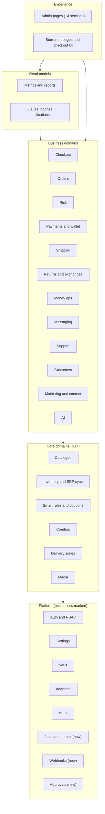

| Module | Responsibilities | Data it owns (writes) | Depends on | Status · stage/PRs |
|---|---|---|---|---|
| **Platform: Auth & RBAC** | Staff and customer sign-in, sessions, 2FA, roles, permission checks, CSRF, wrong-try pause | StaffUser, StaffSession, Role, Permission, StaffRoleAssignment, CustomerCredential, CustomerSession, OtpChallenge, SecurityEvent | Settings, Vault, Audit | IV · PR 15, 16, 495; customer side PL S04 PR 129–130 |
| **Platform: Settings** | Declared registry, store → installation → default resolution, validation, change log, reset | SettingDefinition, *SettingValue, SettingChange | DB | IV · PR 491–496, 510 |
| **Platform: Vault** | Encrypted keys, access log, rotation | VaultKey, *Secret, SecretAccessLog | DB, env master key | IV · PR 493 |
| **Platform: Adapters** | Provider registry with MOCK/SANDBOX/LIVE, Test runs, status mapping | Integration, IntegrationTestRun | Vault, Settings | IV framework · PR 18, 500; courier/payment/messaging adapters PL |
| **Platform: Audit** | Append-only business history (who, what, before → after, source) | AuditLog | DB | IN · PR 139, 496 |
| **Platform: Jobs & outbox** (new) | Worker, queues, schedules from settings, JobRun records, retries, dead letter, replay, stuck alert | ScheduledJob, JobRun, OutboxEvent | Redis, Settings | MN · PR 6 (follow-up) |
| **Platform: Webhooks** (new) | Inbound endpoint per source, signature check, dedupe, async dispatch | WebhookEvent | Adapters, Jobs | MN · PR 196 (ERP), 184 (courier), 170 (payments) |
| **Platform: Approvals** (new) | One queue for staff and AI requests; claim-before-run; preview tokens | AiApprovalRequest (generalised) | Auth, Audit | PL · PR 317, 540 |
| **Catalogue** | Products, variants by ERP SKU, categories, colours, fabrics, size charts, collections, tags, naming/redirects, publish checklist, CSV, link import | Product, ProductVariant, PriceHistory, Category, Collection, SizeChart, Redirect, SeoMeta, PublishQueueItem … | Media, Settings, Inventory (stock for publish) | IV · S01 |
| **Media** | Upload, validate, renditions, watermark copy, where-used, orphan archive | MediaAsset, MediaRendition, ProductMedia | Adapters (storage) | IV · PR 22–25, 37 |
| **Inventory & ERP sync** | Stock mirror, cart holds, ERP document outbox, low stock, counts (report only), reconcile, health | StockLevel, StockReservation, StockMovement, ErpPush, ErpSyncRun/State, LowStockAlert, StockAudit | Adapters (ERP), Jobs | IN · S09 |
| **Smart rules & coupons** | Rule engine (delivery, exchange, tiers, discounts, festive, payment, policy), notices, coupon redemption, simulation, approval of money rules | SmartRule(+Version, Conflict, Simulation), Notice, Coupon, CouponRedemption | Settings, Approvals | IV · S10 |
| **Combos** | Auto pairs, fixed combos, customer sets, price lock in bag, analytics | Combo, ComboItem, ComboAutoRule, PopularPair, ComboDailyStat | Catalogue, Rules, Inventory | IV core · S03 (13 PRs left) |
| **Delivery zones** | Gazetteer, bands, resolver, charge guard, phone-first area | GeoArea, DeliveryBand, AreaBand | Settings | IV · PR 549–553, 555 |
| **Checkout** (new) | Cart page logic, quote, validation, price/stock re-check, place order once, payment choice, advance mode, gift lane, bulk enquiry, call-me trigger, voice address, abandoned capture | Cart, CartItem, CheckoutDraft | Rules, Combos, Inventory, Delivery, Risk, Payments, Orders | PL · S04 PR 105–137, 558, 560, 561, 563, 565, 566, 605, 606 |
| **Orders** (new) | Order service and state machine, snapshots, edits, holds, cancel and cancel requests, outcomes (partial, failed, charge-paid return), notes, merge, order groups | Order, OrderItem, OrderEvent, OrderNote, OrderGroup | Inventory, Payments, Risk, Shipping, Messaging (via outbox) | PL · S05 PR 138–155, 541, 546 |
| **Risk** (new) | Risk matrix, levels (Soft / Hard / Partial), duplicate and re-order scenarios, identity graph, proposals (block, COD off), learning, flag outcomes | RiskSignalConfig, RiskBand, RiskAssessment, FraudRule, FraudAlert, FraudDecision, BlockEntry, CourierFraudCheck; proposals (new) | Customers, Delivery, Approvals | PI · S06 (27 PRs left) |
| **Payments & wallet** (new) | Gateway payments and callbacks, advances (incl. outside-checkout), refunds, wallet ledger, prepaid reward application | Payment, PaymentLink, Refund, WalletAccount, WalletEntry, PrepaidBalance | Adapters (payment), Orders, Approvals | PL · S07 PR 165–174 |
| **Shipping** (new) | Courier accounts and rate cards, booking (single/bulk), labels, handover batches, tracking events, exceptions, claims, zone sync | CourierAccount, CourierRateCard, Shipment, ShipmentEvent, CourierAreaMapping, HandoverBatch, PrintJob, PackingIssue, ChargeMismatch | Adapters (courier), Orders, Delivery | PL · S08 PR 175–184, 192, 554, 564; S20 PR 404–412 |
| **Returns & exchanges** (new) | Requests, window check, eligibility, approval, pickup, receipt, QC, return document to ERP, claims, waivers | Exchange(+Item), ReturnRecord, ReturnItem | Orders, Shipping, Payments, Inventory | PL · S08 PR 185–191, 525, 526 |
| **Money ops** (new) | COD settlement import and parcel matching, "received as", claims, cost ledger, retail expenses, month-end close push | CourierSettlement(+Line), CostEntry, RetailExpense, MonthClose, OrderProfit | Shipping, Payments, Inventory (ERP outbox), Metrics | PL · S07 PR 166, 174; S08 PR 525; S16 PR 342–355, 504, 536, 537, 568 |
| **Customers** (new) | Profiles by phone, addresses, per-phone history, identity matching and merge, consent, segments, loyalty and grades | Customer(+Address), ConsentRecord, Segment, IdentityCluster, CustomerErasureRequest | Orders (read), Messaging | PI · S14 PR 284–303, 505, 533–535 |
| **Messaging** (new) | Order journey, templates, campaigns, caps, quiet hours, consent, send engine with dedupe, delivery receipts, cost rows | NotificationTemplate, NotificationRule, NotificationLog, Journey; caps as settings | Adapters (SMS/WA/e-mail), Customers, Money (cost ledger) | PL · PR 148, 149, 289–292, 295, 298, 300, 505, 545, 546; CN-019 |
| **Support** (new) | Unified inbox, assignment, SLA, call-backs, rider issues, claims and credits, saved replies, order from chat | Conversation, Message, Ticket; rider-issue and claim records (new models) | Messaging adapters, Orders, Payments | PL · S22 PR 425–436, 538 |
| **Marketing & content** (new) | Campaigns and hero, landing pages, ads tracking and feeds, pages, menus, blog, SEO, dictionary | Campaign, LandingTemplate, Page, Menu, BlogPost, ContentRevision, AdAccount, AdCampaign, AdSpendDaily, HouseAdPlacement | Catalogue, Rules, Media | PL · S11, S12, S13 |
| **Metrics & reports** (new) | KPI registry, calculations, MV refresh, exports | Report caches/MVs (derived only) | Every domain (read) | PL · S16 PR 342–355; S15 PR 338–341 |
| **Queues & notifications** (new) | "Needs you now" counts, badges, staff notifications (bell, Telegram, e-mail) | Staff notification records (new model), queue definitions in code | Every domain (read) | PL · ADMIN-ARCHITECTURE §4.1 |
| **AI** (new) | Agents, tool allowlists, approvals, usage and caps, data-class routing, AI-off fallbacks | AiAgent, AgentPermission, AiUsageLedger, AiCapEvent, AiWorkLog, DataClassRoute | Approvals, Adapters (AI), Money (cost ledger) | PL · S15 |
| **Site health** (new) | Customer-problem probe and grouping, server page, audit runner, smoke results | ServiceHealthSample; anonymous problem and audit-run records (new models) | Jobs, Telegram | PL · S21; CN-015 |

---
## 5. Admin information architecture

This section is the UI-screen-to-backend map (addendum artifact 5). It brings in the page-level admin architecture
(161 pages) in tightened form; nothing is dropped. The feature → page mapping (every demo guide, every CN item,
every stage, every addendum item) is in **Appendix A**. Pages already built carry **[built]**.

### 5.0 Conventions used by every page

**Release marks (revised in v2).** **Gate** = needed before the first real order on the main domain (go-live S19 PR
587 and the 70-order rerun). **Plan** = in scope, fully designed, **built in the current plan, not a go-live gate**
(v1 called this "Later", which read as "left out"; the owner's 23 Oct items are Plan and Q1 asks whether any must be a
gate). **Deferred** = waits for the owner (S17 multi-store). **Parked** = hidden slot (S26, S27). Marks order the admin
build and the go-live check only; they do not change the register's stage order. Totals: 133 Gate · 26 Plan · 1
Deferred · 1 Parked (§5.16, §16.5).

**API style** (detailed in §7.1):

| Tag | Meaning |
|---|---|
| — | `GET/POST /api/admin/{module}/…`, JSON, cursor pagination (`?cursor=&limit=`, max 100, stable sort `(sortKey, id)`); phone views use the same endpoints with `limit=20`. Store scope from the session; `?store=all` is read-only. |
| **[cmd]** | State changes are named commands (`POST /api/admin/orders/{id}/confirm`); an illegal transition returns `409 ILLEGAL_TRANSITION` with the allowed next steps. |
| **[idem]** | Requires an `Idempotency-Key` header: same key + same body → same stored result for 24 h; same key + different body → `409`. Required on every money, booking, send, ERP-push and bulk command; bulk returns a per-row result (done / skipped + reason). |
| **[ver]** | Optimistic lock: body carries `version`; a stale write gets `409 STALE` with the fresh record ("Someone changed this. Review and save again."). |
| **[confirm]** | Hard-rule action (money, refund, COD, price, discount, ad budget, block, archive of data): `POST …/preview` returns the exact effect and a `confirmToken` (short-lived); the command must carry it and a reason. |
| **[job]** | Long work returns `202 {jobId}`; progress at `GET /api/admin/jobs/{id}`; result arrives as a notification. Exports are always jobs, permission-checked and audited. |

**States.** **std** = the five base states on every page: *loading* (skeleton in the page's own layout, actions
disabled) · *empty* (what goes here, why empty, one filling action, guide link) · *error* (plain message, Retry,
error id, last good data kept with a "not current" band) · *denied* (menu item hidden; deep link shows the needed
permission's plain name and "Ask the owner") · *partial* (band naming the missing source and its last good time;
missing data never shown as 0). Extra states: **mock** (yellow "Sample data" ribbon), **stale** (older than that
data's freshness limit), **locked** (read-only with reason and the way to unlock), **AI-off** (AI parts hidden,
rule/template fallback shown), **conflict** (409 STALE), **queued** (job running).

**Permissions.** Keys `module.action`; keys already in `packages/auth/src/catalogue.ts` are marked †, all others are
proposals added to the role builder (PR 495) with plain labels in both languages. Reading a section needs
`<module>.read`; a menu item shows only if the person holds a key in it; the server checks every action
(`guardAdmin` + service re-check). Hidden buttons are convenience, never security.

### 5.1 Global shell

**Sidebar (deep green, collapses to icons at ≤ 1366 px):**

| Group | Entries (badge = waiting work only) |
|---|---|
| top | EXTAS mark · store switcher |
| DAILY WORK · রোজকার কাজ | Dashboard · Orders (to confirm + risk) · Products (launch queue) · Customers · Delivery (ready to book + stuck) · Messages (failed sends) · Support (open chats + call-backs) |
| GROW · বিক্রি বাড়ানো | Marketing (approvals waiting) · Website (posts in review) |
| BUSINESS · ব্যবসা | Money (COD mismatches) · Reports (urgent problems) · AI Center (approvals; hidden when AI is off for non-owners) |
| bottom | Settings · Help & Build · account chip (name, role, store) |

Badges come from one endpoint, `GET /api/admin/shell/badges` (short cache, permission-filtered); a badge never counts
work the person cannot open.

**Top bar:** search box (Ctrl K) · **Ask AI** (Plan; hidden when AI is off) · bell · **EN | বাং** · avatar menu
(Profile, Two-step login, My sessions, Sign out).

**Command palette (SH-02).** Ctrl/⌘ K, `/`, or tap on the search box (phone: Search tab). Server-side,
permission- and store-aware: `GET /api/admin/search?q=&groups=` (Meilisearch for products when PR 72 lands; Postgres
for orders, customers and settings).

| Group | Matches on | Opens |
|---|---|---|
| Pages & tabs | title (en/bn), synonyms | the page |
| Settings | label, help text, synonyms from the settings registry | page scrolled to the card, highlighted; result shows the path |
| Orders | order no., phone in any format (`phoneNormalizeBD`), name, consignment no. | order detail |
| Products | name, SKU, barcode, colour | product editor |
| Customers | phone, name | profile (the open is logged) |
| Coupons, campaigns, collections | code, name | their editor |
| Help | manual text | guide side panel |
| Actions | "Create order", "Add product", "New coupon", "Book ready parcels", "Run backup now" (only those permitted) | the action |

Max 5 per group with "See all"; prefixes `>` actions, `?` help, `#` order number; Bengali digits and words accepted.

**Notifications vs "Needs you now"** (addendum 3.10, 3.13):

| | Needs you now (Dashboard) | Notifications (bell, SH-03) |
|---|---|---|
| What | live work queues: counts of things waiting | events that happened once (approval requested, sync failed, backup failed, mention, new urgent customer problem) |
| Life | clears when the work is done; no read state | read/unread; Urgent · Important · FYI; kept 90 days (setting) |
| Source | `GET /api/admin/dashboard/queues` (count, oldest age, link to a saved view) | `GET /api/admin/notifications` + server push; Telegram copy for Urgent |
| Rule | each row says why it exists and links to the filtered queue | each links to the exact record; never duplicates a queue row |

Staff notifications are separate from customer messages (Messages section).

**Store switcher.** At go-live: one store, a static name (no dropdown, §19.2). Deferred (S17): more stores; "All stores" is read-only (lists and
reports), every write asks for a store. Current store in the URL so links and exports keep scope; search never
returns another store's records.

**Default roles** (the owner edits roles, PR 495):

| Role | Sees | Key limits |
|---|---|---|
| Owner / Super admin | everything incl. Help & Build → Build progress | all keys; last owner protected |
| Manager | everything except Team & roles, Keys & connections, System, Build progress | no `vault.*`, `roles.manage` |
| Order desk | Dashboard (own cards), Orders (no Risk rules), Customers (read), Delivery, Messages → Message log, Support (read) | confirm, call, edit before booking, request advance; no refunds |
| Packer | Orders → Packing & print, Returns → Receive & QC; Products → Stock (read) | scan, pack, photo, handover |
| Support agent | Support, Customers (read + notes), Orders (read, notes, create from chat), Message log | refunds only as requests |
| Marketing | Marketing, Website, Messages → Campaigns & Templates, Reports → Marketing & ads | budget raises need the owner |
| Accounts | Money, Reports, Orders (read), Delivery → Returned (read) | records payouts; executes approved refunds |
| Auditor | read-only everywhere + audit log | no writes, no personal-data exports |
| Check account (smoke, CN-016) | read-only pages, no personal data | server-only password |

These default roles are **proposals**: only the owner role (all keys) is seeded (`packages/auth/src/roles.ts`), and the read-only `smoke-check` role is made on the server for the smoke test (`packages/auth/src/check-account.ts`); the owner creates the others in the role builder (PR 495). Each role gets a start page (§19.5, R3).

Phone numbers show in full to roles with `customers.read`; every profile open and copy is logged.

**Language, phone, tablet.** Per-person language (`PATCH /api/admin/auth/me`); labels from the dictionary (PR 503);
English mode shows 0 Bengali; Western digits; ৳ with lakh grouping; store time zone (Asia/Dhaka). Business data is
never auto-translated. Phone (390 px): bottom bar Home · Orders · Support · Search · More; tables become cards; bulk
by long-press; 44 px targets; camera scanners. Tablet: icon sidebar, "Details | Timeline" tabs. Layout checks at
390 / 768 / 1366 / 1920 px.

**Shared page patterns:** List (header with ≤ 1 primary + ≤ 2 secondary, saved views, filter bar, table, peek
drawer, bulk bar that states what will be skipped and why) · Detail (record cards ⅔ + timeline ⅓ with notes) · Form
(anchors with ✓/!, sticky save bar, readiness panel) · Settings card (one feature, switch off by default, values
fold away, default shown, Reset, money changes preview [confirm]) · Board (drag only where the transition is legal)
· Wizard · Report (date control, KPI strip, line/bar charts with "View data", Export [job], freshness line, estimates
marked ~) · Three-pane (inbox, risk review). Undo toast after archive; every money figure says estimated,
provisional or reconciled.

**Shell pages:**

| ID | Page | Mark | Content · API · perms |
|---|---|---|---|
| SH-01 | Sign in `/admin/login` [built] | Gate | e-mail + password, first-password and 2FA steps, full-e-mail hint, wrong-try pause · `/api/admin/auth/login`, `/2fa`, `/password` |
| SH-02 | Command palette | Gate | above · `GET /api/admin/search` |
| SH-03 | Notifications drawer | Gate | above · own notifications only |
| SH-04 | Ask AI panel | Plan (owner 23 Oct; Q1) | chief agent answers with links, never acts outside the approval queue (PR 583, 540); hidden when AI is off |
| SH-05 | Guide side panel "এই সেকশনে কী করা যায়" | Gate | Bengali chapter for the current tab · `GET /api/admin/help/{slug}` (reads the deployed docs copy) |
| SH-06 | Account: profile, two-step login, sessions, language | Gate | `/api/admin/auth/me`, `/totp`, `/sessions` [built API]; log out everywhere |
| SH-07 | System pages: 403, 404, error, maintenance/standby | Gate | error id + "Back to Dashboard"; each is a smoke check |

**Shared backend services the pages rely on (so no page holds business logic):** Metrics service
(`GET /api/admin/metrics?keys=&range=&compare=&groupBy=`, §10) · Queues service (needs-you-now, badges) · Jobs
service (exports, bulk) · Audit service (append-only) · Settings registry (`GET/PUT /api/admin/settings?group=`
[built]) · Integrations registry (mode, last success, last error) · Approval queue (staff and AI).

---

### 5.2 Dashboard (ড্যাশবোর্ড)

Purpose: the owner's morning screen; every staff member's start page with only their cards. Roles: all, cards
filtered by permission. Backend: Metrics, Queues, Site health. Page tree: DSH-01 → drawer Customize cards · drawer
All waiting work · modal Daily summary to Telegram.

**DSH-01 · Dashboard** `/admin` · **Gate** [built as an empty frame; today redirects to products]
- **Layout & data:** header (greeting, date, store, guide link, date control Today · 7 days · 30 days · Custom) ·
  KPI strip: **Delivered sales** (delivered only, D3), **Orders**, **Delivery success (30 days)** with its
  denominator, **Estimated contribution** (~, 7 or 30 days, owner only by default), each with ▲/▼ vs previous period,
  a sparkline, its status (provisional / reconciled) and one freshness line "courier data up to hh:mm · ERP up to
  hh:mm" (definitions §10.2; the picture's "Delivered and booked" chart and "Estimated profit today" card are corrected
  per §19.3, R4) · Delivered-sales trend (⅔) + **Needs you now** (⅓) · Orders by stage (New → Confirmed → Packed → With courier → Delivered, average order-to-courier
  time vs target) · Top products · Delivery success by courier · Running problems strip (only when open, CN-015).
  More options: choose and order cards per person; daily Telegram summary (off; time a setting); who sees
  contribution.
- **Needs you now rows** (each opens a saved view; rows at 0 hidden): orders to confirm · risky orders · waiting
  for advance · cancel requests · voice addresses to call · parcels to book · stuck/late parcels · exchange and
  return requests · claims and rider issues · chats and call-backs · low-stock sizes · approvals waiting · COD
  mismatches · failed messages · urgent customer problems · integration or job failures · **cancels waiting for courier
  confirmation** (§6.5.7) · **returns waiting for ERP confirmation** (§6.5.4) · **ERP pushes failed** · **last month
  not pushed to the ERP** (from the first day of a month).
- **Actions:** none primary (rows are the actions) · S: Download (PDF/CSV), Customize.
- **Perms:** `dashboard.read`; each card needs its module read key (`orders.read`, `money.read` …).
- **API:** `GET /api/admin/metrics?keys=sales.delivered,orders.placed,delivery.success30,contribution.estimated&range=`;
  `GET /api/admin/dashboard/queues`; `GET /api/admin/health/problems?status=open&limit=3`; `PUT /api/admin/dashboard/layout` [ver].
- **States:** std + partial (courier or ERP stale → band on the card), mock (sample orders on staging), empty day.
- **Refs:** ADMIN-ARCHITECTURE §4.1; PR 155, 304, 341; CN-015 (5); CN-019 (2); design review §19.3.

---

### 5.3 Orders (অর্ডার)

Purpose: move every order from placed to done, safely. Roles: Owner, Manager, Order desk, Packer (Packing, QC),
Support (read/notes), Accounts (read). Backend: Orders, Risk, Shipping (fulfilment), Returns, Payments.

Page tree: ORD-01 All orders · ORD-02 To confirm · ORD-03 Risk review · ORD-04 Packing & print (04a Print run, 04b
Picking list, 04c Handover sheet, 04d Invoice designs) · ORD-05 Returns & exchanges (05a Receive & QC) · ORD-06 Risk
rules · ORD-07 Order detail · ORD-08 Create order · ORD-09 Bulk & corporate enquiry · ORD-10 Order settings.

**ORD-01 · All orders** `/admin/orders` · **Gate**
- **Layout & data:** list pattern. Columns: order no., placed time (age), customer + phone, items, total, payment
  (COD / prepaid / partly paid; "received as" once settled), status pill, risk band, courier + consignment, flags
  (gift, replacement of / replaced by, two sizes, voice-entered, bulk, channel source). Four pills: order, courier,
  payment, return/refund (§6.5.0). Views: Today · COD unpaid · Prepaid · Waiting for advance · Gift · Cancel pending
  courier · Replacement orders · Partly delivered · Failed delivery · Cancel requests · Bulk &
  corporate · Incomplete (typed, not placed) · Voice — please call. Filters: search (no., phone, name, tracking),
  status, payment, date, courier; more: risk band, zone band, channel, tag. More options: order number format,
  columns, default view per role.
- **Actions:** P: Create order · S: Export [job], Print selected · row: open, call, WhatsApp · **Bulk:** Confirm,
  Book courier (→ Delivery), Print stickers/invoices/picking list, Tag, Hold, Export; the bar states skips ("1
  cancelled and 2 in risk review will not be booked", F-002/F-014).
- **Perms:** `orders.read`, `orders.confirm`, `orders.hold`, `orders.export`, `orders.tag`; booking `delivery.book`.
- **API:** `GET /api/admin/orders?view=&q=&status=…`; `POST /api/admin/orders/bulk/{confirm|hold|tag}` [idem][cmd];
  `POST /api/admin/orders/export` [job].
- **States:** std + partial (courier status stale), conflict (an order changed while selected; re-checked before the bulk runs).
- **Refs:** PR 140, 151, 152, 154, 274; F-002, F-014; CN-021 P16.

**ORD-02 · To confirm** `/admin/orders/confirm` · **Gate**
- **Layout & data:** header (count, oldest age) · sub-chips Call queue · WhatsApp self-confirm waiting ·
  New-customer verification · Voice — please call · Cancel requests · list + order card with call script: summary,
  band and charge, payment, self-confirm state (sent / replied 1-2-3 / no reply → call at hh:mm), per-phone history
  line (orders, true deliveries, refusals, no-response count), voice player + transcript confidence, cancel reason.
  **Prepaid orders never enter the call queue** (F-020). More options: WhatsApp self-confirm (off; reply texts, wait
  before call queue, which orders, whether it counts as the order's one WhatsApp); call attempts before hold
  (reason shown, never auto-cancel); new-customer verification.
- **Actions:** P: Confirm · S: Call (logs reached / no answer / wrong number), WhatsApp, Edit, Cancel (reason),
  Request advance, Approve/refuse cancel request · **Bulk:** Confirm selected.
- **Perms:** `orders.confirm`, `orders.cancel`, `orders.cancelRequests.decide`, `orders.advance.request`.
- **API:** `POST /api/admin/orders/{id}/confirm` [idem][cmd]; `POST …/{id}/call-log`; `POST …/{id}/cancel` [idem][cmd]
  (reason code); `POST …/{id}/cancel-request/{approve|refuse}` [idem]; `POST …/{id}/advance-request` [idem] (level,
  channel).
- **States:** std + mock (WhatsApp not connected: "would send"), AI-off.
- **Refs:** PR 144, 148, 292, 541, 542, 545; CN-014a; CN-020 (4)(5); CN-021 P12; F-011, F-013, F-020.

**ORD-03 · Risk review** `/admin/orders/risk` · **Gate**
- **Layout & data:** three-pane: queue by section (Duplicate · Re-order in transit · High risk · New identity ·
  Blocked match) · order + alert card (why it fired, matched earlier orders, rider notes, identity links: phone,
  name, address, IP, device) · history and per-rule breakdown, level reached (Soft = delivery-charge advance, Hard =
  full advance, Partial), scenario A–I, per-phone history, AI suggestion with reason (if AI on). Views: section,
  band, age, assignee; "Decided" (decision and who).
- **Actions:** P: Approve · S: Request advance (soft/hard/partial), Decline with reason (customer notice), Merge into
  one parcel, Turn into exchange, Hold, **Propose "COD off for this number"**, Propose block (never automatic) ·
  **Bulk:** Approve within one section; Decline never bulk.
- **Perms:** `orders.risk.read`, `orders.risk.decide`, `orders.merge`, `risk.codOff.propose`, `risk.block.propose`;
  confirming a block `risk.block.confirm` (owner).
- **API:** `GET /api/admin/risk/queue?section=`; `GET /api/admin/risk/orders/{id}/explain`;
  `POST /api/admin/risk/orders/{id}/{approve|decline|hold}` [idem][cmd]; `POST /api/admin/orders/merge` [idem][confirm];
  `POST /api/admin/risk/proposals` (codOff / block → approval queue). Decisions feed learning (PR 543).
- **States:** std + partial (courier fraud check unavailable → "not checked", never "clean"), AI-off, locked (decided
  by someone else; shows who).
- **Refs:** PR 145, 157–161, 163, 519–524, 540, 541, 543, 556, 557, 559, 567; CN-018 (2); CN-021 P12; F-014, F-015, F-043, F-044.

**ORD-04 · Packing & print** `/admin/orders/packing` · **Gate**
- **Layout & data:** step chips Pick → Pack → Ready for courier → Handed over · list of confirmed orders · scan panel
  with order lines (SKU, size, colour, qty, bin), gift flag (prices hidden, receiver address, deliver-on-or-after),
  packing photo state, sticker count and reprint warnings, courier. **A shortage (negative or insufficient stock)
  raises a resolution card and blocks packing/booking until a person decides** (F-006). More options: packing photo
  (off; required or reminder; photos per parcel; retention), sticker size and exact-amount line (never for prepaid),
  default invoice design, picking-list sort.
- **Actions:** P: Mark packed (requires SKU scan match; requires photo when set to required, F-010) · S: Print
  sticker, Print invoice, Reprint (reason), Report defect/out of stock (resolution card, never auto-cancel), Hand
  over · **Bulk:** print in packing order; mark handed over.
- **Perms:** `fulfilment.read`, `fulfilment.pack`, `fulfilment.print`, `fulfilment.handover`, `fulfilment.invoiceDesign`.
- **API:** `GET /api/admin/fulfilment/queue`; `POST /api/admin/fulfilment/orders/{id}/scan`; `POST …/{id}/pack` [idem][cmd];
  `POST …/{id}/photo`; `POST /api/admin/fulfilment/print-runs` [idem][job] → PDF; `POST …/handover` [idem];
  `POST …/{id}/defect` [idem].
- **States:** std + locked (on hold, awaiting advance or in risk review), offline scanner (manual SKU entry).
- **Refs:** PR 179–183, 404–412, 605; CN-014b/c; F-006, F-007, F-010.

| ID | Page | Mark | Layout & data | Actions · perms · API | States |
|---|---|---|---|---|---|
| ORD-04a | Print run | Gate | queue preview, printer size, reprints flagged | Start → PDF [job][idem] · `fulfilment.print` | std, queued |
| ORD-04b | Picking list | Gate | daily consolidated, category → style → size, highest qty first | Print · `fulfilment.print` · PR 181 | std |
| ORD-04c | Handover sheet | Gate | per courier: count, consignments, signature lines | Print, Mark handed over [idem] · `fulfilment.handover` · PR 180 | std |
| ORD-04d | Invoice designs | Gate | 7 templates, every word and block editable, live preview, `invoice.*` settings | Save [ver] · `fulfilment.invoiceDesign` · PR 407, 409 | std, conflict |

**ORD-05 · Returns & exchanges** `/admin/orders/returns` · **Gate**
- **Layout & data:** board Requested → Approved → Received & QC → Done · card: type (size exchange, fault, wrong-item
  claim, return/refused, one-trip swap), original order + courier's delivered mark, **window left** (setting,
  default 72 h from the delivered mark; late requests refused, paid or free, CN-021 P8), who pays (own size choice
  pays the second delivery; our mistake is free via claim with note + photo; waiver with reason, CN-018 (5)),
  exchange charge (from Smart Rules), QC result and **disposition: sellable → "ERP: waiting / confirmed / failed",
  not sellable → loss with reason** (D4, §6.5.4), **restock SKU scanned from the item that came back** (F-022), linked
  refund or credit, courier outcome and claim (one return-case timeline, §19.1). More options: one-trip size swap (off; charge, areas, days);
  link to the exchange rule.
- **Actions:** P: Approve (books the exchange) · S: Refuse (reason), Waive charge (reason) [confirm], Approve claim,
  Book swap pickup, Receive & QC, Close · **Bulk:** approve same-type requests; close done.
- **Perms:** `returns.read`, `returns.decide`, `returns.waive`, `returns.qc`, `returns.claims.decide`.
- **API:** `GET /api/admin/returns?stage=`; `POST /api/admin/returns` [idem]; `POST …/{id}/{approve|refuse|close}` [idem][cmd];
  `POST …/{id}/waive/preview` → `POST …/{id}/waive` [confirm]; `POST …/{id}/qc` [idem]. **Parcel received, QC done,
  sellable-sent, restock confirmed by the ERP, loss recorded, refund approved and refund completed are separate
  events** (§6.5.4).
- **States:** std + locked (outside window, reason shown), partial (delivered mark missing → window "unknown, check courier").
- **Refs:** PR 185–191, 525, 526; CN-014e; CN-018 (5); CN-021 P8; F-005, F-021, F-022, F-052.

| ID | Page | Mark | Layout & data | Actions · perms · API | States |
|---|---|---|---|---|---|
| ORD-05a | Receive & QC `/admin/orders/returns/qc` | Gate | phone-first: scan parcel/consignment → expected vs received items → SKU scan → **Sellable / Not sellable** (reason; photo when the setting asks) (D4, R6) | Record QC [idem] → sellable: return document to the ERP, restock only on ERP confirmation; not sellable: loss entry in the shop, nothing sent to ERP stock · `returns.qc` · `POST /api/admin/returns/{id}/qc` | std, offline scanner |

**ORD-06 · Risk rules** `/admin/orders/risk-rules` · **Gate**
- **Layout & data:** settings page with anchors: **Risk matrix** (rules × weights with "orders this would have
  flagged in the last 30 days") · **Levels** (Soft, Hard, Partial; each level's rule set and thresholds) ·
  **Checkout advance layers** (PR 558/560; one master switch; placement flagged as conflict C7) · **Rule switches** ·
  **Duplicate & re-order rules** (scenarios A–I) · **Blocklist** (reason, who, Undo; proposals waiting) · **Protection
  & learning** (good-customer override, false-positive weekly list, decision learning, flag outcome report). Per
  rule: signal, weight, enabled, 30-day hits, false-positive rate. **Refusals marked "our fault" never count as a
  signal** (F-044). More options: IP/device/GPS signals and their purge (link to Settings → System), courier fraud
  data sources.
- **Actions:** P: Publish changes [confirm] (shows how many current orders change level) · S: Simulate on last 30
  days [job], Reset to default, Unblock (reason) · **Bulk:** enable/disable rules.
- **Perms:** `risk.rules.read`, `risk.rules.write`, `risk.rules.publish`, `risk.block.confirm` (owner), `risk.unblock`.
- **API:** `GET/PUT /api/admin/risk/rules` [ver]; `POST /api/admin/risk/rules/simulate` [job]; `POST /api/admin/risk/rules/publish` [confirm];
  `GET/POST /api/admin/risk/blocklist`, `POST …/{id}/unblock` [idem]; `GET/PUT /api/admin/risk/checkout-layers` [ver][confirm].
- **States:** std + conflict, mock (courier fraud check mocked).
- **Refs:** PR 156, 159, 161–163, 520, 523, 524, 544, 558, 560, 562; CN-018 (2); F-043, F-044.

**ORD-07 · Order detail** `/admin/orders/{id}` · **Gate**
- **Layout & data:** header (no., status, payment pill; primary = next legal step) · cards: Items (incl. "Add to this
  parcel" before booking) · Totals (subtotal, discounts, **stored** delivery charge, paid, **amount due = total −
  paid**, "to collect on delivery" hidden when 0; F-001, F-003, F-040) · Customer & address (band, resolver result,
  voice flag) · Gift (receiver, note, deliver-on-or-after) · Courier (booking, consignment, events, exception state)
  · Risk panel · Phone history · Payments & refunds · timeline (events, every message with channel/cost/state, every
  edit with who and source, notes; replacement links both ways). Edit-lock line once booked: **"Booked with {courier}:
  locked. To change, cancel after booking and create a replacement order."** (F-004; decision D5, §6.5.7).
- **Actions:** P: next legal step · S: Edit (before booking only), Hold/Release (reason), Cancel (reason; before
  booking), **Cancel after booking → Courier cancel confirmed / Courier could not cancel**, **Create replacement
  order**, Request advance, **Record payment received outside checkout** (advance, bank transfer;
  F-040), Record outcome (partial / failed attempt / charge-paid return; money and stock effects), Refund (→ Money,
  [confirm]), Send message (template), Note/flag, Create exchange, Correct phone (logged, F-037).
- **Perms:** `orders.read`, `orders.edit`, `orders.cancel`, `orders.cancel.afterBooking`, `orders.create`, `orders.hold`,
  `orders.outcome.record`, `payments.record` (owner and Accounts by default, D12 open), `money.refunds.request`.
- **API:** `GET /api/admin/orders/{id}` (immutable snapshot + current state); `POST …/{id}/edit` [idem][ver] (refused
  with `409 ILLEGAL_TRANSITION` once booked); `POST …/{id}/{hold|release|cancel}` [idem][cmd];
  `POST …/{id}/cancel-after-booking`, `POST …/{id}/courier-cancel/{confirmed|refused}`, `POST …/{id}/replacement` [idem][cmd]; `POST …/{id}/payments` [idem][confirm];
  `POST …/{id}/outcome` [idem][cmd]; `POST …/{id}/notes`; `GET …/{id}/timeline`.
- **States:** std + locked, conflict, partial (tracking stale).
- **Refs:** PR 125, 127, 134, 138, 139, 141–143, 147, 153, 160, 184, 533; CN-017; CN-020 (4); CN-021 P12/P16; F-001, F-003, F-004, F-005, F-037, F-040.

**ORD-08 · Create order (phone / chat / walk-in)** `/admin/orders/new` · **Gate**
- **Layout & data:** form (also opened pre-filled by "Create replacement order", with the link shown and price/stock
  re-checked, §6.5.7): Customer (phone first → history + area fill) · Items (search, size/colour, live stock) ·
  Delivery (gazetteer autocomplete, band, charge only from the resolved place) · Payment · Channel (phone / chat /
  walk-in / bulk; kept as `Order.source`, F-024) · summary + risk result · sticky Place order.
- **Actions:** P: Place order · S: Save draft, Send bag to customer on WhatsApp.
- **Perms:** `orders.create`. **API:** `POST /api/admin/orders` [idem] — **the same order service as the checkout**
  (price/stock re-check, hold conversion).
- **States:** std + stock changed (line marked), address unresolved (still allowed, flagged).
- **Refs:** PR 430, 555, 563; F-024, F-046.

**ORD-09 · Bulk & corporate enquiry → quote** `/admin/orders/bulk/{id}` · **Gate** (hidden while the feature is off)
- **Layout & data:** enquiry (company, contact, qty, logo, deadline) · quote builder (lines, agreed price, logo price,
  delivery batches) · advance & balance · company invoice · timeline. Settings (in ORD-10): minimum quantity, logo
  price, advance type and amount — all empty/off (CN-021 P11).
- **Actions:** P: Send quote (Ask before sending) · S: Convert to order, Record advance (→ Payments), Split into batches.
- **Perms:** `orders.bulk.read`, `orders.bulk.quote`; prices need `catalogue.prices`† [confirm].
- **API:** `GET/POST /api/admin/orders/bulk-enquiries`; `POST …/{id}/quote` [ver]; `POST …/{id}/convert` [idem].
- **States:** std + feature off. **Refs:** PR 606; F-023; CN-021 P11.

**ORD-10 · Order settings** `/admin/orders/settings` · **Gate**
- **Layout & data:** Settings cards with anchors Confirmation · Edits & cancel · Holds & duplicates · Packing ·
  Returns · Bulk & corporate: customer edit window and cap · cancel rules (one tap until confirmed; request until
  booking; cut-off stage setting, default "confirmed", CN-020 (5)) · cancellation and hold reasons · duplicate-order
  layers · two-size follow-up · cancel/decline notice text · cancellation reason labels (codes fixed, §6.5.0) · after
  booking: cancel only with courier confirmation, replacement booking held until then (D5) · order number format ·
  WhatsApp self-confirm · packing
  photo · one-trip swap · bulk & corporate. Each card also opens from its tab's "More options".
- **Actions:** P: Save [ver] (money-affecting cards [confirm]) · S: Reset to default.
- **Perms:** `orders.settings.write`. **API:** `GET/PUT /api/admin/settings?group=orders.*` [ver].
- **States:** std + conflict. **Refs:** PR 143–146, 153, 546, 605, 606; CN-014; CN-020 (5).

---

### 5.4 Products (প্রোডাক্ট)

Purpose: the catalogue the shop sells; stock is read from the ERP, never overwritten. Roles: Owner, Manager,
Catalogue staff, Marketing (read, collections), Packer (stock read). Backend: Catalogue, Media, Combos, Inventory.

Page tree: PRD-01 All products [built] · PRD-02 Product editor [built] · PRD-03 Launch queue [built] · PRD-04 Combos &
sets [built] (04a Combo wizard, 04b Fixed combo editor) · PRD-05 Stock [built] (05a Low-stock grid, 05b Stock counts
[built], 05c Count detail [built], 05d Movements [built], 05e Sent to ERP, 05f Back-in-stock [built]) · PRD-06 Size
charts [built] · PRD-07 Reviews · PRD-08 Collections · More ▾: PRD-09 Import from link [built] · PRD-10 Bulk CSV ·
PRD-11 Product audit [built] · PRD-12 Naming & links · PRD-13 Media library · PRD-14 Colour library · PRD-15
Catalogue setup.

**PRD-01 · All products** `/admin/products` · **Gate** [built]
- **Layout & data:** status chips On sale · Ready · Draft · Unpublished · Out of stock · Archived; table (photo, name,
  SKU count, **base price from the ERP** (D1) with sync time, sellable stock from ERP, health score 0–100, issue chips
  incl. "price or cost missing from ERP"); search by name, colour, SKU, barcode.
- **Actions:** P: Add product · S: Import from link, Export CSV [job] · **Bulk:** Publish (refused per row until
  checks pass, incl. an ERP price, R10), Unpublish, Recheck, Tag, Archive/Restore, Change sale price [confirm] (base price
  is read-only from the ERP, D1; sale prices stay shop rules if Q2 is yes).
- **Perms:** `catalogue.read/write/publish/prices/export`†.
- **API:** `GET /api/admin/catalogue/products` [built]; bulk publish/unpublish/archive/restore/recheck [idem]; sale-price
  change `POST …/prices/preview` → `POST …/prices` [confirm] (PriceHistory kept; margin guard once ERP cost is mirrored).
  Today the built editor still writes the base price (G3); it becomes a read-only mirror with the S13 fields.
- **States:** std + partial (ERP stock stale → column greyed with time), mock. **Refs:** PR 21, 26, 29, 36, 38.

**PRD-02 · Product editor** `/admin/products/new`, `/admin/products/{id}` · **Gate** [built]
- **Layout & data:** anchors Basics · Photos (min 4) · Colours & sizes (SKU × size grid with ERP SKU and stock) · Prices
  & stock (base price and cost read-only from the ERP with "synced hh:mm", D1, §7.9) · Size chart · Fabric & care (fibres = 100%) · Search & Google · Shop display · More options (page template,
  "was" price override under the honesty rule, exclude from search/feeds, ghost archive); readiness checklist +
  health score; sticky save bar.
- **Actions:** P: Publish (only when checks pass) · S: Save draft, Preview in shop, Archive.
- **Perms:** `catalogue.write/publish/prices`†, `media.upload`†.
- **API:** `POST/PUT /api/admin/catalogue/products/{id}` [ver]; `GET …/{id}/readiness` [built]; `/api/admin/media/*` [built].
- **States:** std + conflict, per-section validation, per-photo upload failure. **Refs:** PR 19–31, 35, 52, 590.

**PRD-04 · Combos & sets** `/admin/combos` · **Gate** [built]
- **Layout & data:** tabs Auto colour-pairs · Fixed combos · Customer sets · Archive · Report; cards with set photo,
  price box, state, savings, stock per piece, **set type Fixed / Flexible** with the split-price rule and the
  delivery-charge-under-limit rule (CN-018 (4), F-051). More options: combo templates (PR 572–574), set photo
  composition, tier rules link.
- **Actions:** P: New combo (→ wizard) · S: New fixed combo, Preview · **Bulk:** on/off, archive. Price changes [confirm].
- **Perms:** `combos.read/write/publish/prices`†. **API:** `/api/admin/combos/*` [built].
- **States:** std + stock gap warning. **Refs:** PR 89–104, 571–576; CN-018 (4).

**PRD-05 · Stock** `/admin/stock` · **Gate** [built]
- **Layout & data:** sync verdict ok/warn/fail and last run · KPI strip (units, value at cost when cost exists,
  low-stock sizes, mismatches, **negative count**) · tabs Overview · Low stock · Counts · Movements · Sent to ERP ·
  Back-in-stock. Sellable stock per variant × location, holds, **negative shown as negative** (change from today's
  clamp, F-006), ERP freshness, failed pushes. More options: low-stock threshold and recipients, sellable-stock
  publish rule (off), hold minutes, warehouses and locations (incl. damaged bin).
- **Actions:** P: Sync all now [idem] · S: Sync one, Retry failed pushes · **Bulk:** retry selected pushes.
- **Perms:** `inventory.read/sync/audit/locations/erp`†.
- **API:** `/api/admin/inventory/{health,stock,low-stock,resync,pushes,pushes/retry,movements,audits,reconcile,warehouses}` [built].
- **States:** std + stale (ERP down: last good numbers with time; checkout still does its own live check), ERP mode
  "no ERP" (S27 parked). **Refs:** PR 194–207, 497–499; F-006.

| ID | Page | Mark | Layout & data | Actions · perms · API | States |
|---|---|---|---|---|---|
| PRD-03 | Launch queue `/admin/products/queue` [built] | Gate | grouped by what is missing (photos, size chart, stock, fabric, text, **ERP price or cost**), Fix link per row | Publish ready, Recheck · `catalogue.publish`† · `/catalogue/publish-queue`, `/inventory/publish-queue` | std |
| PRD-04a | Combo wizard [built] | Gate | 8 steps: bind → pieces → colours → sizes → price → photo → offer → review | Finish [idem] · `combos.write`† | std |
| PRD-04b | Fixed combo editor [built] | Gate | pieces, price box, switches, set photo | Save [ver], price [confirm] · `combos.prices`† | std, conflict |
| PRD-05a | Low-stock size grid | Gate | size × colour heat grid | Open product · `inventory.read`† | std, stale |
| PRD-05b/c | Stock counts / count detail [built] | Gate | count by barcode, variance and reason (**report only; never changes ERP stock**) | Start count, Record line · `inventory.audit`† | std |
| PRD-05d | Movements [built] | Gate | movement ledger reconciled to ERP | Export [job] · `inventory.read`† | std |
| PRD-05e | Sent to ERP | Gate | order, status, return and month-end pushes: state, tries, last error in plain words with what to do (§7.9) | Send again [idem] · `inventory.erp`† · `/inventory/pushes` [built API] | std |
| PRD-05f | Back-in-stock [built] | Gate | requests per SKU | Send message (→ Messages template) · `catalogue.interest`† | std, mock |
| PRD-06 | Size charts `/admin/size-charts` [built] | Gate | by garment type × fit; editor (inches, cm shown, ease, how-to); ERP size coverage warning | New, Paste from Excel, Copy for fit, Read from spec photo (AI, Plan), Assign · `catalogue.write`† | std |
| PRD-07 | Reviews `/admin/products/reviews` | Gate | rating, product, text, photo, source, verified, state; views To moderate · Published · Hidden · With photo · Verified; photo-review reward (off, to wallet) | Publish, Hide, Mark verified, Add review, Import [job] · `reviews.read`, `reviews.moderate` · `/api/admin/reviews` | std (F-008) |
| PRD-08 | Collections | Gate | manual/rule, products, upcoming/live/ended, dates | New, Preview, Archive · `catalogue.write`† · collection routes [built] | std |
| PRD-09 | Import from link [built] | Gate | URL → draft (no price copied); reader on mock until on | Import · `catalogue.import`† · `/catalogue/link-import` | std, mock |
| PRD-10 | Bulk CSV | Gate | export (no cost/ERP/owner data); import with row preview, hash-checked apply, never deletes | Export/Import [job] · `catalogue.import/export`† · `/csv/*` | std, queued |
| PRD-11 | Product audit [built] | Gate | every incomplete product with Fix | Recheck · `catalogue.read`† · `/audit` | std |
| PRD-12 | Naming & links | Gate | templates, bulk rename (preview), renamed report; redirects read-only (link to WEB-04a) | Apply [idem] · `catalogue.write`† · `/naming/*` [built] | std |
| PRD-13 | Media library | Gate | search, where used, orphan archive (logged), regenerate sizes [job] | `media.*`† · `/api/admin/media/*` [built] | std |
| PRD-14 | Colour library | Gate | hex, names bn/en, synonyms, true-colour photo | Save · `catalogue.write`† · `/colours` | std |
| PRD-15 | Catalogue setup | Gate | category tree, garment types, fabrics & care dictionary, brands, "was" price source per category (off) | Save [ver] · `catalogue.write`† | std |

---
### 5.5 Customers (কাস্টমার)

Purpose: one view per person (by phone), segments, loyalty and wallet. Roles: Owner, Manager, Order desk (read),
Support (read + notes), Marketing (segments). Backend: Customers, Payments (wallet), Risk (history).

Page tree: CUS-01 All customers · CUS-02 Customer profile (tabs Overview · Orders · Messages · Support · Wallet &
points · Journey) · CUS-03 Segments (03a builder) · CUS-04 Loyalty & wallet · CUS-05 To review (merge) · More ▾:
CUS-06 Import legacy customers · CUS-07 Consent & data.

**CUS-01 · All customers** `/admin/customers` · **Gate**
- **Layout & data:** name, phone (full; open logged), orders, spend, true delivery %, refusals (excluding "our
  fault"), risk band, grade, last order, opt-in state. Views: New · Returning · VIP · At risk · Refused before ·
  Exchanged · No offers · Voice-entered. More options: columns; phone masking for chosen roles.
- **Actions:** S: Export [job] · row: open, call, WhatsApp · **Bulk:** Tag, Add to segment, Export.
- **Perms:** `customers.read`, `customers.tag`, `customers.export` (audited, retention applied).
- **API:** `GET /api/admin/customers?view=`; `POST /api/admin/customers/bulk/tag` [idem]; export [job].
- **States:** std. **Refs:** PR 284, 285, 297, 299.

**CUS-02 · Customer profile** `/admin/customers/{id}` · **Gate**
- **Layout & data:** detail pattern: Summary (orders, spend, delivered/returned, LTV) · **Phone history** (orders and
  deliveries, refusals, charge-only returns, cancellations, no response to rider or call; CN-021 P12) · risk
  breakdown per rule · COD-off proposals and decisions · tags & notes · wallet & points · consent · timeline (orders,
  messages per order, support, journey).
- **Actions:** P: Create order · S: Send message, Tag/note, Adjust wallet [confirm] (→ approval), Propose COD off,
  Merge with….
- **Perms:** `customers.read`, `customers.notes`, `wallet.adjust` (accounts/owner), `risk.codOff.propose`.
- **API:** `GET /api/admin/customers/{id}` (+ `/history`, `/timeline`); `POST …/{id}/notes`;
  `POST /api/admin/wallet/{customerId}/adjust/preview` → commit [idem][confirm].
- **States:** std + merged (redirect to the surviving profile), partial. **Refs:** PR 157, 286, 288, 297, 533, 534.

| ID | Page | Mark | Layout & data | Actions · perms · API | States |
|---|---|---|---|---|---|
| CUS-03 | Segments | Gate (AI suggestions Plan) | list (name, size, refreshed, used by); builder on behaviour (orders, spend, delivery %, category, district, last order, consent) with live count | New, Duplicate, Use in campaign, Push to ad audience (Plan) · `customers.segments.write` · `GET/POST /api/admin/customers/segments`, `POST …/preview-count` | std |
| CUS-04 | Loyalty & wallet | Plan (wallet ledger view **Gate**) | Rewards & points (off) · Grades & badges · **Wallet ledger** (every credit/debit with source: refund, apology credit, rider overcharge, reward) · Referrals (off; guests may use a friend's code) | Save rules [confirm], Export ledger · `loyalty.write` (owner), `wallet.read` · `GET /api/admin/wallet/ledger` | std, feature off |
| CUS-05 | To review (merge suggestions) | Gate | pairs A ↔ B with matched signals and confidence; side-by-side | Merge [idem][confirm] (reversible split kept in audit), Not the same person · `customers.merge` · `/customers/merge-suggestions`, `/customers/merge` | std |
| CUS-06 | Import legacy customers | Gate | upload old order list → de-dup preview → apply; never overwrites | Import [job] · `customers.import` · PR 535 | std, queued |
| CUS-07 | Consent & data | Gate | opt-outs per channel (honoured everywhere); "offers by SMS" pre-ticked at checkout with easy opt-out (CN-021 P14), WhatsApp marketing separate and unticked; retention (IP/GPS purge after a set period); erasure request = archive + anonymise (decision D9); birthday field | Save [ver][confirm for erasure] · `customers.privacy` (owner) | std |

---

### 5.6 Delivery (ডেলিভারি)

Purpose: book, track and close parcels; keep zones and charges right. Roles: Owner, Manager, Order desk, Accounts
(read Returned). Backend: Shipping, Delivery zones, Returns (outcomes), Money (link).

Page tree: DLV-01 Overview · DLV-02 Ready to book · DLV-03 In transit · DLV-04 Returned & refused · DLV-05 Couriers
(05a Courier detail) · DLV-06 Zones & charges [built] · More ▾: DLV-07 Charge mismatch log · DLV-08 Delivery settings.

**DLV-02 · Ready to book** `/admin/delivery/book` · **Gate**
- **Layout & data:** order, band, weight, COD amount (= amount due; 0 for prepaid), suggested courier + cost,
  alternative, declared value, courier zone id. **Only confirmed (and packed, per setting) orders; cancelled, held,
  awaiting-advance and risk-review orders are excluded and listed as skipped**, and so is a **replacement order whose
  old parcel is not yet confirmed cancelled** (F-002, F-014, D5). Gift orders use the
  receiver and "deliver on or after" (F-007). More options: suggestion rule (zone, weight, real cost — F-029); book
  before or after packing.
- **Actions:** P: Book all ready [idem] · S: Change courier per row, Book selected · **Bulk:** Book, Change courier,
  Print stickers after booking.
- **Perms:** `delivery.book`.
- **API:** `POST /api/admin/delivery/bookings` [idem] (per-row result with consignment id; a failed row leaves the order
  unbooked with the reason). Cancelling a booked parcel is not a Delivery action: it runs through the order's
  cancel-after-booking command (§6.5.7), where an adapter `cancel()` may be used before pickup if the courier supports
  it (G17); otherwise staff phone the courier (D5).
- **States:** std + mock (consignment "MOCK-…"), partial failure (retry failed rows only).
- **Refs:** PR 175–178, 554; F-002, F-007, F-014, F-029.

**DLV-03 · In transit** `/admin/delivery/transit` · **Gate**
- **Layout & data:** chips All · Out for delivery today · **Stuck** (no movement for N hours, setting) · **Late** (past
  promised time; tracking page and AI stop promising the normal time, F-018) · **Exceptions** (failed attempt,
  address problem, lost, damage claim; F-017).
- **Actions:** P: Open parcel · S: Message customer, Raise courier claim, Re-attempt request · **Bulk:** Message, Mark checked.
- **Perms:** `delivery.read`†, `delivery.claims`.
- **API:** `GET /api/admin/delivery/parcels?state=`; tracking ingestion idempotent per provider event id, out-of-order safe (§8.3).
- **States:** std + stale (last sync time). **Refs:** PR 184; F-017, F-018.

**DLV-04 · Returned & refused** `/admin/delivery/returned` · **Gate**
- **Layout & data:** RTO, refused, partial delivery, failed delivery, return with charge paid, rider's return reason;
  "our fault" flag (keeps the refusal out of risk history, F-044).
- **Actions:** P: Record received (→ ORD-05a) · S: Record outcome, Add to refused-parcel list (never auto-block), Open
  COD reconciliation.
- **Perms:** `delivery.read`†, `delivery.outcomes`. **API:** `POST /api/admin/delivery/parcels/{id}/outcome` [idem][cmd].
- **States:** std. **Refs:** PR 189, 191, 525, 526; F-005, F-044.

| ID | Page | Mark | Layout & data | Actions · perms · API | States |
|---|---|---|---|---|---|
| DLV-01 | Overview `/admin/delivery` | Gate | KPI strip (parcels with courier now, delivery success 30 d, average days Dhaka/outside, RTO rate, RTO cost) · success by courier (8 weeks) · RTO by reason · today's list | read-only · `delivery.read`† · `GET /api/admin/metrics?keys=delivery.*` | std, mock, partial |
| DLV-05 | Couriers | Gate | cards per courier: mode (Mock/Sandbox/Live), last sync, success and refusal rates, cost; 05a detail: performance by zone, zone sync, fraud-data source | Connect (→ SET-05), Sync zones [job], Test · `delivery.read`†, keys `vault.write`† · `GET /api/admin/integrations?kind=courier` [built], `POST /api/admin/delivery/couriers/{id}/zone-sync` | std, mock |
| DLV-06 | Zones & charges [built] (moves from `/admin/delivery` to `/admin/delivery/zones`) | Gate | three band cards (Dhaka city · near-Dhaka sub-areas · outside: charge, time, COD limits, on/off), sub-areas, "Test an address" | Save [confirm] for charges; add/rename/merge/move area · `delivery.charges`†, `delivery.areas`† · `/api/admin/delivery/{bands,areas,places,resolve}` [built] | std, empty charges (owner data) |
| DLV-07 | Charge mismatch log | Gate | courier's resolved place vs charged band; never re-charges the customer | read · `delivery.read`† | std |
| DLV-08 | Delivery settings | Gate | sticker size; stuck hours; holiday promises; exact-amount line (never prepaid); trial at delivery switch | Save [ver] · `delivery.charges`† | std |

The courier money check lives in **Money → COD reconciliation** (MNY-02), linked from DLV-04.

---

### 5.7 Messages (মেসেজ) — the control centre (CN-019)

Purpose: every customer message, automatic or campaign, set and seen in one place; nothing sends while the store's
messages master switch is off. Roles: Owner, Manager, Marketing (Campaigns, Templates), Order desk/Support (log
read). Backend: Messaging, Customers (consent), Money (cost ledger).

Page tree: MSG-01 Order journey · MSG-02 Campaigns (02a builder, 02b results) · MSG-03 Templates · MSG-04 Message log ·
MSG-05 Channels & limits.

**MSG-01 · Order journey** `/admin/messages/journey` · **Gate**
- **Layout & data:** master switch state · timeline Order received → Self-confirm (optional) → Confirmation → Packed →
  Booked → Out for delivery → Delivered → After delivery (Day 1, Day 3), plus event steps outside the timeline:
  **cancelled/declined notice**, **advance requested / advance not paid**, **refund approved / refund paid**,
  **exchange approved**, **gift receiver notice** (F-013, F-041, F-045, F-053). Per step: send switch, channel with
  fallback (SMS · WhatsApp · E-mail · None), template + phone preview, when (immediately / after N min / at a time),
  who (all, COD only, prepaid only, gift receiver, gift sender), last 7 days sent/failed/cost. Defaults (owner):
  SMS on placed; SMS + one WhatsApp on processing; delivery-day morning message built, off; **Day-1 care and Day-3
  review on by default, sending once a provider is connected** (CN-019; see C11). Caps per order (per channel and
  total). Inline rules: the amount variable is always **amount due = total − paid** and is never rendered for a
  fully paid order (F-001, F-040); no double send.
- **Actions:** P: Publish journey [ver] · S: Send test to me, Reset step.
- **Perms:** `messages.journey.read`, `messages.journey.write`.
- **API:** `GET/PUT /api/admin/messages/journey` [ver]; `POST /api/admin/messages/test-send` [idem]; send engine
  dedupe key `(orderId, step, channel)` (§8.8).
- **States:** std + mock ("would send"), master switch off banner.
- **Refs:** PR 148, 289, 292, 295, 505, 545, 546; CN-014a/b/f; CN-018 (3)(10); CN-019 (1); F-001, F-011, F-013, F-053.

**MSG-02 · Campaigns** `/admin/messages/campaigns` · **Gate** (AI writer Plan)
- **Layout & data:** list (status, audience, channel, reach, cost, results in orders and ৳) · builder: 1 Audience
  (segment + exclusions: opted out, recent buyers) · 2 Channel · 3 Message · 4 Schedule (time, quiet hours,
  frequency cap) · summary (will receive / skipped and why / estimated cost). Ready-made types: one-off blast,
  win-back, abandoned cart, incomplete-order follow-up (capped), back-in-stock, product-life reminder. Promotional
  opt-out line always added (CN-021 P14).
- **Actions:** P: Schedule [idem] ([confirm] when cost exceeds a set limit) · S: Save draft, Send test, Pause,
  Duplicate · **Bulk:** Pause, Archive.
- **Perms:** `messages.campaigns.read/write/send`.
- **API:** `GET/POST /api/admin/messages/campaigns`; `POST …/{id}/preview-reach`; `POST …/{id}/schedule` [idem]; `POST …/{id}/pause`.
- **States:** std + mock, budget cap reached, consent-filtered count. **Refs:** PR 274–277, 293, 298, 300; F-026, F-032, F-057.

| ID | Page | Mark | Layout & data | Actions · perms · API | States |
|---|---|---|---|---|---|
| MSG-03 | Templates | Gate | by event and channel, bn/en side by side; editor: text, variables (`{order_no}`, `{amount_due}` — empty when fully paid), segment count, phone preview, WhatsApp approval state. Every customer text lives here (hardcode guard) | Save [ver], Reset, Preview with an order, Draft with AI (Plan) · `messages.templates.write` · `GET/PUT /api/admin/messages/templates/{id}` | std (F-033) |
| MSG-04 | Message log | Gate | time, customer, order, step/campaign, channel, cost, state (queued / sent / delivered / failed / skipped + reason); detail with exact text and provider reply; personal data masked per role | Retry failed [idem] (single/bulk) · `messages.log.read`, `messages.log.retry` · `GET /api/admin/messages/log`, `POST …/{id}/retry` | std |
| MSG-05 | Channels & limits | Gate | master switch · providers (SMS, WhatsApp Business, e-mail, Messenger: mode, sender name, credit left) · caps per order · quiet hours · consent rules | Save [ver], Test send, Connect (→ Keys) · `messages.channels.write` · settings group `messages.*` | std, mock, low credit |

---

### 5.8 Support (সাপোর্ট)

Purpose: answer every customer on every channel; resolve money complaints with proof. Roles: Support agent, Order
desk, Manager, Owner; Accounts (refund step). Backend: Support, Messaging adapters, Orders, Payments.

Page tree: SUP-01 Inbox (views All · Open · Waiting · Solved · Mine · Call-backs) · SUP-02 Rider issues · SUP-03
Claims & credits · SUP-04 Saved replies · SUP-05 Support settings.

**SUP-01 · Inbox** `/admin/support` · **Gate** (AI draft Plan; human-only replies at go-live)
- **Layout & data:** list (channel, name, last message, SLA timer, assignee) · thread (messages, internal notes, AI
  draft box that a person edits and sends) · context (customer summary, risk band, live orders, explanation of an
  advance request). Channels: WhatsApp, Messenger, site chat, e-mail, SMS replies, logged calls; social comments/DMs
  Plan. **Call-back requests** from checkout struggle (CN-020 (3)) show the step and field; "voice — please call"
  links to ORD-02. Unknown senders who write a phone number are matched to orders (F-015).
- **Actions:** P: Send reply · S: Assign, Status, Create order from chat (keeps the channel), Send product link, Open
  claim, Log call · **Bulk:** Assign, Mark solved.
- **Perms:** `support.read`, `support.reply`, `support.assign`, `orders.create`.
- **API:** `GET /api/admin/support/conversations?view=`; `POST …/{id}/messages` [idem]; `POST …/{id}/assign`;
  `POST …/{id}/status`; channel webhooks signed and deduplicated (§7.6).
- **States:** std + mock channels, AI-off, channel down band. **Refs:** PR 425–436, 538, 566; CN-020 (3); F-012, F-024, F-046, F-055.

| ID | Page | Mark | Layout & data | Actions · perms · API | States |
|---|---|---|---|---|---|
| SUP-02 | Rider issues | Gate | order, courier, charged vs due, proof, state. Flow: complaint with proof → approve → refund the **exact extra** to wallet or original method with a note → recovery line on the courier claim (CN-018 (7)) | Approve and refund [idem][confirm], Reject (reason), Ask for proof · `support.riderIssues.decide`; execution `money.refunds.execute` · `POST /api/admin/support/rider-issues`, `POST …/{id}/approve` → Refund + claim line | std (F-054) |
| SUP-03 | Claims & credits | Gate (apology rule Plan, off) | claims (wrong item / size / damaged, note + photo) → approve → free exchange in ORD-05 · late-delivery apology credit card (off; % or amount; wallet or next order; per order or by rule; CN-018 (8)) | Approve claim [idem], Reject, Give apology credit [confirm] · `returns.claims.decide`, `support.credits.give` · `/api/admin/claims/{id}/*`, `/api/admin/wallet/{id}/credit` | std |
| SUP-04 | Saved replies | Gate | snippets bn/en with tags | New, Edit, Archive · `support.replies.write` · `/api/admin/support/replies` | std |
| SUP-05 | Support settings | Gate | desk hours · AI answer level (off / draft only / auto for FAQs; buyer-facing always Ask) · escalation window before Telegram ping · link safety · one-click order from chat · **call-me trigger** (failed tries on one field, idle seconds; both settings) · SLA targets · support PWA push | Save [ver] · `support.settings.write` · settings group `support.*` | std |

---

### 5.9 Marketing (মার্কেটিং)

Purpose: bring buyers and offers; every money-moving change asks the owner. Roles: Owner, Manager, Marketing.
Backend: Marketing & content, Rules (coupons), Approvals.

Page tree: MKT-01 Campaigns & hero (01a Campaign editor, 01b Hero template designer, Eid card) · MKT-02 Coupons & offers
· MKT-03 Rules & pop-ups (03a Smart rules [built], 03b Notices & pop-ups [built], 03c House ads) · MKT-04 Ads ·
MKT-05 Landing pages (05a builder) · MKT-06 Studio (06a Social & content, 06b Virtual photoshoot, 06c Video &
creative) · More ▾: MKT-07 Market & competitor intelligence · MKT-08 YouTube.

**MKT-01 · Campaigns & hero** `/admin/marketing/campaigns` · **Gate**
- **Layout & data:** "On the site now" preview · one marketing calendar (campaigns, festive cut-offs, ads, content,
  social) · campaign list (name, dates, template, collection, state) · preset campaigns, 8–10 hero templates + saved
  ones, linked collection, overlap rule (shorter wins), launch default fallback. **Eid card** (off): order-by dates
  per district/band, banner text, pre-order with advance (fixed or %, amount, cut-offs); after a cut-off checkout
  stops promising normal times (F-019).
- **Actions:** P: New campaign · S: Preview on shop, Duplicate, End now; pre-order advance [confirm].
- **Perms:** `marketing.campaigns.write`, `marketing.campaigns.publish`.
- **API:** `GET/POST /api/admin/marketing/campaigns`; `POST …/{id}/publish`; `/api/admin/marketing/hero-templates`;
  festive rule via Smart Rules (PR 214).
- **States:** std + schedule conflict warning. **Refs:** PR 41, 43, 173, 193, 214, 280–282, 597; CN-012 (1); CN-014g; CN-018 (6); F-019.

**MKT-02 · Coupons & offers** `/admin/marketing/coupons` · **Gate**
- **Layout & data:** list (code, type, uses, sales, state) · editor: type (%, fixed ৳, free delivery, BOGO, buy-N,
  set-price unlock), limits (total, per customer), minimum, dates, products/collections, stacking ("set price and a
  code don't add up — the better one applies"), **Who can use it: guests · logged-in · both** (CN-018 (9)), **first
  order only** (F-050), public vs private.
- **Actions:** P: New coupon · S: Pause, Duplicate, Archive · **Bulk:** Pause, Archive.
- **Perms:** `marketing.coupons.write`; any discount change [confirm] by `rules.approve`†.
- **API:** coupons ride the Smart Rules engine (`/api/admin/rules/*` [built], kind discount/coupon) [ver][confirm].
- **States:** std + conflict detection. **Refs:** PR 112, 213, 271, 272; F-009, F-050.

**MKT-04 · Ads** `/admin/marketing/ads` · **Plan** (owner 23 Oct: in scope, built in the current plan, not a go-live gate; Q1) — the Tracking & feeds sub-tab is recommended for go-live (R9)
- **Layout & data:** sub-tabs Overview (spend, ROAS, cost per delivered order) · Campaigns · Approvals (filtered view
  of the one approval queue) · Delivered vs orders · Audiences (incl. refused-parcel exclusion list) · **Tracking &
  feeds** (server-side events, Merchant Center feed) · Creatives · Change log. Attribution is labelled "tracked",
  never as proven cause. Guardrails (sales target, max cost per sale, caps) are owner settings, empty by default.
- **Actions:** P: Approve/decline · S: **Pause all** [confirm], New campaign. Auto-decrease allowed; any increase needs the owner.
- **Perms:** `ads.read`, `ads.manage`, `ads.budget.raise` (owner) [confirm], `ads.pauseAll`.
- **API:** `/api/admin/ads/{overview,campaigns,audiences,feeds,changelog}`; budget preview → commit [idem][confirm]; spend import [job].
- **States:** std + mock, partial ("spend up to hh:mm"). **Refs:** PR 256–270, 531, 532, 569, 581, 589.

| ID | Page | Mark | Layout & data | Actions · perms · API | States |
|---|---|---|---|---|---|
| MKT-01a | Campaign editor | Gate | dates, template, collection, texts, colours, button; live preview | Save [ver], Publish · `marketing.campaigns.*` | std, conflict |
| MKT-01b | Hero template designer | Gate | headline, subline, colours, image, button; save as template | Save · `marketing.campaigns.write` | std |
| MKT-03a | Smart rules `/admin/rules` [built] | Gate | rules by kind (delivery, exchange, set tiers, discounts, festive, payment, policy, fulfilment) with "Customers see" line; editor with preview of every changed place, history and restore, simulation, conflicts | Publish; money rules need owner OK · `rules.read/write/publish/approve`† · `/api/admin/rules/[[...path]]` [built] | std, conflict, pending approval |
| MKT-03b | Notices & pop-ups [built] | Gate | bar, in-page note, pop-up; never on arrival, capped, pause/resume tested | as above | std |
| MKT-03c | House ads | Plan (owner 23 Oct; Q1) | own slots in blog and side canvas: creative, link, dates, impressions/clicks | `marketing.houseAds.write` | std |
| MKT-05 | Landing pages `/admin/marketing/landing` | Gate (A/B Plan) | page, product, orders, conversion, link; builder with sections, in-page order form, try-on line (F-034); orders carry source landing page | Create, Open, Copy link, Archive · `marketing.landing.write` · `/api/admin/marketing/landing-pages` [ver] | std |
| MKT-06 | Studio hub (06a social & content S23, 06b virtual photoshoot S24, 06c video & creative S25) | Plan (owner 23 Oct; Q1) | asset libraries, jobs, approvals, cost ledger | Generate [job] (spend), Publish (Ask) · `studio.read/generate/publish` · `/api/admin/studio/*` | std, queued, spend cap, AI-off |
| MKT-07 | Market & competitor intelligence | Plan (owner 23 Oct; Q1) | owner-supplied links → comparisons, change alerts (PR 548, 335–337) | `marketing.intel.read` | std |
| MKT-08 | YouTube | Plan (owner 23 Oct; Q1) | channel, videos, attribution (PR 278) | `marketing.youtube.write` | std |

---

### 5.10 Website (ওয়েবসাইট)

Purpose: how the shop looks and reads; draft → preview → publish, every publish undoable. Roles: Owner, Manager,
Marketing, Content writer (blog only). Backend: Content (S02, S11, S12), Media.

Page tree: WEB-01 Site builder · WEB-02 Page layouts (02a Side canvas) · WEB-03 Blog & journal (03a Article editor, 03b
Topics & briefs, 03c Writers, 03d Results) · WEB-04 SEO (04a Redirects & 404 + Health, Templates, Sitemaps & robots,
Structured data, Language gate, Search Console sub-tabs) · WEB-05 Words & language · More ▾: WEB-06 Eye-toggles ·
WEB-07 Launch default · WEB-08 Effects & floating buttons.

**WEB-01 · Site builder** `/admin/website/builder` · **Gate**
- **Layout & data:** section list · live preview (phone/desktop) · properties panel: menus ("main categories + More"),
  header (11 logo styles), footer, theme (4 themes + tokens), product page templates T1–T3, category template,
  content pages (FAQ, delivery, exchange, privacy, terms, story, contact).
- **Actions:** P: Publish [ver] (creates a version) · S: Preview, Undo last publish. Text changes reach the phone; design
  changes only after the device gate and phone pixel diff (CN-012 (3)).
- **Perms:** `website.builder.write`, `website.publish`. **API:** `/api/admin/website/{menus,header,footer,theme,templates,pages}` [ver].
- **States:** std + unpublished-changes band, conflict. **Refs:** PR 40, 49–52, 74, 75, 82, 501, 598; CN-012 (3).

**WEB-03 · Blog & journal** `/admin/website/blog` · **Gate** (manual posts; agent writers Plan)
- **Layout & data:** board Ideas → Writing → Review → Scheduled → Published; editor (title, body, language, product
  block, SEO, schedule, preview); monthly topic list the owner approves; results per article. More options: sections
  & tags, blog ad slots, image sourcing order, comments, seasonal page lifecycle.
- **Actions:** P: New post · S: Approve topic list, Schedule, Publish · **Bulk:** approve topics, schedule.
- **Perms:** `blog.read/write/publish`, `blog.topics.approve` (owner). **API:** `/api/admin/blog/{posts,topics,briefs,writers,results}` [ver].
- **States:** std + AI-off (manual writing works). **Refs:** PR 239–253, 528, 529, 547, 591–593; CN-009.

**WEB-04 · SEO** `/admin/website/seo` · **Gate**
- **Layout & data:** sub-tabs Health (missing items per page) · Templates (title/meta per page type) · **WEB-04a
  Redirects & 404** (redirect manager, 404 report with fix, WordPress 301 map for go-live, renamed-product redirects)
  · Sitemaps & robots (AI crawler switch) · Structured data · Language gate (/bn URLs, hreflang) · Search Console.
- **Actions:** P: Fix per issue · S: Regenerate sitemap, Add redirect · **Bulk:** redirects import [job].
- **Perms:** `seo.read`, `seo.write`. **API:** `/api/admin/seo/*`; redirects reuse `/api/admin/catalogue/naming/redirects` [built].
- **States:** std + partial (Search Console not connected). **Refs:** PR 220–238, 527, 586–588.

| ID | Page | Mark | Layout & data | Actions · perms · API | States |
|---|---|---|---|---|---|
| WEB-02 | Page layouts | Gate | page picker (Home, categories), section list (add, move, hide, dates, phone/desktop/both), preview | Publish, Save/Restore snapshot · `website.layout.write` · `/api/admin/website/layouts/{page}` [ver] | std |
| WEB-02a | Side canvas | Plan | desktop gutters: zones, library, window/whole page | Publish after width checks · PR 596 | std |
| WEB-03a/b/d | Article editor · Topics & briefs · Results | Gate | as in WEB-03 | as WEB-03 | std |
| WEB-03c | Writers (agent authors) | Plan (owner 23 Oct; Q1) | five author agents, byline "EXTAS Journal" | PR 593 | AI-off |
| WEB-05 | Words & language | Gate | dictionary (key, English, Bengali, where used, last changed); checkout text set (CN-012 (2)) | Save [ver], Export/Import CSV, Show untranslated · `website.words.write` · `/api/admin/website/dictionary` | std (F-025, F-047) |
| WEB-06 | Eye-toggles | Gate | every field show/hide switch in one searchable list | Save · PR 80–81 | std |
| WEB-07 | Launch default | Gate | save and restore the whole shop look | Restore [confirm] · PR 597 | std |
| WEB-08 | Effects & floating buttons | Gate | light-sweep, shimmer, celebration overlay, floating WhatsApp (off), on-page edit link | Save · PR 70, 79, 86, 87, 600 | std |

---
### 5.11 Money (টাকা)

Purpose: operational e-commerce money view; the books stay in the ERP (Blueprint B3.7–B3.10). Every figure shows
its status: estimated, provisional, reconciled or final (§10.2). Roles: Owner, Accounts, Manager (read), Auditor
(read). Backend: Money ops, Payments, Metrics.

Page tree: MNY-01 Profit & loss (views By day · By style · By category · By combo/set · By channel) · MNY-02 COD
reconciliation (02a Match a payout file) · MNY-03 Payments & refunds (tabs Payments · Refunds · Statements) · MNY-04
Expenses & salaries · MNY-05 Month-end close · MNY-06 Costs & fees.

**MNY-01 · Profit & loss** `/admin/money` · **Gate** (By style / By channel views Plan)
- **Layout & data:** KPI strip (Delivered sales, Net delivered sales, Gross profit, Contribution, Net profit, margin) · waterfall as
  bars (delivered sales → refunds of goods = net delivered sales → product cost = **gross profit** → + delivery charges
  collected → courier → COD and gateway fees → packaging → messages/AI → **return loss** (D4) → goodwill credits =
  **contribution** → ad spend → month-end expenses = **net profit**) · lines awaiting an owner rule shown separately
  (Q3–Q8) · view chips · table · "by delivery date" basis (definitions §10.2) · a "why provisional" panel naming the
  missing source. Per order: ERP cost snapshot + courier + gateway + packaging + allocated
  messages/AI + allocated ads (B3.9). More options: VAT (off, field present); allocate ad spend per order (on).
- **Actions:** S: Export [job]. Filters: range, store, category, channel.
- **Perms:** `money.read`. **API:** `GET /api/admin/metrics?keys=pnl.*&groupBy=`.
- **States:** std + partial (**ERP cost missing for N SKUs → those lines excluded and listed, never cost 0**;
  coverage % shown), estimated (ad spend or courier charges not yet final).
- **Refs:** S16 PR 342–355, 504, 536, 537; B3.9, B3.10.

**MNY-02 · COD reconciliation** `/admin/money/cod` · **Gate**
- **Layout & data:** per-courier cards (COD delivered, received, pending, mismatch, **cash in transit**) · parcel-by-
  parcel table · each payout with its **"received as" label** (bank, bKash, cash at courier office; CN-021 P16) so
  Accounts posts to the right account · mismatch reason codes (partial, double deduction, missing parcel,
  charge-paid return, late settlement, rider overcharge recovery; F-028) · days-to-settle. MNY-02a: upload a courier
  statement file (or pull via API) → auto-match → unmatched list.
- **Actions:** P: Match payout file [job][idem] · S: Open claim, Mark resolved (reason), Export · **Bulk:** mark matched, open claims.
- **Perms:** `money.cod.read`, `money.cod.reconcile` (accounts), `money.claims`.
- **API:** `POST /api/admin/money/cod/payouts` [idem] (file hash = idempotency key); `POST …/{id}/match` [job];
  `POST /api/admin/money/claims` [idem]. **A parcel line can belong to one settlement only** (unique, §6.6).
- **States:** std + mock (courier mock pays exactly; labelled), partial.
- **Refs:** PR 165, 166, 174, 525; CN-018 (7); CN-021 P16; F-028.

**MNY-03 · Payments & refunds** `/admin/money/payments` · **Gate**
- **Layout & data:** tabs **Payments** (gateway and manual rows: bKash, Nagad, card, bank, cash; purpose: order,
  delivery-charge advance, full advance, pre-order advance, exchange difference; state; callback log) · **Refunds**
  (Requested → Approved → Completed / Failed; method wallet or original; source: cancel, return, rider overcharge,
  apology, claim) · **Statements** (gateway statement reconciliation). "Money owed to customers" total is always
  visible (simulation found ৳11,020 invisible, F-041).
- **Actions:** P: Refund [idem][confirm] · S: Approve refund request, Retry failed refund, Export.
- **Perms:** `money.refunds.request` (support/desk), `money.refunds.approve` (owner; delegation is decision D11),
  `money.refunds.execute` (accounts).
- **API:** `POST /api/admin/money/refunds` (request); `POST …/{id}/approve` [confirm]; `POST …/{id}/execute` [idem];
  gateway callbacks via the webhook receiver (§7.6).
- **States:** std + mock gateway, pending callback. **Refs:** PR 165, 167–174; F-040, F-041.

| ID | Page | Mark | Layout & data | Actions · perms · API | States |
|---|---|---|---|---|---|
| MNY-04 | Expenses & salaries | Gate (D2) | quick entry (amount, head, date, note, receipt photo), list, Staff & salaries, Expense heads; corrections are reversing entries; every entry is included in its month's push to the ERP (D2) | Add expense [idem], Add head, Export · `money.expenses.write` · `/api/admin/money/expenses` | std, ERP read-only mode |
| MNY-05 | Month-end close | Plan — **required before the first month end** (D2) | totals per service, what was pushed to the ERP, unposted, differences | Push month to ERP [idem][confirm] (one document per cost type per month via the ERP outbox; status open · closed · pushed · failed; Push again uses the same key) · `money.close` · `POST /api/admin/money/close/{month}/push` | std (needs the contract endpoint, G4; §7.9 E) |
| MNY-06 | Costs & fees | Gate | courier rates, gateway fees, packaging cost, RTO cost inputs (courier charge, packaging, staff per RTO), USD rate, cost ledger (every paid call: service, ৳, purpose, model/template, time; prepaid balances) | Save [ver][confirm], Export ledger · `money.costs.write` · settings group `costs.*`, `GET /api/admin/money/cost-ledger` | std, empty (owner data) |

---

### 5.12 Reports (রিপোর্ট)

Purpose: read-only answers with one set of metric definitions; Site health is where problems are seen. Roles:
Owner, Manager, Accounts, Marketing (its tab), Auditor. Backend: Metrics, Site health. All REP pages use the Report
pattern, `GET /api/admin/metrics` or `/api/admin/reports/{name}`, Export [job] with `reports.export`, states std +
partial + "data up to hh:mm".

Page tree: REP-01 Overview · REP-02 Sales · REP-03 Products & combos · REP-04 Customers & support · REP-05 Marketing &
ads · REP-06 Delivery & RTO · REP-07 Site health (07a Customer problems, 07b Server, 07c Speed, 07d Site audit
results, 07e Smoke runs) · REP-08 Experiments · More ▾: REP-09 Scheduled reports · REP-10 Funnels.

| ID | Page | Mark | Data and charts | Perms | Refs |
|---|---|---|---|---|---|
| REP-01 | Overview `/admin/reports` | Gate | delivered sales, orders, AOV, conversion, repeat rate vs previous period; commentary (Plan) | `reports.read` | PR 155, 340 |
| REP-02 | Sales | Gate | by day, category, product, payment method, zone; by district/upazila and area inside Dhaka (table + map, return rate per area) | `reports.read` | PR 155, 568 |
| REP-03 | Products & combos | Gate | best sellers, sell-through, combo pairs, colour picks | `reports.read` | PR 104, 202 |
| REP-04 | Customers & support | Gate (support part Plan) | new / returning / churned by segment; support per agent, channel, chat → order, first response, resolution | `reports.read` | PR 303, 436 |
| REP-05 | Marketing & ads | Plan (owner 23 Oct; Q1) | spend, revenue, ROAS by channel/campaign (tracked, not causal); content performance | `reports.marketing` | PR 238, 250, 253, 283 |
| REP-06 | Delivery & RTO | Gate | RTO cost book by district, campaign, product, courier, reason (off until enabled; real inputs from MNY-06, no sample rows — F-027); courier performance; fraud report; flag outcomes (advance paid vs abandoned) | `reports.read` | PR 164, 192, 267, 562; CN-014d |
| REP-07 | Site health hub | Gate | one status line each: open problems, server, speed, audit, smoke | `health.read` | PR 413–424 |
| REP-08 | Experiments | Plan | A/B tests with confidence | `reports.experiments` | PR 83 |
| REP-09 | Scheduled reports | Plan | daily/weekly/monthly digests to Telegram and e-mail | `reports.schedule` | PR 341 |
| REP-10 | Funnels | Plan | per-page funnels on the event layer | `reports.read` | PR 338, 339 |

**REP-07a · Customer problems** `/admin/reports/health/problems` · **Gate**
- **Layout & data:** date control (today, yesterday, any day, trend) · groups Urgent · Important · Can wait · Short
  glitches · list (plain-Bengali title, where, for whom, users hit, orders hit, estimated lost sales, status) ·
  problem detail (records, device/browser/network, district only, journey step, fix notes). Statuses: New · Fixing ·
  Fixed (how) · Could not fix (why) · Needs owner permission · Fixed, waiting for the owner's check. No personal
  data ever recorded (CN-015 (1)).
- **Actions:** P: Give permission (for "Needs owner permission") · S: Mark checked, Add note.
- **Perms:** `health.read`, `health.problems.approve` (owner). **API:** `GET /api/admin/health/problems`, `POST …/{id}/approve` [idem].
- **States:** std. **Refs:** CN-015; PR 423, 570, 594.

| ID | Page | Mark | Layout & data | Actions · perms · API | States |
|---|---|---|---|---|---|
| REP-07b | Server | Gate | CPU, RAM, disks (OS, data), NVMe, each service vs limit, DB/Redis/app/Meilisearch up/down, **worker heartbeat and queue lag** (new), cache hit, slowest queries, last backup Blob/Drive, CDN traffic, alert log; thresholds as settings | Refresh, Send test alert · `health.server.read`, thresholds `health.server.write` · `GET /api/admin/health/server` (read-only) | std, agent unreachable |
| REP-07c | Speed | Gate | monthly LCP, CLS, INP, TTFB, page weight from Dhaka on a mid phone over 4G vs targets | Measure now [job] · `health.read` · PR 10, 234 | std, queued |
| REP-07d | Site audit results | Gate | results of the checklist runner (runs in AIC-05), history, bugs | read · `health.read` · PR 570 | std |
| REP-07e | Smoke runs | Gate | last deploy and nightly smoke: per page pass/fail, screenshots (same data as HLP-02) | read · `health.read` · CN-016 | std |

---

### 5.13 AI Center (AI সেন্টার)

Purpose: every AI switch, cap, approval and report. **The shop runs fully with AI off** (PR 324, 506). Roles: Owner;
Manager (read + delegated approvals); others see only approvals addressed to them. Backend: AI, Approvals, Money
(cost ledger).

Page tree: AIC-01 Control room · AIC-02 Approvals · AIC-03 Agents (03a profile, 03b Ask the chief, 03c Telegram routing)
· AIC-04 Skills (04a sandbox) · AIC-05 Checklist audit · AIC-06 AI costs · More ▾: AIC-07 Model picks · AIC-08 Data
routing & masking · AIC-09 AI diary & bug box · AIC-10 AI media library · AIC-11 Agent memory.

**AIC-01 · Control room** `/admin/ai` · **Gate**
- **Layout & data:** master switch (off on a new installation until the owner turns it on) · what is running · today's
  cost vs cap · per-agent cards (on/off, schedule, last action, cost) · "Run the AI-off test".
- **Actions:** P: Master switch [confirm] · S: Per-agent on/off, Run AI-off test [job].
- **Perms:** `ai.read`, `ai.control` (owner). **API:** `GET /api/admin/ai/status`; `POST /api/admin/ai/master` [idem][confirm];
  `POST /api/admin/ai/agents/{id}/toggle`.
- **States:** std + AI-off (explains the fallback per feature). **Refs:** PR 304, 305, 308, 324, 506.

**AIC-02 · Approvals** `/admin/ai/approvals` · **Gate** (the single approval queue for staff and AI)
- **Layout & data:** everything waiting on a person: budget raises, refunds, blocks, COD-off proposals, auto-fixes,
  new skills, data corrections, merges · item detail: what, why, effect preview, who asked (AI marked), expiry.
- **Actions:** P: Approve [idem] ([confirm] for hard-rule items) · S: Decline (reason), Ask a question · **Bulk:**
  approve low-risk items of one type.
- **Perms:** `approvals.read`, `approvals.decide` + the action's own key. **API:** `GET /api/admin/approvals`;
  `POST …/{id}/{approve|decline}` [idem] (claims the item first so it runs once).
- **States:** std. **Refs:** PR 317, 318, 420, 540, 543.

| ID | Page | Mark | Layout & data | Actions · perms · API | States |
|---|---|---|---|---|---|
| AIC-03 | Agents (03a–c) | Plan (owner 23 Oct; Q1) | 7 agents + 5 blog writers: profile (role, owned stages, KPIs, appraisals, curriculum, permission matrix); Ask the chief; Telegram routing | `ai.agents.read/write` · `/api/admin/ai/agents/*` · PR 318, 319, 577–585, 593 | std, AI-off |
| AIC-04 | Skills (04a sandbox) | Plan (owner 23 Oct; Q1) | library (import, version, roll back), sandbox on real data without touching production | new skills need approval · `ai.skills.write` · PR 321–323, 420 | std |
| AIC-05 | Checklist audit | Gate | Run & schedule, report history, bugs with proposed fixes (fixes only after approval) | Run now [idem][job], Schedule, Approve fix (→ AIC-02) · `ai.audit.run` · `POST /api/admin/ai/audit/runs` | std, AI-off (rule checks still run) |
| AIC-06 | AI costs | Gate | spend vs total and per-agent caps (warning, pause), cost book, estimate vs actual, presets | Save caps [confirm], Apply preset · `ai.costs.write` (owner) · `/api/admin/ai/costs/*` (one usage ledger) | std, cap reached (AI paused, shop runs) |
| AIC-07 | Model picks | Gate | provider and model per agent/job; auto-suggest with qualification | Save [ver] · `ai.control` · PR 306, 307, 580 | std |
| AIC-08 | Data routing & masking | Gate | which data class may reach which model; masking before anything leaves | Save [ver][confirm] · `ai.control` · PR 310, 311 | std |
| AIC-09 | AI diary & bug box | Plan (owner 23 Oct; Q1) | what each agent did and why; what it could not do | read · PR 319, 320 | std |
| AIC-10 | AI media library | Plan (owner 23 Oct; Q1) | generated images with source and licence | read/archive | std |
| AIC-11 | Agent memory | Plan (owner 23 Oct; Q1) | view and correct each agent's memory | edit [ver] · PR 582 | std |

---

### 5.14 Settings (সেটিংস)

Purpose: store-wide things only; everything else sits in its own section. Roles: Owner; Manager (except Team &
roles, Keys, System). All pages use Settings cards, `GET/PUT /api/admin/settings?group=` [built][ver], Reset to
default, audit of every change, states std + conflict.

Page tree: SET-00 Settings home · SET-01 Store details · SET-02 Checkout & payments · SET-03 Policies & texts · SET-04
Team & roles (04a People, 04b Roles, 04c Audit log, 04d Sign-in & security) · SET-05 Keys & connections [built] ·
SET-06 ERP connection · SET-07 Stores · SET-08 System (08a Backups & restore, 08b Cache, 08c Images, 08d Data purge &
privacy, 08e Installation).

| ID | Page | Mark | Cards and actions | Perms | Refs |
|---|---|---|---|---|---|
| SET-00 | Settings home `/admin/settings` | Gate | search across every setting label/synonym (bn/en) with path; recent changes | `settings.read`† | PR 491 |
| SET-01 | Store details | Gate | name, logo styles, contacts, social links, legal numbers (DBID, trade licence, BIN — owner fills before go-live), "My own data" register view | `settings.write`† | PR 501, 509 |
| SET-02 | Checkout & payments | Gate | cards below | `settings.checkout` | CN-012 (2), CN-014h, CN-018 (1), CN-020, CN-021 P14 |
| SET-03 | Policies & texts | Gate | terms, exchange policy (who pays, claim, waiver; window from the courier's delivered mark), privacy, delivery FAQ; rule tokens filled from Smart Rules | `settings.write`† | PR 75, 215, 247 |
| SET-04a | People | Gate | invite, deactivate (never delete), roles per person, sessions | `staff.read/manage`† | PR 15, 495 |
| SET-04b | Roles | Gate | nested permission tree, No access / View / Edit per section and action | `roles.read/manage`† | PR 16, 495 |
| SET-04c | Audit log | Gate | append-only: who, what, when, before → after, source (staff / AI / system / API); filters; export [job] | `audit.read`† | PR 139, 496 |
| SET-04d | Sign-in & security | Gate | 2FA required for admins, session limits, wrong-try pause, login alerts | `security.read`†, `security.write` | PR 15 |
| SET-05 | Keys & connections [built] | Gate | every integration: Mock / Sandbox / Live, Test, Remove (archives); keys only in the vault, never shown back | `vault.read/write`† | PR 18, 493, 500 |
| SET-06 | ERP connection | Gate | mode (EXTAS ERP · another ERP · no ERP), company and warehouse mapping, verify, sync health link, **webhook URL and last webhook received** (new) | `inventory.erp`† | PR 196, 205, 497–499 |
| SET-07 | Stores | Deferred (S17) | stores, domains, shared vs separate settings, combined view, "Add store" | `stores.manage` | S17 |
| SET-08a | Backups & restore | Gate | Blob + Drive, schedule, retention, encryption, what is included (DB, media, config, docs bundle), monthly restore test, last runs, Back up now [job], Restore (staging first; production needs typed confirm) | `system.backups` (owner) | PR 8, 395, 396, 507 |
| SET-08b | Cache | Gate | durations per layer, clear all [confirm] | `system.cache` | PR 602 |
| SET-08c | Images | Gate | quality, storage adapter, CDN on/off, sizes | `media.manage`† | PR 22, 24, 88 |
| SET-08d | Data purge & privacy | Gate | IP/GPS purge period, retention link (CUS-07), purge job last run | `security.write` | PR 159, 302 |
| SET-08e | Installation | Parked | installer, setup wizard, clean-install check | — | S26 |

**SET-02 Checkout & payments — cards (each off unless noted; every number editable):**
- **Payment options:** COD open; mobile banking, card & bank, pay online on click (CN-012 (2)).
- **Prepaid reward:** any non-COD payment; type free delivery / fixed amount / percentage; falls back to amount or %
  when delivery is already free (CN-018 (1), F-042).
- **Gifts:** on/off; "Send as a gift" link on product page and bag only (never a checkout field); advance required
  on/off; advance type full / fixed / %; no login; sender contact may be a foreign phone or e-mail (updates only,
  never a trust signal); receiver BD phone + address required; prices hidden on the receiver's invoice; gift note;
  "deliver on or after" (CN-014h, CN-020 (2), PR 605).
- **Checkout words & field order** (words edited in WEB-05) · **Bag panel & recommendations** · **Wallet at checkout** ·
  **Marketing opt-in tick** (SMS pre-ticked; WhatsApp marketing separate and unticked; CN-021 P14).
- **Call me when stuck:** failed-tries and idle thresholds → call-back in Support (CN-020 (3)).
- **Voice address:** mic on/off; low-confidence threshold for "voice — please call"; speech adapter mode (mock until key) (CN-020 (4)).
- **Advance-payment checkout mode:** read-only summary linking to Orders → Risk rules → Checkout advance layers.

---

### 5.15 Help & Build (সাহায্য আর অগ্রগতি)

Roles: everyone (Help & manual); Owner only (Build progress). Backend: reads the deploy's docs copy (CN-011 (2)).

| ID | Page | Mark | Content · actions · API | Perms | Refs |
|---|---|---|---|---|---|
| HLP-01 | Help & manual `/admin/help` | Gate | Bengali chapter per section in sidebar order (what · why with an EXTAS example · how; every switch with default), search, "What's new", screenshots with numbered marks; same text as the guide side panel · `GET /api/admin/help/*` | `help.read` (all) | CN-014 (2), CN-019 (3), PR 599 |
| HLP-02 | Build progress `/admin/build` | Gate | tabs Stages & PRs (PR card with scope history and owner decisions) · What's new · Reported problems ("Report a problem on this PR") · Blueprint & files (read, search, download) · Smoke runs | `build.read` (owner) | PR 594; CN-011, CN-016 |

### 5.16 Page count

Recounted for v2 from the page cards above (§19.0). v1.1's table (133 Launch / 27 Later / 1 Parked) no longer matched
the cards after the 23 Oct edit; the v2 marks give the numbers below.

| Section | Pages | Gate | Plan | Deferred | Parked |
|---|---:|---:|---:|---:|---:|
| Shell (SH) | 7 | 6 | 1 | 0 | 0 |
| Dashboard | 1 | 1 | 0 | 0 | 0 |
| Orders | 15 | 15 | 0 | 0 | 0 |
| Products | 23 | 23 | 0 | 0 | 0 |
| Customers | 8 | 7 | 1 | 0 | 0 |
| Delivery | 9 | 9 | 0 | 0 | 0 |
| Messages | 7 | 7 | 0 | 0 | 0 |
| Support | 5 | 5 | 0 | 0 | 0 |
| Marketing | 17 | 9 | 8 | 0 | 0 |
| Website | 14 | 12 | 2 | 0 | 0 |
| Money | 7 | 6 | 1 | 0 | 0 |
| Reports | 15 | 11 | 4 | 0 | 0 |
| AI Center | 15 | 6 | 9 | 0 | 0 |
| Settings | 16 | 14 | 0 | 1 | 1 |
| Help & Build | 2 | 2 | 0 | 0 | 0 |
| **Total** | **161** | **133** | **26** | **1** | **1** |

Counting rule: every page and sub-page ID (sub-pages such as MNY-02a, AIC-03a–c, CUS-03a, MSG-02a/b and WEB-04a count
as pages; the other WEB-04 sub-tabs, drawers and modals do not). 18 pages are already built (19 routes; the product
editor has two). Of the 26 Plan pages, 20 are the owner's 23 Oct items (AI agents, full ads control, studios and their
reports, Ask AI, agent writers) and 6 were "Later" in v1 (CUS-04, WEB-02a, MNY-05, REP-08–10); MNY-05 must be live
before the first month end (D2). **Sidebar:** this draft keeps 14 entries (12 work sections + Settings + Help & Build);
the sources disagree (13 / 14 / 15, C20). The v1 claim "at most 6 visible tabs each" is **not** met by the sitemap
picture: Products 7, Reports 8, Settings 8 (§19.0, R12). Every folded item is still found by Ctrl K.

---
## 6. Data entities, ownership, relationships and lifecycle

### 6.1 Entity groups and who owns them

"Owner" = the system and module allowed to write the authoritative value. "Code" = written by code on `main` today.

| Group | Entities (Prisma models) | Authoritative owner | Shop writer module | Code today |
|---|---|---|---|---|
| Tenancy & config | Installation, Store, SettingDefinition, *SettingValue, SettingChange | Shop | Settings | Yes |
| Identity & access | StaffUser, StaffSession, Role, Permission, StaffRoleAssignment, CustomerCredential, CustomerSession, OtpChallenge, SecurityEvent | Shop | Auth | Yes |
| Secrets & integrations | VaultKey, *Secret, SecretAccessLog, Integration, IntegrationTestRun | Shop | Vault, Adapters | Yes |
| SKU & variant master | (ERP `ProductVariant`) mirrored in ProductVariant (sku, barcode, size, colour) | **ERP** | Catalogue (presentation only) | Yes (SKU key = ERP SKU) |
| Catalogue presentation | Product, Category, Collection, Tag, SizeChart, Fabric, Colour, SeoMeta, Redirect, MediaAsset … | Shop | Catalogue, Media | Yes |
| Prices | ProductVariant price fields, PriceHistory | **ERP** for base retail price and cost (D1); shop for sale/compare-at, combo and coupon values (B3.7; Q2) | Catalogue (mirror + shop-owned prices) | Yes, but shop-owned today (G3) |
| Stock | StockLevel (mirror), StockMovement (mirror ledger) | **ERP** | Inventory (from ERP only) | Yes |
| Cart holds | StockReservation | Shop until confirmation, then ERP `reserved` | Inventory | Yes |
| Rules & promotions | SmartRule(+Version), Notice, Coupon, CouponRedemption, Combo* | Shop | Rules, Combos | Yes |
| Delivery geography | GeoArea, DeliveryBand, AreaBand | Shop | Delivery | Yes |
| Cart & checkout | Cart, CartItem, CheckoutDraft | Shop | Checkout | Cart yes; draft no |
| Orders | Order, OrderItem, OrderEvent, OrderNote, OrderGroup | Shop (ERP gets a SalesOrder copy) | Orders | Seed only |
| Payments & wallet | Payment, PaymentLink, Refund, WalletAccount, WalletEntry, PrepaidBalance | Shop operationally; ERP books journals from pushed documents | Payments | No |
| Shipping | CourierAccount, CourierRateCard, Shipment, ShipmentEvent, CourierAreaMapping, HandoverBatch, PrintJob, PackingIssue, ChargeMismatch | Shop (courier is the source of tracking facts) | Shipping | No |
| Returns & exchanges | ReturnRecord, ReturnItem, Exchange, ExchangeItem | Shop; ERP books the return from the document | Returns | No |
| COD & costs | CourierSettlement(+Line), CostEntry, RetailExpense, OrderProfit, MonthClose | Shop operationally; ERP is the ledger | Money ops | No |
| Customers & consent | Customer, CustomerAddress, ConsentRecord, Segment, IdentityCluster, CustomerErasureRequest | Shop | Customers | Read only |
| Risk | RiskSignalConfig, RiskBand, RiskAssessment, FraudRule, FraudAlert, FraudDecision, BlockEntry, CourierFraudCheck | Shop | Risk | No |
| Messaging | NotificationTemplate, NotificationRule, NotificationLog, Journey | Shop | Messaging | Templates seeded |
| Support | Conversation, Message, Ticket | Shop | Support | No |
| ERP integration | ErpPush, ErpSyncRun, ErpSyncState, StoreErpMapping, WebhookEvent | Shop (records of exchange) | Inventory, Webhooks | Push/sync yes; webhooks no |
| Jobs | ScheduledJob, JobRun, OutboxEvent | Shop | Jobs | No |
| Audit | AuditLog | Shop (append-only) | every module | Yes |
| AI | AiAgent, AgentPermission, AiUsageLedger, AiCapEvent, AiApprovalRequest, AiWorkLog, DataClassRoute | Shop | AI, Approvals | No |
| Books, payroll, suppliers, POs, receiving | — (not in the shop) | **ERP** | none | — |

### 6.2 Field-level ownership for critical fields

| Field | Owner | Shop behaviour | Notes |
|---|---|---|---|
| SKU, barcode, colour, size, active | ERP | Read-only mirror; new SKUs appear from `/catalog/variants` | IV |
| Stock on hand, reserved, available | ERP | Mirror; shop computes **sellable = available − live cart holds** under row lock | IV; negative must be shown (F-006) |
| Base retail price | **ERP** (D1; B3.7, A3.4) | Read-only mirror with `erpPriceSyncedAt`; missing → not sellable; stale → sells at last value with a band (§7.9) | D1 decided; today still edited in the shop (G3) |
| Sale / compare-at price, combo price, coupon value | Shop (B3.7) | Editable with `catalogue.prices`† / `rules.approve`†, PriceHistory, [confirm] | IV |
| Average cost | **ERP** (D1) | **Not synced today**; read-only mirror + snapshot on the order line (timing Q4); missing → null, never 0 | Needed for gross profit, contribution, return loss and the margin guard |
| Delivery charge on an order | Shop (resolver at checkout) | **Stored once; never re-read from address text** (F-003) | Charge guard IV |
| Order totals, amount due | Shop (order service only) | `amountDue = totalMinor − paidMinor`; every message, sticker and courier COD reads it | F-001, F-040 |
| Paid amount | Shop (from Payment rows with status PAID, minus completed refunds where relevant) | Derived, never typed | §6.5.3 |
| Consignment id, tracking status | Courier | Stored from booking response and events | Unique per courier account |
| Delivered mark time | Courier event | Starts the exchange window (CN-021 P8) | — |
| COD collected / paid out | Courier settlement | Matched parcel by parcel; "received as" label | CN-021 P16 |
| Wallet balance | Shop wallet ledger | Sum of entries; `balanceAfterMinor` per entry | Schema |
| Return disposition | Shop (D4) | Sellable / unsellable chosen at QC; sellable restock counted only from the ERP mirror | §6.5.4 |
| Month-end expenses | Shop records; ERP ledger (D2) | One push per month, idempotent | §7.9 E |
| Journals, expenses ledger | ERP | Shop pushes documents only (`assertNoJournal`) | IV for orders |

### 6.3 Core relationships

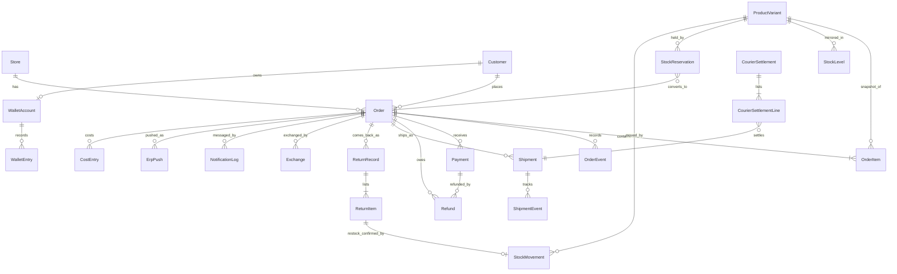

Relations marked here that do **not** exist in the schema today and are proposed (additive): `Refund → Order`,
`ReturnItem → StockMovement` (restock confirmation), `CourierSettlementLine → Shipment` as a required unique link
(see §6.6).

### 6.4 The order snapshot

At placement the order service writes, in one transaction, an immutable snapshot. Later catalogue, price, rule or
address changes never alter it.

| Snapshot part | Fields (existing unless marked new) | Mutable later? |
|---|---|---|
| Identity | `number` (unique per store), `idempotencyKey` (unique per store), `source`, `placedAt`, `currency` | Never |
| Contact & address as typed | `phone`, `customerName`, `email`, `shippingAddressText`, `areaId`, `deliveryBandId`, `addressResolution`, `addressUnclear`, `chargeFixed` | Only through the Edit command before booking (logged before → after); after booking never: cancel and replace (D5, §6.5.7) |
| Gift (new) | `isGift`, `receiverName`, `receiverPhone`, `senderContact`, `giftNote`, `hidePricesOnInvoice`; reuse `shipAfter` for "deliver on or after" | Before booking only |
| Lines | `OrderItem`: `sku`, `productName`, `colourName`, `sizeLabel`, `unitPriceMinor`, `compareAtMinor`, `discountMinor`, `lineTotalMinor`, **`unitCostMinor`** (ERP avg cost at placement; null when unknown, never 0) | Line status only (ACTIVE, REMOVED, CANCELLED, EXCHANGED, HELD_*); price fields never |
| Money | `subtotalMinor`, `discountMinor`, `deliveryChargeMinor`, `walletAppliedMinor`, `totalMinor`, `couponCode`, applied rule ids (new, JSON) | Recomputed only by the Edit command before booking; each recompute is an `OrderEvent` with before/after |
| Payment intent | `paymentMethod`, `advanceRequirement`, `codAmountMinor` | `codAmountMinor` is derived from amount due at booking time |
| Consent & attribution | `smsMarketingConsent`, `whatsappMarketingConsent`, UTM fields, `landingPageId`, `visitorId` | Never |
| Risk at landing | `riskScore`, `riskBand`, `riskSection` | New assessments are new `RiskAssessment` rows |

**Lock points** (financial and operational):
1. **Placed → Confirmed:** customer may cancel in one tap; staff may edit freely.
2. **Confirmed → Booked:** customer may request cancel (cut-off a setting, default "confirmed"); staff edits recompute totals.
3. **Booked:** no edits to address, items or COD (decision D5). A change is **cancel after booking** (with courier
   confirmation) plus a **linked replacement order** (§6.5.7).
4. **Picked up / handed over:** order content locked; only outcomes, payments, refunds and notes.
5. **Delivered / closed:** money changes only as new Payment, Refund, WalletEntry or settlement rows.
6. **Month closed and pushed to the ERP:** figures marked final; corrections appear in the next open month.

### 6.5 Lifecycles

#### 6.5.0 Four separate status dimensions (never one combined "status")

Order, courier (shipment), payment and return/refund are **four independent facts**, each with its own record, its own
states and its own writer. Lists show them as four pills; filters work on each separately ("Delivered · refund
pending" is a valid combination). The order status changes only through order commands, and the other three
dimensions move it **only through the mapping rules below**. No screen edits one dimension by editing another.
Everything in this subsection is **SO** (the existing enums and models) or **PROP** (marked new); no order, shipment,
payment or return code exists on `main` yet.

| Dimension | Record | States (existing enum values unless marked *new*) | Written by |
|---|---|---|---|
| **Order** | `Order.status` | DRAFT · PLACED · *AWAITING_ADVANCE* · CONFIRMED · ON_HOLD · PROCESSING · PACKED · HANDED_OVER · IN_TRANSIT · DELIVERED · PARTIALLY_DELIVERED · RETURNED · CANCELLED; plus flags *cancelPending* and *customerWantsChange* (§6.5.7) | order service commands only (§6.5.1) |
| **Courier** | `Shipment.status`; an order can have several shipments over time, at most one active | BOOKING · BOOKING_FAILED · IN_REVIEW · PENDING_PICKUP · PICKED_UP · IN_TRANSIT · OUT_FOR_DELIVERY · *ATTEMPT_FAILED* · *ADDRESS_PROBLEM* · DELIVERED · PARTIALLY_DELIVERED · RETURNING · RETURNED · *LOST* · *DAMAGED* · *CANCEL_REQUESTED* · CANCELLED | shipping service: booking response, courier events (deduplicated), and the staff step "Courier cancel confirmed" |
| **Payment** | `Payment.status` per payment row; an order-level **payment state** derived from the rows | rows: INITIATED · PENDING · AUTHORIZED · PAID · FAILED · CANCELLED (REFUNDED and PARTIALLY_REFUNDED derived from completed refunds, never set by hand); order-level, computed and not stored (*new*): UNPAID · PARTLY_PAID · PAID · OWED_BACK · COD_TO_COLLECT · COD_COLLECTED · COD_SETTLED | payments service (gateway callbacks, recorded payments); COD states from shipment events and settlement matching |
| **Return / refund** | `ReturnRecord` (*status* new, S2), `ReturnItem` (*disposition* new, S19), `Refund.status` | return: *EXPECTED · RECEIVED · QC_DONE · CLOSED*; item disposition: *SELLABLE → ERP_PENDING → RESTOCKED / ERP_FAILED* or *UNSELLABLE → LOSS_RECORDED* (D4); refund: REQUESTED · APPROVED · REJECTED · COMPLETED · FAILED | returns service (QC, ERP confirmation); payments service (refunds) |

**Mapping rules (another dimension → order):**

| Event | Effect on the order | Guard |
|---|---|---|
| Shipment PICKED_UP | HANDED_OVER → IN_TRANSIT | only forward (state rank and event time, §8.3) |
| Shipment DELIVERED | → DELIVERED; stores the delivered mark time (starts the exchange window, CN-021 P8) | — |
| Shipment PARTIALLY_DELIVERED | → PARTIALLY_DELIVERED once the kept-item list is recorded | item list required; approval per setting |
| Shipment RETURNED (refused, failed final) | → RETURNED; creates ReturnRecord EXPECTED | — |
| Shipment ATTEMPT_FAILED, ADDRESS_PROBLEM | none; work item in Delivery → In transit → Exceptions | order stays IN_TRANSIT until a final outcome |
| Shipment LOST, DAMAGED | none until resolved; courier claim opened | claim outcome recorded in Money |
| Shipment CANCELLED after booking | → CANCELLED only through the cancel-after-booking command (§6.5.7) | staff recorded "Courier cancel confirmed" |
| Advance payment PAID | AWAITING_ADVANCE → PLACED | amount ≥ required |
| Order CANCELLED with money paid | Refund REQUESTED created (never an automatic payout) | F-041 |
| Return item RESTOCKED / LOSS_RECORDED | none; the order stays DELIVERED (or RETURNED) | — |
| Refund COMPLETED | none; order-level payment state recomputed | — |

Rules: the order never moves backwards; duplicate or late courier events are stored and never move a state back; a
delivered order can still have returns and refunds, which live in their own dimension; the customer's tracking page
shows a plain combination ("Delivered · refund being processed").

**Cancellation reasons.** Stored in the existing `Order.cancelReasonCode` (SO). Codes are fixed; labels are editable
settings (F-038 adds real-life reasons on the owning PR): CUSTOMER_BEFORE_CONFIRM · CUSTOMER_CHANGE_AFTER_BOOKING (D5) ·
ADVANCE_NOT_PAID · RISK_DECLINED · OUT_OF_STOCK · DUPLICATE_ORDER · ADDRESS_UNREACHABLE · OTHER (note required).

#### 6.5.1 Order state machine

Proposed additions to `OrderStatus` (additive enum values): **`AWAITING_ADVANCE`** (risk level or gift requires an
advance; F-043, CN-020 (2)). Failed attempts, lost and damaged parcels are shipment states (§6.5.2) that drive the
order's outcome commands.

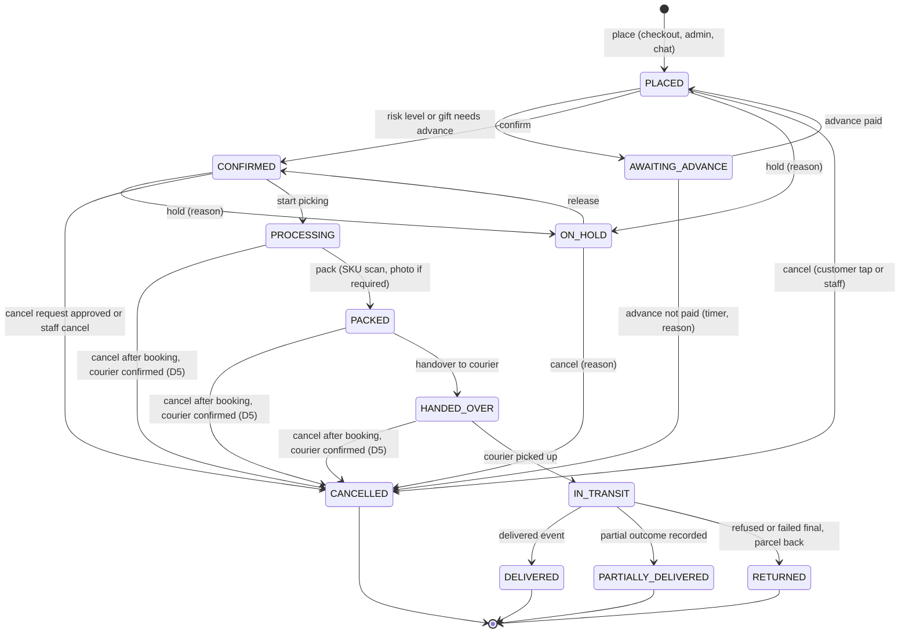

| Command | From → To | Actor / permission | Guards | Side effects (same transaction unless "outbox") |
|---|---|---|---|---|
| `place` | — → PLACED or AWAITING_ADVANCE | customer, `orders.create` | idempotency key; price and stock re-check; holds converted | snapshot; OrderEvent; hold CONVERTED; outbox: journey message "placed" |
| `recordAdvance` | AWAITING_ADVANCE → PLACED | gateway callback or `payments.record` | payment PAID, amount ≥ required | Payment row; OrderEvent |
| `expireAdvance` | AWAITING_ADVANCE → CANCELLED | system (timer setting) | not paid by deadline | cancel reason "advance not paid"; holds released; outbox: notice |
| `confirm` | PLACED → CONFIRMED | `orders.confirm`; prepaid may auto-confirm (setting) | not in risk review; not awaiting advance | outbox: ERP `order.create` push (on confirm, R11); journey message |
| `hold` / `release` | PLACED/CONFIRMED ↔ ON_HOLD | `orders.hold` | reason required | OrderEvent; holds keep counting |
| `cancel` | PLACED/CONFIRMED/ON_HOLD → CANCELLED | customer (until cut-off), `orders.cancel` | not booked (else `cancelAfterBooking`) | holds released; ERP `order.status CANCELLED` if pushed; refund **request** created if anything was paid (F-041); outbox: notice |
| `startPicking`, `pack` | CONFIRMED → PROCESSING → PACKED | `fulfilment.pack` | SKU scan match; photo if required; no unresolved shortage | ERP `PROCESSING`/`PACKED` status push |
| `handover` | PACKED → HANDED_OVER | `fulfilment.handover` | shipment booked | HandoverBatch |
| courier events | HANDED_OVER → IN_TRANSIT → DELIVERED | system (webhook/poll) | event newer than last applied (§8.3) | ERP shipment events; journey messages; delivered mark time |
| `recordOutcome` | IN_TRANSIT → PARTIALLY_DELIVERED / RETURNED | `orders.outcome.record` or courier event | partial needs approval (setting) and item list | line statuses; expected ReturnRecord created; refund request if prepaid; risk signal with "our fault" flag |
| `edit` | PLACED/CONFIRMED, **not booked** | `orders.edit` | version check; refused once a shipment is booked (D5) | recompute totals; OrderEvent before/after |
| `cancelAfterBooking` | booked order → flag *cancelPending*; shipment → CANCEL_REQUESTED | `orders.cancel.afterBooking` | reason required | OrderEvent; Needs-you-now row until the courier answer is recorded (§6.5.7) |
| `recordCourierCancel` | confirmed: → CANCELLED (shipment CANCELLED); refused: stays, flag *customerWantsChange* | `orders.cancel.afterBooking` | after `cancelAfterBooking` | holds released; ERP `CANCELLED` via outbox; refund request if paid; cancel notice via outbox |
| `createReplacement` | — → new order PLACED with `replacesOrderId` | `orders.create` | one active replacement per old order; price and stock re-check | link both ways; replacement booking held until the old shipment is CANCELLED |

Every command writes an `OrderEvent` (from, to, actorType, actorId, source) and an `AuditLog` row; illegal transitions
return `409 ILLEGAL_TRANSITION`.

#### 6.5.2 Shipment lifecycle

Proposed additive `ShipmentStatus` values: **`ATTEMPT_FAILED`**, **`ADDRESS_PROBLEM`**, **`LOST`**, **`DAMAGED`** (F-017).
Mapping from each courier's raw status lives in the courier adapter (§7.4); `rawStatus` keeps the original.

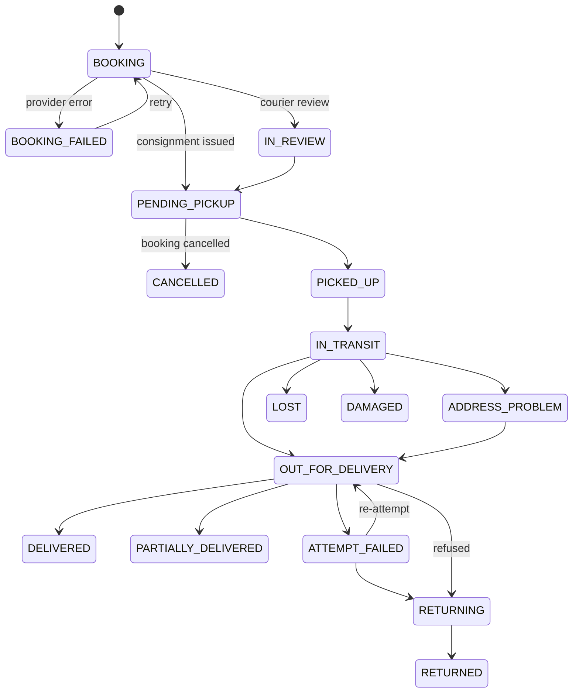

#### 6.5.3 Payments, advances and money status

- `Payment.status` (existing): INITIATED → PENDING → AUTHORIZED → PAID / FAILED / CANCELLED; REFUNDED and
  PARTIALLY_REFUNDED are **derived** from completed refunds and should not be set directly.
- Advances use `purpose` ADVANCE_DELIVERY_CHARGE / FULL_ADVANCE / PREORDER_ADVANCE; money received outside the
  checkout (bKash to merchant number, bank transfer) is a Payment with method and reference, recorded by a permitted
  role with [confirm] (F-040).
- **Money status** (new, shared by Payment, CostEntry, CourierSettlementLine and P&L figures): `ESTIMATED` (from rate
  cards or allocation) → `PROVISIONAL` (from an event, not yet settled) → `RECONCILED` (matched to a settlement or
  statement) → `FINAL` (month closed and pushed). Replaces the free-text `Payment.reconciliationStatus`.

#### 6.5.4 Return, QC, restock, loss and refund: separate facts (invariant 5, decision D4)

Owner decision D4: a returned parcel comes back through courier management and is **received at the shop**; staff
**inspect it physically**; a **sellable** item is sent to the ERP and stock counts as increased **only when the ERP
confirms**; an **unsellable** item is recorded as a **loss in the e-commerce records** and causes **no ERP stock
adjustment**. Status: **SO** for `ReturnRecord`, `ReturnItem.qcStatus` (GOOD / B_GRADE / DAMAGED, exists),
`ReturnRecord.erpSyncedAt`, `Refund`; everything else **PROP**; contract call `POST /returns` is **SO** (contract only).

| Fact | Record and state | Who / what sets it | Stock effect | Money effect |
|---|---|---|---|---|
| 1. Parcel came back (refused, failed, partial remainder, exchange pickup) | `ReturnRecord.status` EXPECTED (courier "returned" event) → RECEIVED (scan at the shop, ORD-05a), `receivedAt` | courier event; packer `returns.qc` | none | courier return fee as a provisional cost |
| 2. Physical QC per item | `ReturnItem.qcStatus` (existing) plus **`disposition` SELLABLE or UNSELLABLE** (new); the scanned SKU must match what came back (F-022); UNSELLABLE needs a reason (photo when the setting asks) | packer / returns staff | none in the shop | — |
| 3a. Sellable item sent to the ERP | `ErpPush` kind `return.create` carrying **sellable items only**; disposition ERP_PENDING; idempotency key `return:{returnId}:{version}` | system on QC save (outbox) | none yet | — |
| 3b. Restocked | disposition RESTOCKED when the ERP has answered 2xx for that return **and** the next stock pull or `stock.changed` webhook shows the movement (mirror `StockMovement` with `referenceType = RETURN_ITEM`); ERP_FAILED after the retry limit → Needs-you-now row | system | sellable stock rises **only from the ERP mirror** (R3) | — |
| 3c. Unsellable → loss | disposition LOSS_RECORDED; a loss entry (`CostEntry`, service `RETURN_LOSS`) valued at the item's cost snapshot (timing: Q4) | system on QC save | **none; never sent to the ERP as stock** | loss line in Contribution (§10.2 M10); whether it travels in the month-end push is **Q3** |
| 4a. Refund approved | `Refund.status = APPROVED`, `approvedById` | owner (or delegated, D11) via [confirm] | — | liability "money owed to customers" |
| 4b. Refund completed | `Refund.status = COMPLETED`, provider reference or wallet entry id | Accounts / gateway callback | — | cash out or wallet credit; ERP refund document — contract call missing (C5, G5) |

A refund may exist without a return (cancelled prepaid order, rider overcharge, apology credit) and a return without a
refund (COD refused parcel). The two are linked only through the order.

**Mapping D4 to the contract (PROP, §16.4 R6).** The contract's QC values are good / B-grade / damaged. The QC screen
offers the owner's two outcomes; a sellable item is sent as `good`; `damaged` is never sent because unsellable items
stay in the shop's records; `B-grade` is not used unless the owner later asks for a "sellable with a flaw" choice. What
the ERP's 2xx on `POST /returns` means (document accepted vs stock posted) is not written in the contract (G7); the
"stock movement observed" condition above covers both readings.

**Retries, duplicates and audit (PROP).** The return push uses the same outbox relay as orders (backoff, DEAD after the
set tries, "Send again" in PRD-05e and on the ORD-05 card); a replay carries the same key, so the ERP restocks at most
once. Once an item is ERP_PENDING its disposition cannot be changed by editing; a correction is a new adjusting record
with a reason. Every step writes `AuditLog` and a return timeline entry (who scanned, QC result, ERP answer).

**Not covered by D4 — packing-time damage.** A piece found damaged on the packing screen before it ships is still in ERP
stock; Blueprint B1.2 ("Defective item found at packing": "writes an ERP `BadStockEntry`") sends it to the ERP. The contract has no such
call (G6). This is a separate case from returns and is listed so it is not confused with D4.

**Tests needed to accept this flow (none written or run; listed in §12.3):** sellable push sent once under replay;
unsellable never pushed; stock rises only after ERP confirmation; scanned-SKU mismatch refused; a second QC save on an
ERP_PENDING item refused; ERP_FAILED raises the Needs-you-now row; loss entry created once with the cost snapshot.

#### 6.5.5 COD settlement lifecycle

Settlement imported (file hash or provider reference unique per courier account) → lines matched to shipments
(one line per shipment, unique) → each line `MATCHED` / `MISMATCH (reason code)` / `MISSING` (shipment delivered,
no line after N days, setting) → claims opened for mismatches → resolved (reason) → money status RECONCILED → month
close FINAL. Payout carries `receivedAs` (BANK / BKASH / CASH_AT_COURIER_OFFICE) and the account Accounts posts it to.

#### 6.5.6 Message lifecycle

`NotificationLog`: QUEUED → SENT → DELIVERED / FAILED / SKIPPED (reason: consent, cap, quiet hours, master switch
off, fully paid amount rule). Dedupe key `(storeId, orderId, step, channel)` for journey messages and
`(storeId, campaignId, customerId)` for campaigns.

#### 6.5.7 Change requested after courier booking: cancel and replace (decision D5)

Owner decision D5: after a courier is booked, the parcel is **not edited and not re-booked**. If the customer wants a
change, the order is **cancelled** (staff phone the courier to cancel the parcel) and anything new is a **new order
created from the dashboard**. Status: everything below is **PROP** (no order code exists); `Order.cancelReasonCode` and
`cancelledAt` are **SO**; the replacement link is new (S18).

| Step | What staff do | What the system records | Guard |
|---|---|---|---|
| 1 | Open the order (ORD-07). The header says "Booked with {courier} · {consignment} · locked". Edit is not offered. | — | booked orders are read-only except the commands below |
| 2 | Press **Cancel after booking**; pick the reason (default CUSTOMER_CHANGE_AFTER_BOOKING) and add a note. | order flag *cancelPending*; shipment → CANCEL_REQUESTED; `OrderEvent`, `AuditLog` | `orders.cancel.afterBooking`; [idem][cmd]; reason required |
| 3a | Phone the courier; record **Courier cancel confirmed** (who at the courier, time, optional reference). | shipment → CANCELLED; order → CANCELLED with the reason; holds released; ERP `PATCH /orders/{id}` CANCELLED via the outbox (releases the ERP reservation); a refund **request** if anything was paid; courier cancel charge, if any, as a cost on this order | confirmation is a separate step, so "phoned" is never assumed |
| 3b | If the courier says it is too late (picked up or out for delivery): record **Courier could not cancel**. | order stays IN_TRANSIT with flag *customerWantsChange*; when the parcel comes back it follows the return flow (§6.5.4); the refusal is **not** a risk signal | — |
| 4 | Press **Create replacement order** (on the cancelled or cancel-pending order). | ORD-08 opens pre-filled (customer, address, items); a **new order with a new number**; `replacesOrderId` on the new order, `replacedByOrderId` on the old one, shown both ways on the timelines | price and stock re-checked like any new order; changed lines marked; one active replacement per old order (unique) |
| 5 | Confirm and pack the replacement as normal. | — | the replacement **cannot be booked or handed over while the old shipment is CANCEL_REQUESTED or still moving**; DLV-02 lists it as skipped: "waiting for the old parcel to be cancelled" |

**Duplicate-fulfilment prevention (PROP):** (a) the old order can never reach PACKED or HANDED_OVER again once cancel is
requested; (b) step 5's booking block; (c) one active replacement per old order; (d) the packing screen warns when the
same phone has another open order with the same SKUs; (e) a cancel for a change is not a refusal and never feeds the
risk history.

**Money already paid on the old order.** The cancel creates a refund request (existing rule, F-041). Moving the paid
amount to the replacement instead of refund-and-repay is useful but is a money rule, so it is **a recommendation
needing approval** (§16.4 R8; Accounts would do it with [confirm]); until approved, the refund request stands.

**Customer messages.** Two journey events in Messages (templates in MSG-03): "order cancelled for your change" (sent
once, outside the per-order cap like every cancel notice, F-013) and the normal "order placed" message for the
replacement with its own amount due. Dedupe key per order and step (§8.8).

**Audit and reports.** `OrderEvent` on both orders (cancel requested, courier confirmed by whom and when, replacement
link), `AuditLog` rows, and a report count "Cancelled after booking" by reason and courier (Reports → Delivery & RTO).
Acceptance tests are in §12.3.

### 6.6 Proposed schema refinements (all additive; none built)

Each lands in the register PR that first writes the model, with an expand-only migration (CI already checks drift).

| # | Model | Change | Why |
|---|---|---|---|
| S1 | `Refund` | add relation to `Order`; `idempotencyKey` + `@@unique([storeId, idempotencyKey])`; `source` (CANCEL, RETURN, RIDER_OVERCHARGE, APOLOGY, CLAIM, EXCHANGE_DIFF); `walletEntryId?`; `providerRef?` | invariant 3; F-041, F-054 |
| S2 | `ReturnRecord` | `status` (EXPECTED, RECEIVED, QC_DONE, CLOSED); `idempotencyKey` unique; `ourFault Boolean` | invariant 5; F-044 |
| S3 | `ReturnItem` | `scannedSku`, `restockMovementId?` (unique); keep the existing `qcStatus` (v1 wrongly proposed a new `qcResult`) | F-022; invariant 5 |
| S4 | `CourierSettlementLine` | `shipmentId` required for matched lines; `@@unique([storeId, shipmentId, kind])`; `matchState`, `reasonCode`, `moneyStatus` | no double counting; F-028 |
| S5 | `CourierSettlement` | `receivedAs`, `receivedAccountRef`, `fileHash` | CN-021 P16 |
| S6 | `ShipmentEvent` | `providerEventId` + `@@unique([shipmentId, providerEventId])` (fallback key: status + occurredAt hash) | duplicate events |
| S7 | `ShipmentStatus` | add ATTEMPT_FAILED, ADDRESS_PROBLEM, LOST, DAMAGED | F-017 |
| S8 | `Shipment` | `declaredValueMinor`, `weightGrams`, `courierZoneId`, `attemptCount` | F-017, F-029 |
| S9 | `OrderStatus` | add AWAITING_ADVANCE; `Order.advanceDueAt` | F-043 |
| S10 | `Order` | gift fields (§6.4); `version Int @default(0)` for [ver]; `appliedRuleIds Json?` | PR 605; optimistic locking |
| S11 | `Payment` | replace use of `reconciliationStatus` string with `moneyStatus` enum (keep the old column, stop writing it); `recordedById` for manual payments | §6.5.3; F-040 |
| S12 | `CostEntry`, `OrderProfit` | `moneyStatus`; `costCoverage` on OrderProfit | missing ≠ 0 |
| S13 | `ProductVariant` | `erpRetailPriceMinor?`, `erpAvgCostMinor?`, `erpPriceSyncedAt?` (read-only mirror) | D1, margin guard |
| S14 | Staff notifications | new model (recipient, kind, severity, link, readAt, expiresAt) | §5.1 |
| S15 | Rider issues and claims | new models or a typed `Ticket` kind with amount fields | SUP-02, SUP-03 |
| S16 | Customer problems | new anonymous problem and record models (no personal data) | CN-015 |
| S17 | `AuditLog` | no column change; DB-level append-only (§9.2) | invariant 12 |
| S18 | `Order` | `replacesOrderId?` (unique) and the inverse relation; flags `cancelPending`, `customerWantsChange` (or `flags` JSON keys); `ShipmentStatus` value CANCEL_REQUESTED; courier-cancel confirmation fields on `Shipment` (`cancelConfirmedById`, `cancelConfirmedAt`, `cancelRef`) | D5, §6.5.7 |
| S19 | `ReturnItem` | `disposition` (SELLABLE, UNSELLABLE), `dispositionState` (ERP_PENDING, RESTOCKED, ERP_FAILED, LOSS_RECORDED), `lossReason?`, `lossCostEntryId?` | D4, §6.5.4 |
| S20 | `CostEntry` | use `service = RETURN_LOSS` (no column change) and `moneyStatus` (S12) | D4, M10 |

---
## 7. API and integration contracts overview

### 7.1 Internal admin API (consumed only by the admin screens)

| Aspect | Rule | Today |
|---|---|---|
| Base and auth | `/api/admin/{module}/…`; `guardAdmin` (session, 2FA, forced password change, same-origin CSRF, permission per store) then the service re-checks | IV |
| Reads | Cursor pagination, stable sort `(sortKey, id)`, max 100; saved views are server-side filters | Product list has search and filters; no pagination standard documented yet |
| Writes | Named commands (`POST …/{id}/confirm`); no status PATCH | Not verified for every built route; adopt for all new modules |
| Idempotency | `Idempotency-Key` header on money, booking, send, ERP-push and bulk commands; stored in the existing (unused) `IdempotencyKey` model: key, store, route, body hash, response, expiry (24 h) | Model exists, unused |
| Concurrency | `version` field [ver] → `409 STALE` with the fresh record | Not yet |
| Hard-rule actions | `…/preview` returns effect + `confirmToken`; commit requires token + reason; audited | Rules approval exists (money rules) |
| Long work | `202 {jobId}`; `GET /api/admin/jobs/{id}`; result as a notification | Not yet (exports inline) |
| Errors | `{ ok:false, error:{ code, message, messageBn, field?, retryable, errorId } }`; HTTP 400 validation, 401/403, 404, 409 (ILLEGAL_TRANSITION, STALE, DUPLICATE), 422 business rule, 429, 5xx with `errorId` only | Today `{ok:false,error,details}`; proposed extension is backward-compatible (`error` becomes an object with `code`) — adapt in one PR with the admin client |
| Versioning | Unversioned: the admin and its API ship in the same deploy; breaking changes are allowed only together with the screen change | — |
| Audit | Every write: who, store, source (staff / AI / system / API), before → after | IV for built modules |

### 7.2 Storefront and customer API

| Endpoint (proposed) | Purpose | Notes |
|---|---|---|
| `POST /api/cart/*` | add/remove/change lines; set and combo locking | calls `addSetToBag`, `refreshBagSets`, holds |
| `POST /api/checkout/quote` | totals, delivery charge from the resolved place, rule texts, prepaid reward, advance requirement | `quoteCart`, delivery `quote`, risk pre-check |
| `POST /api/checkout/place` | place the order once | **`Idempotency-Key` = checkout draft id** generated when the checkout opens; re-check price and stock under lock; returns the existing order on repeat |
| `POST /api/checkout/pay` / gateway return URLs | start a payment; return handling never trusts the browser redirect alone (server verifies with the gateway) | §7.5 |
| `GET /api/orders/{number}/track?phone=` | customer tracking (rate-limited, no personal data beyond the order owner's view) | late flag honoured (F-018) |
| `POST /api/orders/{number}/cancel` / `cancel-request` | customer cancel until cut-off | CN-020 (5) |
| `POST /api/account/claims` | wrong-item/size claim with note + photo | CN-018 (5) |
| `POST /api/support/callback` | call-me request from checkout struggle | CN-020 (3) |
| Public delivery APIs | `app/api/delivery/{resolve,suggest,phone-area}` | **IV** (built) |

Rate limits: per IP and per phone on tracking, OTP, phone lookup (exists), checkout place, call-back. Customer
first login is by SMS code; an account created from a guest order never gets a guessable password (F-039).

### 7.3 ERP API (CN-005, `docs/ERP-API-CONTRACT.md`)

**Security:** one integration = one store = one ERP company; Bearer key (company from the key, never the body);
HMAC `X-Extas-Signature` + `X-Extas-Timestamp` (5-minute window) both directions; `Idempotency-Key` on every POST;
HTTPS; error `{ "error": { code, message, details } }`.

| Call | Direction | Shop status | Notes / gaps |
|---|---|---|---|
| `GET /health` | shop → ERP | IV (adapter) | — |
| `GET /catalog/variants?updatedSince=` | shop → ERP | IV for SKU/size/colour; `retailPrice`, `avgCost` parsed but **not applied** | D1 decided: mirror both read-only (S13, G3); `variant.changed` covers price but not cost, so cost freshness relies on the pull |
| `GET /stock?updatedSince=`, `GET /stock/{sku}` | shop → ERP | IV; live check used before booking/checkout | negative clamp to fix (F-006) |
| `POST /orders` | shop → ERP | IV as outbox kind `order.create` (relay manual until worker) | push on **confirm** (R11); 409 short stock → order flagged, packing blocked |
| `PATCH /orders/{externalOrderId}` | shop → ERP | IV `order.status` (PROCESSING, PACKED, CANCELLED, DELIVERED, RETURNED) | contract allows item edits before packing; the shop sends edits only before booking and never after (D5); a cancel after booking sends CANCELLED once the courier confirms |
| `POST /payments` | shop → ERP | PL | methods COD / bKash / Nagad / card; needs bank/cash and "received as" (C5) and refunds |
| `POST /shipments`, `POST /shipments/{id}/events` | shop → ERP | PL | from Shipping module via outbox |
| `POST /returns` | shop → ERP | SO (contract only) | **sellable items only** (D4), sent as `good`; drives ERP restock; meaning of the ERP's answer not written (G7) (§6.5.4) |
| `POST /ad-spend` | shop → ERP | PL | daily per platform |
| `variant.changed`, `stock.changed` webhooks | ERP → shop | **MN** (no receiver) | §7.6; polling `updatedSince` remains the fallback |
| Monthly expense document, cost ledger push | shop → ERP | **no endpoint** | required by D2; endpoint missing is technical gap G4 (§7.9 E) |

Contract hygiene: the ERP commits `openapi.yaml`; the shop adds a contract test that validates the mock and, when
keys exist, a read-only check against SANDBOX. Any contract change goes through a CN note on both projects. **ERP side
status:** reported LIVE by the ERP project on 23 Oct (`cn005-readiness.md`, not in this repo) — not verified here; the
shop stays on the practice ERP until the owner connects the real one. The per-sync detail is §7.9.

### 7.4 Courier adapter (Steadfast, Pathao, RedX, …)

One internal interface; provider specifics stay inside the adapter (addendum 3.5, 4.5).

| Operation | Input → output | Idempotency | Notes |
|---|---|---|---|
| `capabilities()` | → { booking API, cancel, webhooks or polling, partial delivery, COD statement API, zone ids, weight slabs } | — | drives UI options and job choice |
| `quote(parcel)` | band/zone, weight, COD → charge | — | rate card fallback (estimated) |
| `book(parcel)` | order ref, receiver, address, zone id, COD (= amount due), declared value, weight, note → consignment id | key `book:{shipmentId}:{attempt}`; `Shipment @@unique([storeId, idempotencyKey])` exists | on timeout: query by merchant ref before retrying (never double-book) |
| `cancel(consignment)` | → ok / not allowed | key per shipment | before pickup only |
| `track(consignment)` / `parseWebhook(raw)` | → normalised events {providerEventId, status, rawStatus, occurredAt, note} | `ShipmentEvent` unique (S6) | status mapping table per provider; unknown raw status → kept raw, flagged |
| `syncZones()` | → courier area ids for `CourierAreaMapping` | job | PR 554 |
| `fetchStatement(period)` / `parseStatementFile(file)` | → settlement lines | file hash / provider ref unique | MNY-02 |

Mock adapter (first): deterministic consignment ids "MOCK-…", scripted event sequences including failed attempt,
partial, lost, late settlement, double deduction (so the five COD traps of the simulation can be replayed).

### 7.5 Payment adapter (bKash, Nagad, card/bank gateway)

| Operation | Purpose | Rule |
|---|---|---|
| `initiate(payment)` | create a gateway session for an order, advance or exchange difference | key = `Payment.idempotencyKey` (unique, exists) |
| `verify(callback)` | callback/IPN handling via the webhook receiver | signature or server-side query; never trust the redirect |
| `query(providerTrxId)` | recover unknown outcomes (timeouts, missing callbacks) | job retries with backoff; result idempotent |
| `refund(payment, amount)` | gateway refund | key `refund:{refundId}`; one completed refund per Refund row |
| `fetchStatement(period)` | gateway settlement for MNY-03 Statements | statement id unique |

Card data never touches the shop (hosted gateway pages only). Which gateways are used is an owner/integration choice
(G18).

### 7.6 Inbound webhooks (one receiver)

`POST /api/webhooks/{source}` where source ∈ erp, courier-{name}, payment-{name}, messaging-{name}:
1. Read the raw body; verify signature and timestamp with the source's secret from the vault (ERP: existing
   `verifyErpSignature`).
2. Insert `WebhookEvent` (`@@unique([source, idempotencyKey])`, idempotency key = provider event id, else hash of the
   body); on unique conflict return 200 without reprocessing.
3. Return 200 quickly; enqueue `webhook.process` with the event id.
4. The processor applies the event idempotently (out-of-order rules per source, §8.2–8.3), sets `status`
   PROCESSED/FAILED with error; FAILED events are replayable from the admin (Integrations page).
5. Invalid signatures are stored with `signatureValid=false`, never processed, and counted for alerting.

Outbound: ERP documents via the existing `ErpPush` outbox; courier bookings, message sends and gateway refunds via
`OutboxEvent` rows written in the business transaction and relayed by the worker.

### 7.7 Idempotency map

| Operation | Key | Stored where | Duplicate behaviour |
|---|---|---|---|
| Checkout place | checkout draft id | `Order @@unique([storeId, idempotencyKey])` | returns the existing order |
| Admin create order | client key | same | same |
| Admin commands (money, booking, bulk, send) | `Idempotency-Key` header | `IdempotencyKey` model | same response for same body; 409 for different body |
| Cart hold | cart line + variant | `StockReservation` per line under row lock | updates the hold, never a second |
| Coupon use | coupon + order | `CouponRedemption @@unique([couponId, orderId])` | refused |
| Payment | order + purpose + attempt | `Payment @@unique([storeId, idempotencyKey])` | same payment |
| Refund | source + source id | `Refund` unique (S1) | same refund |
| Wallet entry | operation key | `WalletEntry @@unique([walletId, idempotencyKey])` | same entry |
| Courier booking | shipment + attempt | `Shipment` unique + provider merchant ref | query before retry |
| Tracking event | provider event id | `ShipmentEvent` unique (S6) | ignored |
| Settlement import | file hash / provider ref | `CourierSettlement @@unique([courierAccountId, reference])` + line unique (S4) | ignored / line refused |
| ERP push | deterministic `{kind}:{orderId}:{version}` | `ErpPush @@unique([storeId, idempotencyKey])` + header | ERP returns first result |
| Stock movement from ERP | ERP state key | `StockMovement.idempotencyKey @unique` | ignored |
| Message send | order + step + channel / campaign + customer | `NotificationLog @@unique([storeId, dedupeKey])` | skipped |
| Webhook | source + event id | `WebhookEvent @@unique([source, idempotencyKey])` | 200, not reprocessed |
| Return | order + parcel/request | `ReturnRecord` unique (S2) | same return |

### 7.8 Versioning and compatibility

- **ERP API:** `/api/v1/…`; additive fields allowed; breaking changes need `/v2` and a CN note in both projects; the
  shop's zod schemas ignore unknown fields.
- **Webhooks:** every payload carries `type` and `version`; the processor keeps handlers per version.
- **Storefront API:** same-deploy consumers only (the shop's own pages), so no public versioning; tracking links in
  sent SMS must keep working across deploys (stable URL shape).
- **Provider adapters:** pinned provider API versions inside each adapter; a provider change is an adapter PR with
  its mock updated.

### 7.9 Per-sync table: the five ERP exchanges

One column per exchange. Status labels as in §2.5. **ERP side for every column: reported LIVE by the ERP project
(`cn005-readiness.md`, not in this repo) — NV here.** The shop runs on the practice ERP mock until the owner connects the
real ERP; the first real-ERP check is a read-only contract run against it (§12.1, G8).

| Aspect | A. Price and cost (ERP → shop) | B. Stock (ERP → shop) | C. Orders (shop → ERP) | D. Returns (shop → ERP) | E. Month-end expenses (shop → ERP) |
|---|---|---|---|---|---|
| **Source of truth** | ERP (D1): base retail price and cost | ERP | shop order; ERP holds a `SalesOrder` copy and the reservation | shop decides disposition (D4); ERP owns stock | shop records the expenses; the ERP ledger is the formal account (D2) |
| **Trigger** | real-time `variant.changed` webhook (receiver **MN**) · scheduled pull `GET /catalog/variants?updatedSince=` (code **IV**, schedule **MN**: no worker) · manual "Sync now" (**IV**) | `stock.changed` webhook (**MN**) · scheduled pull `GET /stock?updatedSince=` (**IV** code, schedule **MN**) · manual Sync all / one (**IV**, `/api/admin/inventory/resync`) · live `GET /stock/{sku}` before placement (**PL**) | outbox row written on `confirm` (R11) and on each status change; relay on enqueue plus sweep (relay **IV**, schedule **MN**) · manual "Send again" (**IV** API) | outbox row on QC save, sellable items only (**PROP**) | owner or Accounts presses **Push month** after reviewing the close (manual, [confirm]); a reminder on the first day of the next month (**PROP**) |
| **Payload outline** | `sku`, `retailPrice`, `avgCost`, `active`, `updatedAt` (contract) | `sku`, warehouse, `onHand`, `reserved`, `available`, `updatedAt` | `externalOrderId`, customer, address, items (sku, qty, unit price, discount), shipping fee, COD amount, payment method, note | `externalOrderId`, items (sku, qty), reason, QC per item (`good` for sellable) | month, store, one line per cost type / expense head (total, entry count, source references), currency, document version — **no contract endpoint (G4)** |
| **Success confirmation** | mirror updated, `ErpSyncRun` ok, new `erpPriceSyncedAt` (S13) | mirror updated, `StockMovement` keyed by ERP state, `ErpSyncRun` ok, cursor advanced (**IV**) | ERP 2xx with `erpOrderId`; `409` short stock is a business answer (order flagged, packing blocked), not a retry | ERP 2xx **and** the stock movement observed → RESTOCKED (§6.5.4) | ERP document id; `MonthClose.status` PUSHED with `pushedToErpAt` (model **SO**) |
| **Retries** | adapter timeouts with retry and backoff (**IV**) | same (**IV**) | relay backoff, DEAD after the set tries (**IV**) | same relay pattern (**PROP**) | same relay pattern (**PROP**) |
| **Duplicate prevention** | `updatedAt` compare per SKU; webhook unique (`WebhookEvent`) | `StockMovement.idempotencyKey @unique`; `updatedAt` compare (**IV**) | deterministic key `{kind}:{orderId}:{version}` plus `Idempotency-Key` header, claim-before-send (**IV**) | key per return and version; disposition locked once ERP_PENDING | `MonthClose @@unique([storeId, month])` (**SO**) plus `Idempotency-Key` per push version |
| **Staff visibility** | **gap today:** price/cost freshness is not shown. PROP: "ERP price synced hh:mm" on PRD-02, a "Price or cost missing from ERP" queue in PRD-03, a Needs-you-now row past the freshness limit | `/admin/stock` sync verdict, last run, failures (**IV**) | pushes with tries and last error, Send again: API **IV** (`/api/admin/inventory/pushes`, `/pushes/retry`); the PRD-05e screen tab is **PL** | ORD-05 card "ERP: waiting / confirmed / failed"; PRD-05e; Needs-you-now row (**PROP**) | MNY-05 month status: open · closed · pushed · failed, what was sent, differences (**PL**) |
| **What staff must do when it fails** | nothing for a short outage (last mirrored price sells); past the limit, check Settings → ERP connection | nothing for a short outage (checkout keeps its own check); past the limit, check the connection | read the plain reason; fix the cause (for example a SKU unknown to the ERP); press Send again | same as C; the item stays unsellable until confirmed | read the reason; press Push again (same key, so the ERP posts once) |
| **Reconciliation** | daily price/cost difference report (**PROP**) | `reconcileWithErp` names differences and changes nothing (function **IV**, not scheduled) | daily: every confirmed order has a SENT push; ERP-409 orders listed (**PROP**) | items SELLABLE but not RESTOCKED after the limit → Needs you now (**PROP**) | pushed totals vs shop totals; reading the ERP's posted totals back is impossible today (no endpoint, G4) |
| **Implementation status** | **Partially implemented**: SKU/size/colour **IV**; `retailPrice` and `avgCost` parsed but **not applied** (`packages/adapters/src/erp/http-client.ts`); webhook receiver **MN**; no schedule | **Partially implemented**: pull, mirror, holds, health **IV**; schedule and webhook **MN** | **Partially implemented**: outbox, relay, status `PATCH` **IV** in tests; no real order source until S04/S05 checkout placement; no schedule | **Schema/API-only**: contract `POST /returns`, `ReturnRecord.erpSyncedAt`, `ReturnItem.qcStatus`; no code | **Documented/planned only**: D2, Blueprint B3.8; `RetailExpense.erpPushId` and `MonthClose` are schema-only; no contract endpoint |

Other ERP calls, for completeness: `POST /payments` (**SO**, contract lacks bank/cash, "received as" and refunds: C5,
G5), `POST /shipments` and `/events` (**SO**), `POST /ad-spend` (**SO**). They follow column C's outbox pattern.

**Real-time, scheduled and manual paths.** Webhooks (A, B) are the fast path; scheduled pulls are the safety net that
also catches missed webhooks; manual buttons are the recovery path staff use when a Needs-you-now row appears. Today
only the manual paths run, because there is no worker (G1).

**When the ERP price or cost is stale or missing (PROP; never shown as zero):**

| Case | Products and storefront | Checkout and order | Profit figures |
|---|---|---|---|
| Base price missing for a variant | cannot be published; on a live product that size shows "not available" and cannot be added to the bag; listed in "Price missing from ERP" (PRD-03). This check is always on: a missing price would otherwise sell at ৳0. | refused, line marked | — |
| Base price older than the freshness limit (a setting) | still sells at the last mirrored price; "price synced hh:mm" band on PRD-02; Needs-you-now row | the order snapshot keeps the price the customer saw | — |
| ERP price changed while an item is in a bag | the bag shows the new price with a notice at the next view | placement re-check returns the changed lines (409) for the customer to re-confirm | — |
| Cost missing | sells normally (cost never blocks selling) | `unitCostMinor` stored as null, never 0 | the line is left out of cost-based totals, coverage % shown, figure labelled **provisional** |
| Cost stale | — | the snapshot is used as stored | drill-down shows "cost as of {date}"; snapshot timing is Q4 |

---

## 8. Sequence diagrams

### 8.1 Checkout → order (idempotency and stock re-check)

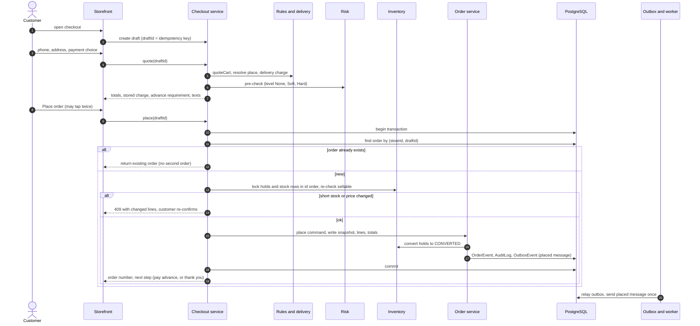

Notes: COD orders with no risk level go to PLACED; Soft/Hard risk or gift orders go to AWAITING_ADVANCE (§8.6, §8.7).
A network drop after commit is safe: the retry hits the same draft id. The ERP is not called during checkout except
the optional live `GET /stock/{sku}` for the last piece (setting).

### 8.2 ERP stock sync (webhooks, polling, outages, out-of-order)

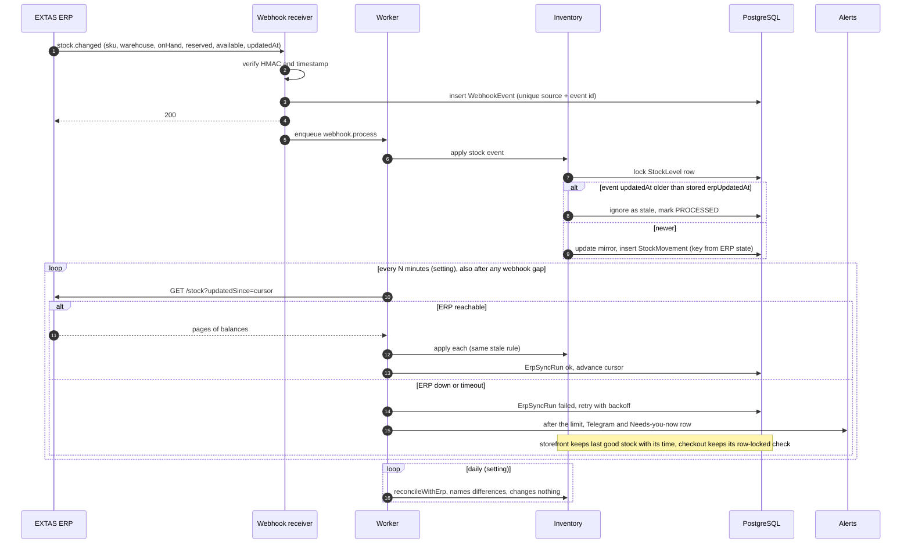

Rules: the shop never writes ERP stock; a negative `available` is stored and shown as negative and blocks packing for
affected orders until a person decides (F-006). Duplicate webhook → unique conflict → no effect. Out-of-order →
`updatedAt` comparison per SKU × warehouse.

### 8.3 Courier booking and tracking events

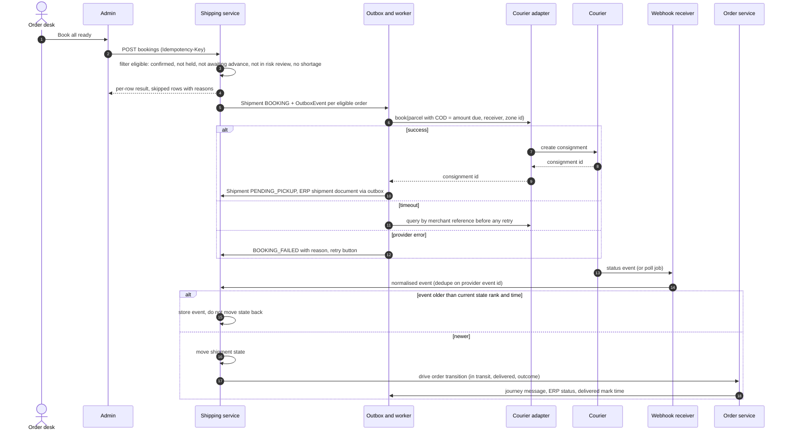

### 8.4 Return, exchange and refund

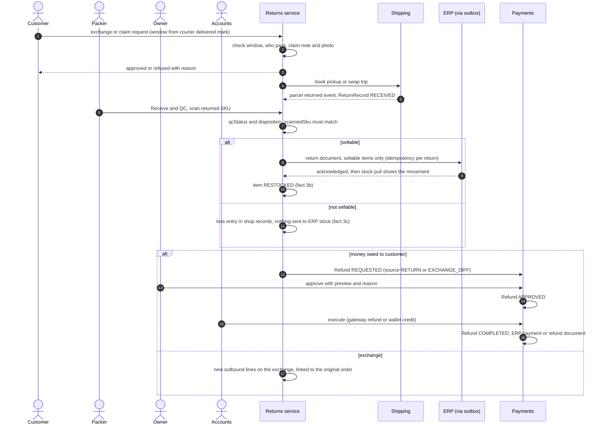

### 8.5 COD reconciliation with "received as"

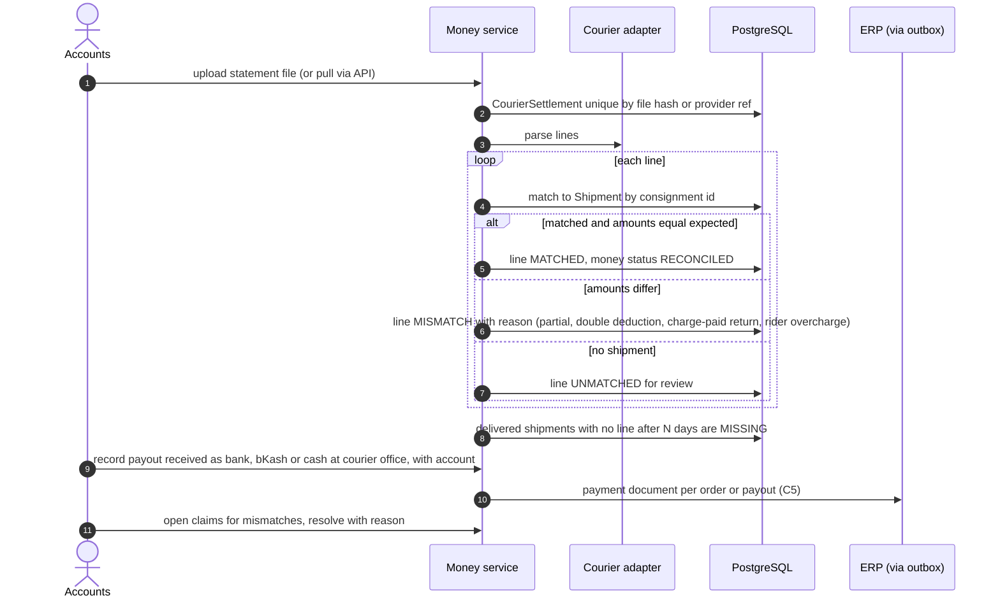

### 8.6 Gift order (advance only)

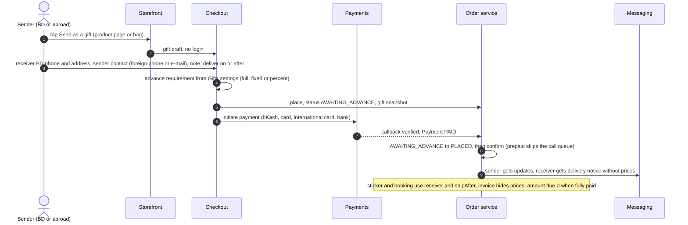

### 8.7 Risk rules → advance

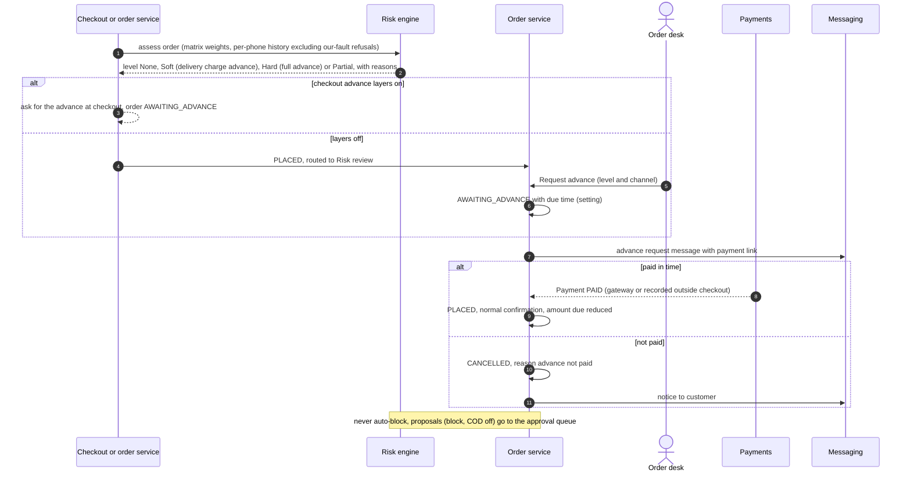

### 8.8 Messages: the order journey

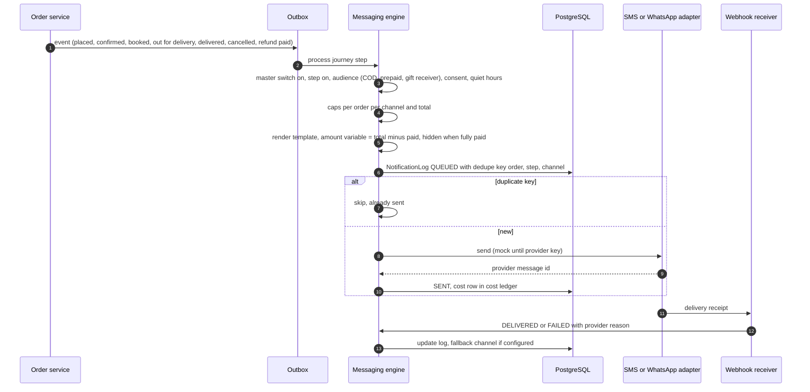

### 8.9 Reporting metric flow

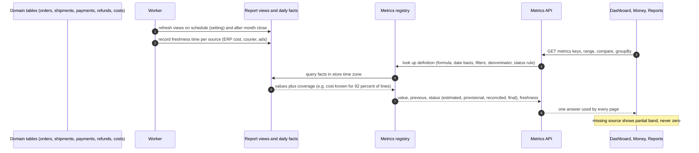

---
## 9. Security, audit, error handling, background jobs and observability

### 9.1 Identity and authorization

| Topic | Keep (built) | Add |
|---|---|---|
| Staff auth | scrypt, `__Host-` HttpOnly SameSite=Strict cookies, idle/total limits, device list, logout everywhere, TOTP (seed in vault), forced first password, wrong-try pause, login alerts, Fetch-Metadata/Origin CSRF check | 2FA required for every admin role at go-live (setting exists in plan, SET-04d) |
| RBAC | roles as data, permission catalogue in code (36 keys), no escalation, last owner protected, per-store assignment, service re-check | new key families: `orders.*`, `fulfilment.*`, `returns.*`, `risk.*`, `delivery.book/claims/outcomes`, `payments.record`, `money.*`, `wallet.*`, `customers.*`, `messages.*`, `support.*`, `marketing.*`, `ads.*`, `website.*`, `blog.*`, `seo.*`, `reports.*`, `health.*`, `ai.*`, `approvals.*`, `system.*`, `build.read`, `help.read`; each added to the role builder with bn/en labels; owner-only keys: `risk.block.confirm`, `ads.budget.raise`, `ai.control`, `ai.costs.write`, `system.backups`, `customers.privacy`, `money.refunds.approve` (unless D11) |
| Customer auth | functions exist (`customer-auth.ts`) | routes; first login by SMS code; no password derived from the phone (F-039); OTP rate limits (OtpChallenge + SecurityEvent pattern exists) |
| Store scope | `storeId` on every store table (test-enforced); `guardAdmin(storeId)` | same for every new module; cross-store tests per module (existing pattern) |
| Personal data access | — | phone shown in full to `customers.read`; every profile open and copy logged (`CustomerAccessLog` schema exists) |

### 9.2 Audit trail

- **Keep:** `AuditLog` written in the same transaction as the change (who, actorType STAFF/CUSTOMER/AI_AGENT/SYSTEM/
  COURIER/ERP, before/after, IP, UA, source, store) by every built module; `SettingChange`, `SecretAccessLog`,
  `PriceHistory`, `SmartRuleVersion`.
- **Change (MN):** make it append-only **in the database**, not just by convention: the app's database role gets
  INSERT and SELECT only on `AuditLog`, `OrderEvent`, `WalletEntry`, `StockMovement`, `CostEntry`, `SettingChange`,
  `SecretAccessLog`; a trigger refuses UPDATE/DELETE as a second line. Migrations run under a separate migration
  role (the deploy already uses a separate migrate image).
- **Separate concerns:** business audit (these tables) vs operational logs (structured app logs, §9.6). Secrets,
  OTPs, card data and full tokens never appear in either (vault tests already check secrets).
- **Retention and access:** audit kept for the life of the store by default (setting); read with `audit.read`†;
  exports are jobs and are themselves audited. Investigate: whether today's catalogue CSV export writes an audit row (G16).

### 9.3 Error handling

| Class | Example | HTTP / handling | Retry | Shown to user |
|---|---|---|---|---|
| Validation | phone format, missing field | 400 with `field` | no | field message bn/en |
| Business rule | outside exchange window, coupon not for guests | 422 with `code` | no | plain reason |
| Conflict | stale version, illegal transition, duplicate | 409 `STALE` / `ILLEGAL_TRANSITION` / `DUPLICATE` | after refresh | "Someone changed this…" / allowed next steps |
| Permission | missing key | 403 | no | denied state with permission name |
| Transient provider | courier timeout, gateway 5xx, ERP down | job retry with backoff; request returns 202/queued | yes, bounded | "queued", "would send", stale band |
| Data integrity | negative stock, settlement mismatch, missing cost | stored and surfaced as a work item, never auto-fixed | no | resolution card / mismatch reason |
| Programming error | unexpected exception | 500 with `errorId`; logged with stack and correlation id; Telegram alert above a rate | no | error screen with id |

### 9.4 Background jobs and event processing

**Decision:** add **one worker process** using **BullMQ** on the existing `redis-queue` container (PR 6 specified it;
the job functions in `inventory`, `rules` and `media` were written for it). Postgres remains the source of truth:
the outbox tables (`ErpPush`, `OutboxEvent`) and `JobRun` records survive a Redis loss, and the relay re-enqueues
anything not marked done. A single scheduler leader is elected with a Redis lock so blue and green never both run
schedules during a deploy; consumers are idempotent so overlap is harmless.

**Synchronous vs asynchronous:**

| Synchronous (in the request) | Asynchronous (worker) |
|---|---|
| Quote, place order, hold/release, payment initiation, every state command, settings writes, [confirm] commits | Outbox relays (ERP, courier booking, messages, gateway refunds), webhook processing, stock poll and reconcile, hold expiry, courier tracking poll, statement matching, exports, imports, media renditions, MV refresh, low-stock evaluation, PII purge, AI jobs, report digests |

**Job catalogue (intervals are settings; most keys already exist in the registry):**

| Job | Trigger / schedule | Idempotency | On failure |
|---|---|---|---|
| `inventory.reservations.release` | every `inventory.reservation.sweepSeconds` | status transition under lock | retry next tick; alert if holds older than 2× limit exist |
| `inventory.erp.pushDocuments` (outbox relay) | every `erp.push.relaySeconds` + on enqueue | claim-before-send + `Idempotency-Key` | backoff; DEAD after set tries; Retry in PRD-05e |
| `inventory.erp.pullStock` | every `erp.sync.stockPollMinutes` | movement key from ERP state | ErpSyncRun failed; alert after limit |
| `inventory.erp.reconcile` | every `inventory.reconcile.everyHours` | read-only | report differences |
| `inventory.lowStock.evaluate` | every `inventory.lowStock.sweepMinutes` | alert once per threshold crossing | retry |
| `webhook.process` | per received event | WebhookEvent status | FAILED + replay |
| `outbox.relay` (courier, messages, refunds) | on enqueue + sweep | per-row claim; provider idempotency keys | backoff; DEAD + manual replay |
| `shipping.track.poll` | per courier without webhooks | event unique | stale band after limit |
| `orders.advance.expire` | every minute | command guard | retry |
| `erp.returns.confirm` | after each stock pull | disposition state guard | ERP_FAILED after the limit → Needs you now |
| `money.monthClose.remind` | first day of a month | one per month | — |
| `ads.spend.import` | daily | per platform and day | missing day shown as missing |
| `money.cod.match` | on statement import | line unique | job FAILED, partial results kept |
| `messages.campaign.dispatch` | scheduled time | dedupe per customer | pause on cap or failure rate |
| `reports.refresh-views` | schedule + after month close | refresh is repeatable | stale freshness line |
| `media.renditions` | on upload | checksum reuse | per-photo failure state |
| `privacy.purge` | daily | field nulling is repeatable | alert |
| `health.problems.group` | probe batches | grouping key | — |

**What depends on the worker, and what happens without it** (evidence: no `bullmq` in any `package.json` at
`80e6c1e`; job functions exist in `packages/inventory/src/jobs.ts`, `packages/rules/src/jobs.ts`,
`packages/media/src/jobs.ts`; the worker itself is **PROP**, completing PR 6):

| Workflow | Needs | Today on `main` | Operational consequence if it stays like this |
|---|---|---|---|
| Cart hold expiry | schedule | sweep function **IV**, not scheduled | expired holds keep stock unsellable until something else releases them |
| ERP stock pull and reconcile | schedule | manual Sync only | stock ages silently between manual syncs; the sync panel shows the age |
| ERP price/cost pull | schedule | manual only; price/cost not applied | profit stays provisional; price drift between ERP and shop |
| ERP order, return and status pushes | queue | relay **IV**, run by hand | ERP reservations arrive late; other ERP channels can oversell |
| Courier tracking (webhooks and polling) | queue + schedule | not built | no delivered marks → **Delivered sales cannot be counted**, exchange windows unknown |
| Customer messages | queue | not built | customers not told about confirmation, cancel, refund |
| Payment status query | queue | not built | advances stuck in "pending" |
| Ad spend import | schedule | not built | Net profit lacks ad spend (provisional) |
| Report view refresh | schedule | not built | Dashboard and Reports go stale |
| Month-end push | queue (manual trigger) | not built | no expense document reaches the ERP |

**Every run writes `JobRun`** (job, attempt, status, stats, error). Dead-letter = status DEAD with a Replay action
(admin, audited). **Monitoring:** queue depth and oldest waiting job per queue, worker heartbeat, jobs running longer
than their limit (stuck) — shown on REP-07b and raised as "integration or job failures" in Needs you now and on
Telegram.

### 9.5 Integration management and secrets

Keep the integration registry (mode, Test button, mock → live only after a pass, audited) and the vault (envelope
encryption, master key from `VAULT_MASTER_KEY`, access log, rotation, store isolation). Add per integration: last
success, last error, error rate, webhook secret, rate-limit hints, and the degraded-mode rule (ERP down → last good
stock + live check; courier down → booking queued; gateway down → COD still available; messaging down → queued with
"would send"). **Investigate (G15):** where the vault master key is kept and whether a restore on a new VM can recover
the secrets (a backup without the master key cannot decrypt the vault; a backup with it in clear defeats the vault).

### 9.6 Observability

| Item | Today | Proposal |
|---|---|---|
| Logs | `console.warn` for unknown errors | structured JSON logs (level, time, requestId, storeId, actorId, route, durationMs, errorId); personal data and secrets redacted by a field allowlist |
| Correlation | none | `x-request-id` set at Caddy (or generated in middleware), passed to jobs and outbound calls, stored on `AuditLog.source` details and `JobRun` |
| Metrics | none | request rate/latency per route group, job durations and failures, queue lag, provider error rates; exposed to `extas-monitor` and REP-07b |
| Health | `/api/health` liveness (commit + colour) | add `/api/health/ready` (DB via PgBouncer, Redis, migrations at expected version, worker heartbeat fresh); deploy smoke waits on readiness |
| Alerts | backup/infra via Telegram (keys pending) | job DEAD, webhook signature failures, ERP stale beyond limit, courier booking failure rate, payment callback gaps, error spikes |
| Customer problems | not started | CN-015 probe and grouping when checkout exists (follow-up 10) |

### 9.7 Data lifecycle and privacy

- **Classes:** public (catalogue), internal (settings, rules), personal (name, phone, address, IP, device, GPS, voice
  recording), financial (payments, refunds, wallet), secret (vault only).
- **Minimisation:** no card data (hosted gateway pages); voice recordings kept with a retention setting; CN-015 probe
  never stores personal data.
- **Retention:** IP/GPS purge after a set period (PR 159/302; `Order.piiExpiresAt` index exists); nothing is deleted
  from orders — an erasure request anonymises personal fields on old orders and keeps money and stock records
  (decision D9; legal requirements in Bangladesh are **not** assumed and must be confirmed, G19).
- **Backups:** daily base + WAL each minute + photos + docs bundle; monthly restore test; **offsite (Blob/Drive)
  must be active before real orders** (owner keys).
- **Files:** media archive-only; orphan detection by explicit logged action; packing photos and voice recordings carry
  retention tags.

### 9.8 Performance and capacity

Keep the index pack, pg_trgm, PgBouncer, tuned Postgres, Lighthouse budget and k6 baseline. Add before real orders:
a k6 checkout scenario (quote + place with holds) including the last-piece race at Eid-like concurrency; report reads
on views or a low-priority pool; cache only where freshness is written down (stock ≤ seconds-level setting, settings
change-driven — both already designed in PR 602 and the settings cache). Targets are taken from PR 234 (LCP from
Dhaka on 4G) and the k6 baseline, not invented here.

### 9.9 AI and automation governance

AI off until the owner turns it on (AIC-01); every agent has an explicit tool allowlist and permission scope
(`AgentPermission`); anything that reaches a buyer, moves money, changes prices or COD, blocks, deletes or changes
configuration goes through the approval queue; every action is logged under the AI actor type with its result; a
recommendation is never reported as done until the command's result is confirmed; usage is written to one ledger with
per-agent caps (pause at cap; the shop keeps running); data-class routing and masking before anything leaves
(AIC-08); CN-015 auto-fixes go through a normal PR with gates and never touch hard-rule items.

### 9.10 Permissions matrix for sensitive actions

"Verified" = the key exists in `packages/auth/src/catalogue.ts` (36 keys at `80e6c1e`) and the built routes check it
through `guardAdmin` plus the service; audit "verified" = the built module writes `AuditLog` (or its history table) in
the same transaction (`01-current-state-audit.md` §9). Everything else is **PROP**. Only the owner role (all keys) is seeded
(`packages/auth/src/roles.ts`) and the read-only `smoke-check` role is made on the server (`check-account.ts`); every other role, and so every "default
holder" below, is a proposal the owner creates in the role builder (PR 495, **IV**).

| Sensitive action | Permission key | Key | Proposed default holders | Extra protection | Audit |
|---|---|---|---|---|---|
| Change a shop-owned price (sale price, combo price) | `catalogue.prices`, `combos.prices` | verified | Owner, Manager | [confirm] (PROP); after D1 the base price is read-only from the ERP (Q2) | verified (`PriceHistory`, `AuditLog`) |
| Approve money rules and discounts | `rules.approve` | verified | Owner | rule approval flow (verified) | verified (`SmartRuleVersion`) |
| Delivery charges | `delivery.charges` | verified | Owner, Manager | [confirm] (PROP) | verified |
| Store settings | `settings.write` | verified | Owner, Manager | money cards [confirm] (PROP) | verified (`SettingChange`) |
| Staff and roles | `staff.manage`, `roles.manage` | verified | Owner | no self-escalation, last owner protected (verified) | verified |
| Keys and connections | `vault.read`, `vault.write` | verified | Owner | keys never shown back (verified) | verified (`SecretAccessLog`) |
| Read the audit log | `audit.read` | verified | Owner, Auditor | — | — |
| ERP re-sync, resend a push | `inventory.sync`, `inventory.erp` | verified | Owner, Manager | [idem] | verified |
| Catalogue export | `catalogue.export` | verified | Owner, Manager | — | export audit **NV** (G16) |
| Cancel an order before booking | `orders.cancel` | proposed | Owner, Manager, Order desk | reason required | proposed |
| Cancel after booking, confirm courier cancel | `orders.cancel.afterBooking` | proposed | Owner, Manager, Order desk | reason + separate courier-confirmation step (§6.5.7) | proposed |
| Create a replacement order | `orders.create` | proposed | Owner, Manager, Order desk, Support | link enforced, one per old order | proposed |
| Record money received outside checkout | `payments.record` | proposed | Owner, Accounts (D12 open) | [confirm] + reference | proposed |
| Refund: request · approve · execute | `money.refunds.request` · `.approve` · `.execute` | proposed | Order desk, Support · Owner (D11 open) · Accounts | approve [confirm]; approver ≠ requester unless the owner (R14) | proposed |
| Adjust a wallet | `wallet.adjust` | proposed | Owner, Accounts | [confirm] → approval queue | proposed |
| Add or correct an expense | `money.expenses.write` | proposed | Owner, Accounts | corrections are reversing entries | proposed |
| Close a month and push it to the ERP | `money.close` | proposed | Owner, Accounts | [confirm] with a totals preview | proposed |
| COD reconciliation | `money.cod.reconcile` | proposed | Accounts | — | proposed |
| Return QC disposition | `returns.qc` | proposed | Packer, returns staff | unsellable needs a reason (photo per setting) | proposed |
| Raise ad budget · pause all ads | `ads.budget.raise` · `ads.pauseAll` | proposed | Owner · Owner, Marketing | [confirm] | proposed |
| Confirm a customer block | `risk.block.confirm` | proposed | Owner | approval queue; never automatic | proposed |
| AI master switch and caps | `ai.control`, `ai.costs.write` | proposed | Owner | [confirm] | proposed |
| Restore a backup | `system.backups` | proposed | Owner | staging first; typed confirm for production | proposed |
| Export customer data | `customers.export` | proposed | Owner | audited job, retention applied | proposed |

**Least-privilege and audit improvements (PROP):** separate request, approve and execute for refunds (R14); Accounts
cannot change prices or rules; Marketing sees masked phone numbers by default (the masking setting exists in CUS-01);
every export is an audited job; every profile open is logged (`CustomerAccessLog`, **SO**); audit and ledger tables
become append-only at the database level (§9.2). No "break-glass" bypass is proposed.

---

## 10. Financial and KPI definitions

This is **operational e-commerce reporting**. The ERP keeps the double-entry books; nothing here replaces them.

### 10.1 Conventions

| Topic | Rule |
|---|---|
| Currency | BDT, integer minor units (`*Minor`); Float money is forbidden (`schema-guard.test.ts`, IV) |
| Rounding | per line at calculation, half-up to the minor unit; totals are sums of rounded lines; percentages computed from minor-unit sums and shown to 1 decimal |
| Time zone | store time zone (default Asia/Dhaka); a day is 00:00–23:59 local |
| Date basis | each metric names its date: `placedAt` (demand), `deliveredAt` (earned), `refund completedAt`, settlement date |
| Test orders | excluded everywhere (flag on order) |
| Status | every money figure carries **estimated / provisional / reconciled / final** (§6.5.3); a total takes the weakest status of its parts |
| Missing inputs | excluded and counted (coverage %), never 0 |
| VAT | off (CN-009: after launch); fields present |

### 10.2 Metric table (one definition per figure)

"Sales" means **delivered orders only** (owner, D3); returns are reported as returns. Status path: **estimated** (rate
card or allocation) → **provisional** (from an event, not settled) → **reconciled** (matched to a settlement or
statement) → **final** (month closed and pushed to the ERP). A total takes the weakest status of its parts. Status of
the whole registry: **PROP** — no metric service exists; today's materialized views compute different figures (§10.4).
Rows marked with Q depend on an open owner question (§16.2); until it is answered the affected amount is shown **on its
own labelled line** and every total that would contain it says "excludes N items awaiting a rule". This draft does not
decide those rules.

| # | Metric | Definition | Source | Time basis | Exclusions | Status | Open |
|---|---|---|---|---|---|---|---|
| M1 | **Delivered sales** ("Sales") | Σ goods value (line totals after line and order discounts) of items delivered | `OrderItem` snapshot + courier delivered event | courier delivered mark | not delivered, cancelled, refused at the door, test orders; delivery charge (M5) | provisional until COD collected or prepaid captured → reconciled when settled → final | prepaid reward (Q8) shown separately, not netted, until answered |
| M2 | **Returns** | count and goods value of delivered items that came back (exchange, fault, return) | `ReturnItem` | return RECEIVED date | refused-at-door parcels (never in M1); replacement items sent out | provisional → final | — |
| M3 | **Refunds** | Σ completed refunds, by source (cancel, return, rider overcharge, apology, claim, exchange difference) | `Refund` COMPLETED | refund completion date | approved-but-unpaid refunds (shown as "Money owed to customers") | reconciled when matched to the gateway or wallet → final | refunds after a closed month (Q5) |
| M4 | **Net delivered sales** | M1 − goods refunds for delivered items (refund sources RETURN and EXCHANGE_DIFF) | derived | as its parts | rider-overcharge, apology and claim refunds are costs (M12), not sales | weakest of parts | — |
| M5 | **Delivery charges collected** | Σ delivery charge actually collected: on delivered parcels, delivery-charge advances, charge-paid returns | order snapshot `deliveryChargeMinor`, `Payment` ADVANCE_DELIVERY_CHARGE, `ReturnRecord.chargePaidMinor` | parcel outcome date | free-delivery orders, waived charges | provisional → reconciled with the settlement | — |
| M6 | **Courier charges** | Σ courier fees on all parcels: forward, return and COD fee | rate card (estimated) → settlement line (reconciled) | parcel outcome date | — | estimated → reconciled → final | exchange pickup and re-delivery legs (Q6) shown on their own line |
| M7 | **Payment fees** | gateway fees | gateway statement; fee inputs in MNY-06 | payment date | — | estimated → reconciled | — |
| M8 | **Ad spend** | Σ platform spend imported per day | `AdSpendDaily` (import job) | spend date | days not imported are shown as missing, never 0 | provisional (platforms revise) → final at month close | — |
| M9 | **Product cost** | Σ ERP cost snapshot × quantity of delivered, kept items | `OrderItem.unitCostMinor` (new, S13) from ERP `avgCost` (D1) | delivered mark | lines without cost left out, coverage % shown | provisional while coverage < 100 % | snapshot timing (Q4) |
| M10 | **Return loss** (D4) | cost value of returned items judged unsellable | `ReturnItem` disposition + cost snapshot | QC date | sellable items (they go back to the ERP) | provisional until the cost is known | month-end push inclusion (Q3) |
| M11 | **Gross profit** | M4 − M9 | derived | delivered basis | as its parts | weakest of parts | — |
| M12 | **Contribution** | M11 + M5 − M6 − M7 − packaging − per-order messages and AI − M10 − goodwill and apology credits | derived | event dates of each part | ad spend and month-end expenses | weakest of parts | goodwill credit timing (Q7) |
| M13 | **Month-end expenses** | Σ retail expenses, salaries and cost-ledger services of the month not already inside M12 | `RetailExpense`, `CostEntry` | expense date / month | items already allocated per order | provisional until the month is closed → final after the push (D2) | — |
| M14 | **Net profit** (operational) | M12 − M8 − M13 | derived | month or chosen period | ERP-only items (assets, financing, VAT) | final only after month close and push | — |

**Supporting figures, never called "sales":** Orders placed and Ordered value (by `placedAt`, include later-cancelled
orders); AOV = M1 ÷ orders with at least one delivered item; Delivery success and RTO rate (final-outcome
denominator, below); RTO cost; Cancellation rate, with "Cancelled after booking" separately (§6.5.7); COD outstanding;
Cash in transit; Money owed to customers (approved, unpaid refunds + wallet balances).

| Rate | Definition | Basis | Note |
|---|---|---|---|
| Delivery success | parcels DELIVERED or PARTIALLY_DELIVERED ÷ parcels with a final outcome (delivered, partial, returned/refused, lost) | outcome date | partial counted as success is D7 (open); always also shown separately; the denominator is shown on the card |
| RTO rate | parcels RETURNED ÷ parcels with a final outcome | outcome date | lost parcels have their own rate; exchange pickups are not RTO |
| RTO cost | Σ per RTO parcel: forward charge + return fee + packaging + staff handling (setting, off) − charge collected on charge-paid returns | outcome date | courier figures from settlement when reconciled, else estimated |

Wallet used at checkout is a payment method when the credit came from a refund; for goodwill credit it follows Q7.
Ad spend per order (required by B3.9) is spread over delivered orders — a proposed basis — and always labelled estimated.

### 10.3 Where each KPI is shown

| Metric | Dashboard | Money | Reports | Delivery |
|---|---|---|---|---|
| Delivered sales (M1), Orders placed, AOV | DSH-01 | MNY-01 | REP-01, REP-02 | — |
| Returns, Refunds, Net delivered sales (M2–M4) | — | MNY-01, MNY-03 | REP-02 | DLV-04 (returns) |
| Delivery success, RTO rate, RTO cost | DSH-01 (success) | MNY-01 (RTO cost line) | REP-06 | DLV-01 |
| Gross profit, Contribution (M11, M12) | DSH-01 (estimated contribution, owner) | MNY-01 | — | — |
| Net profit, Month-end expenses (M13, M14) | — | MNY-01, MNY-05 | — | — |

All read `GET /api/admin/metrics` with the same keys (`sales.delivered`, `returns`, `refunds`, `sales.netDelivered`,
`delivery.chargesCollected`, `courier.charges`, `fees.payment`, `ads.spend`, `cost.product`, `loss.returns`,
`pnl.gross`, `pnl.contribution`, `expenses.month`, `pnl.net`, `orders.placed`, `aov`, `delivery.success`,
`delivery.rtoRate`, `delivery.rtoCost`).

### 10.4 Inconsistent views found, and how this draft resolves them

| Where | Current behaviour (evidence) | Resolution |
|---|---|---|
| `mv_sales_daily.revenueMinor` (`0001_init/migration.sql`) | Σ `Order.totalMinor` of all non-draft orders by `placedAt`, incl. cancelled/returned and delivery charge | Rebuild as daily facts feeding **Ordered value** (by `placedAt`) and **Sales** (by `deliveredAt`, items only, refunds netted) — additive new view; the old one is left unused, not dropped |
| Delivered revenue in the same view | delivered = status DELIVERED, dated by placement | dated by delivered mark; PARTIALLY_DELIVERED counts kept items |
| `mv_style_profit_monthly` | `COALESCE(cost, 0)` → overstated profit | exclude unknown-cost lines, expose coverage |
| `mv_ad_performance_daily`, `mv_district_sales_monthly` | spend COALESCEd to 0; same revenue basis issues | missing spend = "not imported", Sales basis as above |
| Page-level Dashboard draft and `02-dashboard.png` | "Sales (delivered + booked)", chart "Delivered and booked orders", "Estimated profit today · after ads and courier", avg order = sales ÷ placed orders | Sales = delivered sales (D3); ordered value as secondary; "Estimated contribution" (ads excluded) on the Dashboard, Net profit only in Money; AOV on the delivered basis (§19.3) |
| Page-level Delivery success | delivered ÷ (delivered + returned + refused) | final-outcome denominator incl. partial and lost (§10.2) |
| Demo Finance (simulation §5.2) | "All time" net spread salaries over 155 days and mixed sample orders | Profit is period-bound; fixed costs only for the selected period |
| Simulation P&L | "Contribution before ads" and "after ads" | Contribution = before ads; Net profit = after ads and month-end expenses; "after ads" is a waterfall step |

### 10.5 Financial edge cases this draft does not decide

v1 listed draft defaults for these; they are withdrawn. Each is an owner question (§16.2) with a recommended answer;
until answered, the amount stays on its own labelled line (§10.2).

| Q | Edge case | Recommended answer (needs the owner's yes) |
|---|---|---|
| Q3 | Unsellable-return loss and the month-end push | include it as a cost in the push; no ERP stock change |
| Q4 | Product cost snapshot timing | ERP cost at placement |
| Q5 | Refund after a month is closed and pushed | shown in the next open month; a closed month is never reopened |
| Q6 | Exchange pickup and re-delivery courier cost | its own cost line inside Contribution, not part of RTO cost |
| Q7 | Goodwill and apology wallet credit | a cost on the day it is given |
| Q8 | Prepaid reward | a discount on the order |

Not owner questions: Blueprint B3.9 already requires per-order allocation of ad spend; spreading it over delivered orders
is a proposed technical basis, always labelled estimated (R4 family, needs approval with the metric registry); the COD fee
base comes from each courier's rate inputs in MNY-06 (owner data, not a policy question); gift payments from abroad
use the gateway statement for currency and fees (technical, G18). Whether delivery charges belong in "Sales" is a
recommendation (R4: no, they are M5), and partial delivery as success is D7.

---

## 11. Failure modes, retries, idempotency and recovery

| # | Failure | Detection | Immediate behaviour | Retry / idempotency | Recovery | Visible where |
|---|---|---|---|---|---|---|
| 1 | Double tap or network drop at Place order | same draft id | return existing order | `Order` unique idempotency key | none needed | — |
| 2 | Last piece bought by two people | row lock order + re-check | one wins, other gets 409 with the changed line | lock retry on deadlock (built) | customer picks another size | checkout message |
| 3 | Price or rule changed during checkout | quote vs place mismatch | 409 changed lines; re-confirm | — | — | checkout message |
| 4 | ERP unreachable | sync run failed | last good stock with time; checkout keeps local check; pushes queue | backoff; DEAD after limit | Retry in PRD-05e; reconcile job | PRD-05, REP-07b, Telegram |
| 5 | ERP returns 409 short stock on order push | push response | order flagged shortage; packing blocked | none automatic | person resolves (swap size, partial, cancel) | ORD-04 resolution card |
| 6 | Stock webhook duplicated / out of order | unique conflict / older `updatedAt` | ignored | WebhookEvent unique; stale rule | — | webhook log |
| 7 | Webhook missed | polling `updatedSince` | corrected at next poll | cursor | — | sync health |
| 8 | Negative ERP balance | mirror value < 0 | shown negative; affected orders blocked at packing | — | person decides | PRD-05, ORD-04 |
| 9 | Courier booking timeout | adapter timeout | shipment stays BOOKING | query by merchant ref before retry | book again only if not found | DLV-02 row |
| 10 | Courier booking rejected | provider error | BOOKING_FAILED with reason | manual retry | change courier or fix address | DLV-02 |
| 11 | Duplicate / late tracking event | event unique / state rank | stored, state not moved back | S6 unique | — | parcel timeline |
| 12 | Parcel lost or damaged | courier event or stuck timer | LOST/DAMAGED; claim prompt | — | claim → settlement line | DLV-03, MNY-02 |
| 13 | Payment callback missing | payment pending past limit | order waits (advance) or stays unpaid | `query` job with backoff | mark failed → customer retry link | MNY-03 pending |
| 14 | Payment callback duplicated | WebhookEvent unique | ignored | Payment unique | — | callback log |
| 15 | Refund executed twice (double click, retry) | Refund unique + status guard | second attempt returns first result | S1 + gateway refund key | — | MNY-03 |
| 16 | Gateway refund fails | provider error | Refund FAILED | retry button | alternative method (wallet) with approval | MNY-03 |
| 17 | Same COD statement uploaded twice | file hash unique | refused as duplicate | settlement unique | — | MNY-02 |
| 18 | Parcel appears in two statements | line unique per shipment | second line refused, flagged | S4 | claim/resolution | MNY-02 mismatch |
| 19 | Message provider down | send error | FAILED, fallback channel if set | retry with backoff; dedupe key prevents double send | Retry failed (MSG-04) | MSG-04, Needs you now |
| 20 | Message would exceed cap / no consent | engine check | SKIPPED with reason | — | — | MSG-04 |
| 21 | Worker down | heartbeat stale | requests still accepted; outbox grows | relay resumes from Postgres outbox | restart via deploy/monitor | REP-07b, Telegram |
| 22 | Redis lost | connection errors | jobs re-enqueued from outbox and `JobRun` | idempotent consumers | — | REP-07b |
| 23 | Deploy fails smoke | smoke script | automatic rollback (built) | — | fix before next PR (CN-016) | deploy report |
| 24 | Bad migration | migrate step fails | deploy stops before swap (built) | expand-only rule | PITR from WAL; pre-migration snapshot (proposed) | deploy report |
| 25 | Concurrent edit of an order | version mismatch | 409 STALE with fresh record | — | re-apply | ORD-07 |
| 26 | Bulk action includes ineligible rows | eligibility filter | rows skipped with reasons | per-row result | — | bulk bar |
| 27 | AI proposes a hard-rule action | tool allowlist | goes to approval queue | approval claim-before-run | — | AIC-02 |
| 28 | Offsite backup failing | backup job status | local backups continue | next schedule | fix keys/network | SET-08a, Telegram |
| 29 | Customer change after booking; courier not yet confirmed | cancel requested, no courier answer | order flagged cancel-pending; replacement booking blocked | — | staff record confirmed / could not cancel | ORD-07, Needs you now |
| 30 | Return push accepted but stock never shows the movement | ERP_PENDING older than the limit | item stays unsellable | relay replay with the same key | ERP check; manual reconcile | ORD-05, PRD-05e |
| 31 | ERP price missing or stale | mirror null / sync age | missing: not sellable; stale: sells at last value with a band | next pull | Settings → ERP connection | PRD-01/02/03, Needs you now |
| 32 | Month-end push fails or is sent twice | push error / same key | MonthClose FAILED; a repeat returns the first result | relay backoff; same key | Push again | MNY-05 |

---
## 12. Test strategy and acceptance criteria

### 12.1 Layers (existing tooling kept)

| Layer | Tooling today (IV) | Added for the money path |
|---|---|---|
| Unit | Vitest in every package | pricing/totals golden tests (amount due, prepaid reward fallback, set split price, exchange charge), state-machine transition tables (every legal and illegal pair) |
| Database integration | PostgreSQL 17 in the CI `db` job; idempotent seeds run twice | idempotency (double place, double refund, double booking, double settlement import), out-of-order events, concurrency (last piece, coupon limit, refund double-click), uniques S1–S6, append-only audit role |
| Contract | zod schemas + ERP mock | `openapi.yaml` from the ERP project validated against the mock; courier/payment/messaging adapter contract suites run against each mock and (read-only) sandbox |
| API | `apps/web` route tests with 403 checks | every new command: permission denied, illegal transition, stale version, [confirm] without token, idempotent repeat |
| End to end | `tools/admin-login-e2e.sh` on production images; device gate (341 checks); Lighthouse | checkout journeys (COD, prepaid, part-paid, gift, risk advance) on staging images; admin flows for Orders, Delivery, Returns, Money |
| Live | smoke after deploy + nightly (36 pages), automatic rollback | readiness check, worker heartbeat, every new built page added to smoke |
| Load | k6 baseline | checkout + holds at Eid-like concurrency |
| Migration | drift check; migration tests pin `0001_init` | each additive migration applied to a copy of staging data; rollback = previous image with expand-only schema |
| Simulation | demo runs (CN-013, CN-019 (4)) | **70-order rerun on staging** (go-live gate, §12.4) |

Rules: a test that would pass without the change does not count (E4.3); integration test counts are checked in CI so
skipped files are visible; permission and cross-store tests for every module (existing pattern).

### 12.2 Simulation findings become acceptance tests (CN-017: required tests of the PR that builds the flow)

U = Urgent, I = Important, C = Can wait. **Gate** = must pass on staging before real orders.

| ID | Sev | Acceptance test (observable outcome) | Owning PRs | Gate |
|---|---|---|---|---|
| F-001 | U | Every SMS/WhatsApp amount equals the invoice's amount due for COD, fully prepaid (no amount line) and part-paid orders | 148, 505, 166 | Yes |
| F-002 | U | "Book all" and every booking path skip cancelled, returned, held, awaiting-advance and review orders, listing each skip with a reason | 176, 182 | Yes |
| F-003 | U | Shown delivery charge = stored = collected for a recognised address, an unrecognised one with a chosen area, and a free-delivery order | 125, 549–553, 563, 564 | Yes |
| F-004 | U | After booking, edits and add-ons are refused; a change is cancel-after-booking with courier confirmation plus a linked replacement order that cannot be booked before the old parcel is confirmed cancelled (D5) | 127, 143, 144, 176, 179 | Yes |
| F-005 | U | Partial delivery (with approval), charge-paid return and failed attempt each have their state, money and stock effects | 166, 184, 525, 526, 212 | Yes |
| F-006 | U | A negative ERP balance is shown negative, raises the packing resolution card and blocks booking | 183, 195, 197, 203 | Yes |
| F-007 | U | A gift order's receiver, band and deliver-on-or-after date are on the sticker and the booking; prices hidden on the receiver invoice | 605, 179, 176 | Yes |
| F-008 | I | A submitted review reaches moderation; the photo reward (when on) credits the wallet once | 295, 296, 65 | — |
| F-009 | I | A public code works for guests; a member-only code says so in words; referral codes read on first orders | 112, 271–273 | Yes |
| F-010 | I | With "packing photo required", Mark packed is refused without a photo | 182 | Yes |
| F-011 | I | Self-confirm on: the WhatsApp is actually sent (or "would send" in mock) before the customer copy promises it | 148, 292, 545 | Yes |
| F-012 | I | AI drafts on the 10 complaint intents in Bengali/Banglish: no intent falls back to "order status"; drafts never send without a person | 425–436, 538 | AI on only |
| F-013 | I | Cancel/decline sends the notice step (outside the cap) | 546 | Yes |
| F-014 | I | An order in risk review cannot be booked from any screen | 161, 541, 176 | Yes |
| F-015 | I | Identity check matches on name/address/device besides phone; inbox links unknown senders by the number they write | 541, 555, 556, 559, 567 | — |
| F-016 | I | Advance-payment checkout mode and one-click advance request work end to end | 542, 560, 562 | Yes |
| F-017 | I | Failed attempt, address problem, lost and damage claim are states with their effects; zone ids and declared value sent at booking | 175–177, 184, 192, 554 | Yes |
| F-018 | I | A parcel past its promise is flagged Late; tracking and AI stop promising the normal time | 135, 184, 192 | Yes |
| F-019 | I | After the Eid cut-off the checkout stops promising normal times for affected bands | 193, 214 | — |
| F-020 | I | Prepaid orders skip the confirmation call queue | 541, 545 | Yes |
| F-021 | I | A size re-ship after try-on links to the original order, is not flagged "refused before", and follows the charge setting | 186, 190, 526 | — |
| F-022 | U | QC restocks the scanned returned SKU, never the ordered one; sellable goes to the ERP, unsellable becomes a shop loss (D4) | 185, 187, 188 | Yes |
| F-023 | I | Bulk/corporate enquiry → quote → advance → order works when switched on | 606 | — |
| F-024 | I | Orders created from chat keep the channel; "send my bag on WhatsApp" works | 430 | — |
| F-025 | I | বাংলা journey shows 0 English UI words | 84, 505 | Yes |
| F-026 | I | Abandoned checkout and failed payment are captured; follow-up only with consent and cap | 274, 275, 125, 170 | Yes (capture) |
| F-027 | I | RTO cost uses real inputs (forward + return legs + packaging), no sample rows | 164, 192, 267, 175 | — |
| F-028 | I | Courier statement import flags all five traps with reason codes and measures days to settle | 165, 166, 174, 525 | Yes |
| F-029 | I | Parcel weight changes the courier cost and suggestion | 176, 178 | — |
| F-030 | I | A landmark-only village address is sent to the address queue, order still confirmable | 563, 549 | Yes |
| F-031 | I | Every promise in customer copy has an end-to-end test or the copy is removed | 148, 215, 505 | Yes |
| F-032 | C | Tier/grade updates after repeat orders; product-life reminder available as a campaign type | 289, 296, 300 | — |
| F-033 | U | Hardcode guard fails the build on the simulation's hard-coded texts and owner domain | 494, 215 | Yes |
| F-034 | C | Try-on line present on landing pages | 254 | — |
| F-035 | C | A size sold out in every colour shows crossed out, not hidden | 61–75, 72 | — |
| F-036 | C | "Two sizes" flag does not fire for a family order pattern (setting) | 110, 146 | — |
| F-037 | I | Staff phone correction is logged and messages go to the corrected number | 142, 555 | Yes |
| F-038 | I | Reason lists include the real-life reasons found (cancel, hold, return, refusal) | 142, 526 | — |
| F-039 | U | A guest-order account cannot log in with phone = password; first login by SMS code | 130, 15 | Yes |
| F-040 | U | A full and a delivery-charge advance are recorded as payments; sticker, courier COD, SMS and invoice show total − paid | 542, 560, 173, 166, 161 | Yes |
| F-041 | U | Cancelling or returning a paid order creates a refund record the owner approves and the customer sees; wallet refunds show in balance and ledger | 172, 171, 144, 189, 166 | Yes |
| F-042 | I | Prepaid reward: each type, and the fallback when delivery is already free | 120, 213 | Yes |
| F-043 | I | Hard → full advance, Soft → delivery-charge advance, Waiting for advance with timer, "Advance not paid" reason and notice | 156, 161, 560, 542, 562, 144 | Yes |
| F-044 | I | A refusal marked "our fault" never flags the next order | 526, 156, 163, 562 | Yes |
| F-045 | I | Receiver-pays order: receiver on sticker and booking, receiver SMS with the amount | 605, 179, 148 | Yes |
| F-046 | I | Call-back request and voice notes reach the inbox; phone orders tagged "phone" | 430, 425–436, 84 | Yes |
| F-047 | I | Bengali checkout with Bengali sizes help; Bengali SMS for a Bengali buyer | 84, 78, 505, 61–75 | Yes |
| F-048 | I | Contact person and call time captured; Bengali sticker; far-district promise per band | 549, 554, 563, 179, 135 | — |
| F-049 | I | A buyer abroad paying for family in Bangladesh completes a gift/advance order (CN-020) | 605, 120 | — |
| F-050 | I | Coupon "Who can use it" and "first order only" enforced | 271, 213 | Yes |
| F-051 | I | Fixed set cannot be split at the door; flexible set applies the split price and the delivery-charge rule | 89, 97, 212, 179 | Yes |
| F-052 | I | Exchange waiver with reason; our-mistake claim with note; prepaid exchange charge payable online and announced | 185–187, 190, 148 | Yes |
| F-053 | I | Messages control centre shows the full journey incl. cancel, refund, exchange and receiver steps, with caps and log | 148, 505, 289, 292, 295, 300, 545 | Yes |
| F-054 | I | Rider overcharge refund of the exact extra and the apology credit (when on) post to wallet/original method with a courier claim line | 192, 171, 172, 296 | Yes |
| F-055 | I | AI drafts on the new intents are never harmful; unknown intent hands over | 425–436, 538 | AI on only |
| F-056 | C | Customer cancels an unconfirmed order in one tap; after confirmation, a request until booking (CN-020 (5)) | 143, 144 | Yes |
| F-057 | C | A slow decider's bag gets at most the set number of consented reminders | 274, 275 | — |

### 12.3 Additional acceptance criteria from this architecture

1. Every state command refuses illegal transitions with `409 ILLEGAL_TRANSITION` and writes `OrderEvent` + `AuditLog`.
2. Replaying any webhook, ERP push, booking, payment callback, refund execution, settlement import or message send
   creates no second effect (tests per §7.7 row).
3. Dashboard, Money and Reports return identical values for the same metric key, range and store.
4. With ERP cost missing for some SKUs, contribution excludes those lines and shows coverage; no figure uses cost 0.
5. With the worker stopped, no request fails; on restart the outbox drains with no duplicates.
6. The app database role cannot UPDATE or DELETE audit and ledger rows.
7. Readiness check fails when DB, Redis or the worker heartbeat is down; deploy smoke uses it.
8. Offsite backup and Telegram alerts are live, and one restore drill from offsite has passed (Blueprint E3 go-live conditions).
9. **D5:** a booked order refuses Edit; cancel-after-booking needs a reason and a separate courier answer; the
   replacement carries `replacesOrderId`, is unique per old order, and is skipped by every booking path until the old
   shipment is CANCELLED; the cancel notice is sent once; a cancel for a change never feeds risk history.
10. **D4:** a sellable item is pushed once under replay; an unsellable item is never pushed and creates one loss entry;
    sellable stock rises only after the ERP movement is observed; a scanned-SKU mismatch and a second QC on an
    ERP_PENDING item are refused.
11. **D2:** one push per store and month (unique); a repeat returns the first result; expenses entered after the push
    land in the next open month.
12. **D3:** Delivered sales excludes cancelled, refused, undelivered and booked-only orders, and equals the hand
    reconciliation in the 70-order rerun.
13. **D1:** the base price and cost are read-only in the admin; a variant without an ERP price cannot be published or
    added to the bag; a missing cost is null and makes the figure provisional.

### 12.4 Go-live gate: the 70-order rerun on staging

The same script as the demo (50 orders, CN-013) plus the 20 extra orders (CN-019 (4)) runs on new.extas.com.bd with
real adapters in sandbox where available and mocks elsewhere, before the main domain switch (S19 PR 587). Pass means:

| Check | Pass condition |
|---|---|
| Staging acceptance list items 1–21 (report §9 and P2.8) | all pass |
| Urgent findings (F-001–F-007, F-022, F-033, F-039, F-040, F-041) | all pass |
| Stock identity `opening − delivered − held + movements = available` | holds for every SKU touched; real variances carry reason codes |
| ERP documents | 0 duplicate keys; every confirmed order, payment, shipment and return pushed |
| COD traps (partial, double deduction, missing parcel, charge-paid return, late settlement) | 5 of 5 flagged **and explained** with reason codes |
| Money owed to customers | every paid cancel/return has a refund record; 0 unexplained amounts (simulation found ৳11,020) |
| Messages | 0 wrong amounts; cancel, refund, exchange and receiver steps present |
| Risk | nobody auto-blocked; advances recorded; "our fault" refusals excluded |
| Reports | metric values from §10.2 match a hand reconciliation of the run; Delivered sales counts delivered items only |
| Cancel and replace (D5) | every post-booking change in the run is a cancel plus a linked replacement; 0 double deliveries |
| Returns (D4) | every sellable return confirmed by the ERP or listed as waiting; every unsellable one is a loss entry |
| Speed | PR 234 budget met from Dhaka on 4G and Slow 3G |

---

## 13. Phased roadmap

**Principles:** keep the register's stage order (Blueprint E3 waves) and the work in progress; do not restart. New
platform items in this draft attach to existing register PRs as dated scope or follow-ups (CN-016 rule) unless the
owner files new numbers. Progress is counted in stages and PRs, never in days.

**Where the build stands:** waves 0–1 complete (S0A, S00, S01, S09) and S10 complete; wave 2 in progress (S02 storefront
foundation in open PR #23; S03 9/22); S06 delivery-zone engine pulled forward (6/33); follow-ups 5, 7–10, 13–19 open.

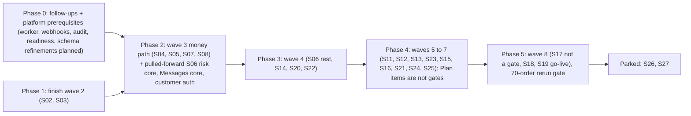

| Phase | Contents (stages / PRs) | Depends on | Risk | Priority | Before real orders? |
|---|---|---|---|---|---|
| **0 · Prerequisites** (parallel with Phase 1) | Follow-ups 5, 7–9, 13–19; **worker process** (completes PR 6: BullMQ, scheduler leader, JobRun, heartbeat) and wiring of existing jobs; **webhook receiver** (PR 196 scope for ERP `stock.changed`/`variant.changed`); **append-only audit role** (PR 496/139 scope); **readiness check + structured logs + request id** (PR 9/17 scope); negative-stock display (follow-up 16); metrics registry skeleton and new report views (PR 603 scope, additive); read-only ERP cost mirror, and the price mirror once D1 is decided (PR 196/498) | none | Low — additive, no new stage | **Highest**: the money path assumes them | Yes |
| **1 · Wave 2** | S02 storefront (PR #23 then the rest of 40–88, 501, 503, 595–600, 602); S03 remaining 13 PRs | PR #23 review and merge | Medium (UI volume) | High | Storefront yes; S02 extras (side canvas, effects) no |
| **2 · Wave 3: money path** | S04 checkout (105–137, 558, 560, 561, 563, 565, 566, 605 gift, 606 bulk) with order idempotency and re-check; S05 orders (138–155, 541, 546) with the state machine §6.5.1; S07 payments, refunds, wallet (165–174); S08 courier, returns, exchange (175–193, 525, 526, 564); advance checkout layers and order dashboard inside S04/S05 (558, 560, 541); **pulled forward from S06**: risk levels and advance (156, 161, 542, 562); customer auth (129–130) and **pulled forward from S14**: profile and consent basics (284, 298); Messages core (148, 505, 289, 292, 295, 545, 546) as one section (CN-019); schema refinements S1–S20 with their first writer PRs | Phase 0 worker + webhooks; S02 pages; D1, D4, D5 (decided); R11 | **High** — money, stock and customer trust; most simulation findings live here | **Highest** | Yes (all) |
| **3 · Wave 4** | S06 rest (157–160, 162–164, 502, 519–524, 540, 543–545, 554, 556, 557, 559, 567); S14 rest (CRM, segments, loyalty, merge); S20 fulfilment documents (404–412); S22 support inbox (425–436, 538) | Phase 2 | Medium | High | Yes for: courier zone sync (554), RTO cost book inputs, support inbox (human replies), fulfilment documents; loyalty and segments later |
| **4 · Waves 5–7** | S11 SEO, S12 blog, S13 marketing incl. **MKT-04 full ads control** (Tracking & feeds first), **S23, S24, S25 studios (MKT-06; S24/S25 are E3 wave 7)**, **AI agents, skills, diary, memory, Ask AI (AIC-03/04/09/10/11, SH-04)** — all **Plan: built in this plan, not go-live gates (Q1)**; S15 AI control room (master switch off), S16 finance and reports (metrics registry, MNY-01–04, 06), S21 site health (CN-015 probe, server page, audit runner, PR 594) | Phase 2 data | Medium | Medium–High | Yes for: SEO redirects/WordPress 301 map, tracking & feeds (R9), MNY-01–04 and 06, REP-01–04, 06, 07, AIC-01/02/05–08, server page (A2.9 go-live condition). MNY-05 before the first month end. Not gates: ads control, studios, AI agents and the other Plan pages (Q1) |
| **5 · Wave 8: go-live** | S18 compliance, security, manual; S19 deploy, backup, go-live (391–403, 507, 587): offsite backups live, Telegram alerts, restore drill, **70-order rerun on staging**, domain switch with 301s | everything marked "Yes" | High (one-way switch) | Gate | It is the gate |
| **Wave 8 and parked** | S17 multi-store sits in E3 wave 8 with S18/S19 but is **not a go-live gate** (SET-07 Deferred; C19); loyalty, referrals, apology credit rule are built and off (Plan); parked S26, S27 | owner approval for S17 and parked | Low | Low | No |

**Must exist before the first real order** (summary): worker and webhooks; order state machine with locks; checkout
idempotency and re-check; advances and refunds as records; courier booking with eligibility filter and exception
states; returns with the five distinct facts; COD reconciliation with reason codes and "received as"; Messages
journey with amount-due rule, caps and log; metrics registry for Dashboard/Money/Reports; audit append-only;
readiness and alerts; offsite backups and Telegram; ERP price/cost mirror with the stale/missing rules (D1);
return disposition with ERP-confirmed restock and shop loss (D4); cancel-and-replace after booking (D5); expense
entry (D2); all **Gate** pages of §5; staging acceptance list and the 70-order rerun passed. **Before the first month
end:** MNY-05 and the month-end push (D2, needs G4). **Not gates (Plan; Q1):** AI agents and skills, full ads control
(except Tracking & feeds, R9), studios.

---
## 14. Keep / Adapt / Combine / Defer / Reject / Investigate

### 14.1 Every addendum item

| Item | Decision | Reason |
|---|---|---|
| 3.1 Storefront & checkout | **Keep** | Core; built as one checkout service sharing the order service with admin and chat orders; guest checkout kept (phone-first), accounts optional with SMS-code first login |
| 3.1 Abandoned/failed checkout handling | **Keep** (capture) / **Defer** (follow-ups beyond consented cap) | F-026/F-057; capture is cheap and needed for the problem probe |
| 3.2 Catalogue & merchandising | **Keep** | Built and verified; the ERP price/cost mirror (D1, G3) and reviews remain |
| 3.2 Bundles, reviews, back-in-stock | **Keep** | Owner-approved features with register PRs |
| 3.3 Inventory & ERP sync | **Adapt** | Built; needs worker, webhook receiver, negative stock shown, price/cost mirror |
| 3.3 Shop-side reservation | **Keep** | Defined by A3.5 rule 2; handover to ERP at confirmation |
| 3.4 Orders & lifecycle | **Keep** | Core; explicit state machine and lock points (§6.5.1, §6.4) |
| 3.4 Partial delivery, split fulfilment | **Adapt** | Partial delivery and charge-paid return: yes (F-005). Split fulfilment from several warehouses: **Defer** (one shared pool, one location today) |
| 3.5 Delivery & courier with adapter | **Keep** | Three couriers already named; adapter boundary prevents leakage |
| 3.5 Courier performance metrics | **Keep** | Denominators defined in §10.2 |
| 3.6 Returns, exchanges, refunds | **Keep** | Five distinct facts (§6.5.4) |
| 3.7 Customers & CRM | **Keep** (profile, history, consent, merge) / **Defer** (loyalty, referrals: built off) | CN-018 perks off by default |
| 3.7 Support SLA tracking | **Keep** | Cheap once the inbox exists; simulation showed breaches |
| 3.8 Coupons & promotions | **Keep** | Built engine; add audience and first-order rules |
| 3.8 Ad platform integrations & attribution | **Adapt** | Tracking & feeds before go-live (data not lost, R9); full ads control is Plan (owner 23 Oct; Q1); "tracked" never "caused" |
| 3.9 CMS | **Keep** | Register S02/S11/S12; revisions via publish versions |
| 3.10 Messaging | **Keep** | CN-019 control centre; dedupe and consent are launch requirements |
| 3.10 Staff notifications separate | **Keep** | §5.1 table |
| 3.11 Money & financial ops | **Adapt** | Operational only; money status model; ERP books |
| 3.11 Tax/VAT | **Defer** | Owner: VAT after launch (CN-009); fields present |
| 3.12 Reports & shared KPI definitions | **Adapt** | Replace SQL-embedded KPIs with a registry (§10) |
| 3.13 Dashboard & alerts | **Keep** | Consumes queues and metrics only |
| 4.1 Identity & authorization | **Keep** | IV; extend keys; 2FA required for admins at go-live |
| 4.1 Customer MFA | **Reject** | SMS-code login is enough for customers; adds friction to a phone-first market |
| 4.2 Audit trail | **Adapt** | Make append-only at DB level; retention setting |
| 4.3 Idempotency & concurrency | **Keep/Adapt** | Patterns built; extend per §7.7; add four missing uniques |
| 4.4 Background jobs | **Adapt** | One worker on existing Redis; Postgres outbox stays source of truth |
| 4.4 Dead-letter & replay | **Keep** | ERP pushes already have DEAD + retry; generalise |
| 4.5 Integrations & secrets | **Keep** | IV framework; add adapters mock-first |
| 4.6 Errors & observability | **Adapt** | Structured logs, request ids, readiness; no heavy APM stack |
| 4.7 Privacy & retention | **Adapt** | Anonymise, never delete orders (D9); legal requirements **Investigate** (G19) |
| 4.8 Files & media | **Keep** | IV; renditions move to the worker |
| 4.8 Virus/content scanning | **Defer** | Staff-only uploads at launch; revisit when customers upload claim photos at scale |
| 4.9 Search & exports | **Keep** | Ctrl K palette, exports as audited jobs |
| 4.10 Configuration | **Keep** | IV registry; settings UI via Settings cards |
| 4.10 Separate feature-flag system | **Reject** | Settings switches (off by default) already are the flags |
| 4.11 API compatibility | **Adapt** | `openapi.yaml` from ERP, contract tests, webhook versions |
| 4.11 Public API versioning for storefront | **Reject** | Only the shop's own pages consume it |
| 4.12 Performance | **Keep** | Add checkout load scenario |
| 4.12 Extra infrastructure (read replicas, CDN rework) | **Reject** for now | One VM sized generously; measure first |
| 4.13 Deployment & recovery | **Keep/Adapt** | Built; add offsite activation and a pre-migration snapshot (or document PITR as the rollback) |
| 4.14 Testing | **Keep/Adapt** | Built tooling; add money-path suites (§12) |
| 4.15 Admin UX as backend requirement | **Keep** | Every page card in §5 names API, perms and states |
| 4.16 AI governance | **Keep** | AI off by default; approval queue; allowlists |
| Invariants 1–12 | **Keep** | All apply (§1.4); one justified exception (reservation handover) |

### 14.2 Notable existing plan items

| Item | Decision | Reason |
|---|---|---|
| 334-model Prisma skeleton for all stages | **Keep/Adapt** | Saves migrations; refine additively where invariants need it (§6.6); unused models cost nothing |
| BullMQ (PR 6) | **Keep** | Already specified and provisioned; job code written for it |
| Generic `IdempotencyKey` model (unused) | **Adapt** | Use for HTTP command idempotency (24 h stored responses) |
| `OutboxEvent` (unused) alongside built `ErpPush` | **Combine** | Keep `ErpPush` for ERP; use `OutboxEvent` for courier, messages, refunds — same relay pattern |
| `ScheduledJob` / `JobRun` (unused) | **Keep** | Job registry and run history for the worker |
| Four materialized views (PR 603) | **Adapt** | Keep the mechanism; new definitions per §10; old views left unused, not dropped |
| Meilisearch | **Keep** (storefront search, PR 72) | Already running; admin search starts on Postgres |
| Four-layer cache (PR 602) | **Keep** | Freshness rules written per layer; stock cache short |
| Stock count by barcode (PR 203) | **Keep** as report only | Consistent with A3.6 only because it never moves stock (C4) |
| Retail expenses + monthly push (B3.8) | **Keep** | Owner D2: all costs go to the ERP at month end; endpoint missing is technical (G4) |
| "Parameter for Checkout" as its own section (PR 558) | **Combine** | Into Orders → Risk rules (CN-018 newer; C7, R13) |
| Ads "Approvals" tab, support blocklist | **Combine** | One approval queue; one block register |
| Demo "Server" tab bundle | **Combine** | Monitoring in Reports → Site health; configuration in Settings → System |
| Demo "fill/clear demo data" button | **Reject** | Live store never holds demo data (hard rule 4) |
| Auto-blocking of customers | **Reject** | Hard rule; proposals only |
| Separate "instant COD" feature | **Reject** | CN-021 P16 |
| Microservices / event bus | **Reject** | Modular monolith on one VM is simpler and enough |
| Stock adjustments in the shop | **Reject** | ERP owns stock (A3.6); restock only via ERP return documents; unsellable returns are a shop loss, never an ERP stock change (D4) |
| Editing or re-booking a booked parcel | **Reject** | Owner D5: cancel and create a replacement order |
| Storing card data | **Reject** | Hosted gateway pages only |
| Multi-store (S17) | **Defer** | One domain at go-live; `storeId` already everywhere; E3 keeps it in wave 8 (C19) |
| Studios S23–S25, house ads, side canvas | **Keep (Plan)** | Owner 23 Oct: in the current plan; not a go-live gate (Q1); E3 waves 5 and 7 |
| AI agents, skills, memory, Ask AI panel | **Keep (Plan)** | Owner 23 Oct: in the current plan; AI off until the owner turns it on; control room, approvals, costs, routing and audit are Gate (Q1) |
| Loyalty, referrals, apology credit rule | **Keep (Plan, built off)** | CN-018 perks off by default; wallet ledger is Gate |
| Month-end close push (MNY-05) | **Keep** | Required by D2; live before the first month end; needs the contract endpoint (G4) |
| Installer (S26), no-ERP stock (S27) | **Defer** (parked) | Owner decision 18 Oct |
| CN-015 auto-fix via PR | **Keep** with boundary | Only non-hard-rule fixes, normal gates, owner check before live |
| Help & Build section | **Keep** | Owner reads progress and manual in the admin |
| Proposed call-back PR 607 and abroad-payer PR 608 (simulation report) | **Combine** | CN-020 places call-me on the checkout PRs + Support and the abroad payer on the gift PR 605 |

---

## 15. Conflicts with the Main Blueprint or the current code

Each conflict is listed with options; this draft resolves none by itself. C1, C2, C3 and C13 are now resolved by the
owner's decisions D1, D2 and D5 (§16.0); C17–C21 are new in v2. "Draft assumes" is the safe default this document uses so
that the rest of the design is coherent until the owner decides.

| # | Conflict | Sources | Options | Draft assumes |
|---|---|---|---|---|
| C1 | **Resolved by D1** (ERP owns base price and cost; sale prices per Q2). Original conflict: **Price and cost ownership.** A3.4: retail price and cost flow ERP → shop. B3.7: ERP owns cost and base retail price, shop owns sale/compare-at price, with a margin guard. Code: shop edits prices (`catalogue.prices`, PriceHistory); ERP `retailPrice`/`avgCost` parsed but never applied (`adapters/src/erp/http-client.ts`); cost never synced, so `unitCostMinor` and profit have no source. | Blueprint A3.4, B3.7; code | (a) Follow B3.7: mirror ERP base price and cost read-only; shop owns sale/compare-at; margin guard. (b) Shop owns all selling prices; ERP sends cost only. (c) ERP owns every price including sale prices. | **(a)**, by D1 (sale prices confirmed by Q2) |
| C2 | **Resolved by D2** (keep MNY-04, push every cost monthly; endpoint is G4). Original conflict: **Retail expenses in the shop.** A3.6 removes expense entry from the shop; B3.8 keeps a Retail expenses screen with a monthly push to the ERP; the ERP contract has no expense endpoint. | Blueprint A3.6 vs B3.8; contract | (a) Keep MNY-04 and add an expense-document endpoint to the contract. (b) Drop MNY-04; expenses only in the ERP; shop P&L reads them back. (c) Keep MNY-04 for shop-only reporting, no push. | **(a)**, by D2 |
| C3 | **Resolved by D2** (all costs pushed; endpoint is G4). Original: **Cost ledger push** (B3.9 per-service monthly totals) has no contract endpoint. | Blueprint B3.9; contract | (a) Add endpoint. (b) Send as expense documents (with C2a). (c) Keep shop-only. | (a) or (b), technical choice with the ERP project |
| C4 | **Stock audit.** A3.6 removes stock audit/adjustments from the shop; PR 203 built a barcode count. | Blueprint A3.6; code | (a) Keep as report-only (never moves stock). (b) Remove the page. | (a) |
| C5 | **Payments to the ERP.** Contract `POST /payments` lists COD / bKash / Nagad / card; CN-021 adds payouts "received as" bank / bKash / cash at courier office; refunds have no contract call. | Contract; CN-021 P16 | (a) Extend `/payments` with `receivedAs`, bank and cash methods, negative amounts or a `/refunds` call. (b) Push per-payout documents instead of per-order payments. | (a), pending the ERP project |
| C6 | **Admin section count.** CN-018: "at most about 10 sections". ADMIN-ARCHITECTURE: 12 + Settings (13). Page-level architecture: 14 incl. Help & Build. | CN-018; docs | (a) Keep 14. (b) Fold Website into Marketing and Help into the avatar menu (12). (c) Further folds to about 10 (AI Center into Settings, Support into Customers). | (a), recommendation R12 (see C20) |
| C7 | **Checkout advance layers placement.** PR 558: "its own dashboard section"; CN-018 (newer): risk settings live in Orders → Risk rules. | Register PR 558; CN-018 | (a) Card inside ORD-06. (b) Own section. | (a), recommendation R13 |
| C8 | **Negative stock.** Code clamps sellable stock at 0 (`packages/inventory/src/stock.ts:26`); CN-017 / F-006 require showing negative and blocking. | Code; CN-017 | Fix in follow-up 16 (no real option to keep the clamp). | Fix |
| C9 | **KPI definitions.** Materialized views encode revenue incl. cancelled orders and delivery charge, by placement date, cost 0 when missing. | Code (`0001_init`); this draft §10 | (a) New views per §10, old ones unused. (b) Alter old views (not additive). | (a) |
| C10 | **Exchange window start.** Smart Rules `policy.exchange.windowHours` (PR 211) exists; CN-021 P8 counts from the courier's delivered mark, which needs courier events. | Code; CN-021 | Lands on PR 211/186 as dated scope. | Delivered mark; "unknown" state until courier data exists |
| C11 | **Day-1 care and Day-3 review on by default** (CN-019) vs the standing rule "every optional feature off by default" (CN-018). | CN-018 vs CN-019 | Newer explicit decision wins (CN-019); listed for the reviewer's awareness. | On, sending only once a provider is connected |
| C12 | **`companyId` on every call** (A3.5 rule 3) vs **company from the key, never the body** (contract, CN-005). | Blueprint vs contract | Contract (newer) wins; the shop never sends `companyId` in bodies. | Contract |
| C13 | **Resolved by D5** (no edits after booking at all). Original: **ERP item edits.** Contract allows `PATCH` item edits until packing; CN-017 requires locks or re-book after courier booking. | Contract; CN-017 | Shop sends edits only before booking; after booking only CANCELLED (D5). | As stated |
| C14 | **Error envelopes differ** (shop `{ok:false,error,details}`, ERP `{error:{code,message,details}}`). | Code; contract | Map in the adapter; adapt the shop's admin envelope to carry `code` (§7.1). | Adapter mapping |
| C15 | **Gift fields absent.** PR 605 / CN-020 require receiver, sender contact, note, hide-prices; `Order` has only `shipAfter`. | Code (schema); CN-020 | Additive fields (S10) on PR 605. | S10 |
| C16 | **Order push timing.** Contract `POST /orders` creates a CONFIRMED SalesOrder; shop orders may wait for an advance or a risk decision before confirmation. | Contract; CN-018 (2) | (a) Push on confirm only. (b) Push on placement as draft (contract has no draft status). | (a), recommendation R11 |
| C17 | **Return QC values vs D4.** Contract `POST /returns` carries good / B-grade / damaged; Blueprint describes "QC good/damaged → restock or write-off" (PR-096); D4 sends only sellable items to the ERP and records unsellable ones as a shop loss. | Contract; Blueprint S08; owner D4 | (a) Send sellable only, as `good` (D4). (b) Send all with QC values. | (a) (R6); packing-time damage (`BadStockEntry`) is a separate case (G6) |
| C18 | **Dashboard picture vs D3.** `02-dashboard.png` labels the sales chart "Delivered and booked orders" and shows "Estimated profit today · after ads and courier". | Picture; `ADMIN-ARCHITECTURE.md` §4.1; owner D3 | Correct the cards before build (R4). | Corrected in DSH-01 |
| C19 | **S17 placement.** Blueprint E3 puts S17 multi-store in wave 8 with S18/S19; this draft and the owner's 23 Oct answer treat multi-store as after go-live. | Blueprint E3; owner 23 Oct | Keep E3's order; S17 is not a go-live gate. | Not a gate; register unchanged |
| C20 | **Section and tab counts.** 13 (`ADMIN-ARCHITECTURE.md`, sitemap header) vs 14 (this draft) vs 15 sidebar links (shell picture); 3 sections over 6 tabs. | Docs; pictures | R12. | 14 |
| C21 | **Owner decisions not in the register.** D1–D5 and the 23 Oct scope move exist in chat and §16.0 only. | Register (newest CN-021) | R1: file a CN note through the change process. | Treated as decided |

---

## 16. Decisions, open questions, technical gaps, recommendations and scope

Four lists are kept apart on purpose: a missing implementation is a **technical gap** (§16.3), not an open business
decision; a decision the owner has made (§16.0) is not reopened because its code does not exist yet.

### 16.0 Resolved decisions (made by the owner; this draft follows them)

The 23 Oct answers come from the owner's chat answer of 23 Oct 2026, 10:17. **They are not yet filed as a CN note in the
register** (newest: CN-021); filing them is R1.

| # | Owner decision (23 Oct 2026, 10:17) | Where this draft applies it |
|---|---|---|
| D1 | **Yes.** The product price **and** the cost (purchase price) come from the ERP. | §6.1, §6.2, §7.9 A, PRD-01/02, C1 resolved. Interpretation used: the ERP owns the **base retail price** and cost; sale prices, coupons and combo prices stay shop rules as in Blueprint B3.7 and the built Smart Rules and combos — the owner confirms this reading in **Q2**. |
| D2 | **Yes, all costs go to the ERP.** At month end the fixed costs, and every kind of cost, are pushed to the ERP. | MNY-04 (Gate), MNY-05 (required before the first month end), §7.9 E, C2/C3 resolved; endpoint missing is G4 (technical, not a business question). |
| D3 | **Yes.** "Sales" means delivered orders only; returns come back as returns. | §10.2 M1–M4, DSH-01, §19.3. |
| D4 | Returns are received at the shop and inspected physically. **Sellable** → sent to the ERP; stock goes back only when the ERP confirms. **Not sellable** → a **loss in e-commerce**; no ERP stock change. | §6.5.0, §6.5.4, ORD-05/05a, §10.2 M10; whether the loss travels in the month-end push is **Q3**. |
| D5 | **No re-booking edits.** A change after courier booking = **cancel** (staff phone the courier) + a **new order from the dashboard**. | §6.4 lock points, §6.5.7, ORD-07, ORD-08, DLV-02, F-004, C13 resolved. |
| Scope, 23 Oct | AI agents, full ads control and the image/video studio belong in the current plan, not "later". | §16.5: class **Plan** — fully designed, built in the current plan, not a go-live gate; **Q1** asks whether any must be live before the first real order. |

Earlier decisions this draft relies on (in the register): CN-009 (VAT after launch, archive not delete); CN-014 (eight
optional ideas, Bengali guide per section); CN-015 (customer problems); CN-016 (smoke after deploy); CN-017 (simulation
findings become required tests); CN-018 (settings with options, off by default; never auto-block; simple admin);
CN-019 (Messages control centre; Day-1 and Day-3 on); CN-020 (gift = advance, no login; call-me; voice address; cancel
rules); CN-021 (P8 window from the delivered mark, P11 bulk lane settings, P12 COD-off proposal only, P14 SMS
pre-ticked, P16 no instant COD, "received as"); 18 Oct: S26 and S27 parked.

### 16.1 Assumptions

| # | Assumption | If wrong |
|---|---|---|
| A1 | The ERP implements `docs/ERP-API-CONTRACT.md` incl. webhooks and `openapi.yaml`; it reports its side LIVE (23 Oct), not verified here | Shop keeps polling; contract work moves onto the critical path |
| A2 | Steadfast, Pathao and RedX offer booking and tracking APIs and statement exports; webhook and cancel support vary | Polling, phone cancellation (D5) and file import cover the gap |
| A3 | Payment gateway(s) offer server-side verification and refund APIs | Manual refunds recorded with references |
| A4 | One store and one ERP company at go-live; one shared stock pool | Multi-store work moves earlier |
| A5 | Traffic fits one VM (E8ds_v6) with PgBouncer | Measure with k6 before go-live |
| A6 | Bengali and English only; BDT; Asia/Dhaka | Per-store settings already designed |
| A7 | The vault master key is held outside the database and recoverable for a restore (NV, G15) | Secrets lost on restore; keys re-entered |
| A8 | The bag (S04 PR 105–114, `@extas/cart`) fits §8.1; checkout placement is not yet written | Align in the checkout PRs |

### 16.2 Genuinely open business questions (owner; yes/no; never a number)

| # | Question | Recommended | Until answered | Affects |
|---|---|---|---|---|
| Q1 | Must any of the AI agents, full ads control or the image/video studio be live **before the first real order**, or may they follow right after? | **Follow right after.** The go-live gates are the money path, the courier, returns and backups (Blueprint E3 go-live conditions; §12.4). | treated as Plan (not a gate); build order unchanged | §13, §16.5 |
| Q2 | Do sale prices, coupons and combo prices stay shop rules, with the base price and cost from the ERP? | Yes (Blueprint B3.7) | catalogue base price treated as ERP-owned; sale/coupon/combo editing kept | PRD-01/02, `catalogue.prices` |
| Q3 | Does the unsellable-return loss travel in the month-end push as a cost (no stock change)? | Yes | loss shown in the shop only, flagged "not pushed" | MNY-05, M10 |
| Q4 | Is product cost taken at placement (not at delivery)? | Yes | M9 provisional, both dates kept | M9, M10 |
| Q5 | Does a refund after a closed month show in the next open month (closed months never reopen)? | Yes | such refunds listed separately | M3, MNY-05 |
| Q6 | Is exchange pickup/re-delivery courier cost its own line inside Contribution, not RTO cost? | Yes | separate line, outside RTO cost and Contribution | M6, M12 |
| Q7 | Is goodwill/apology wallet credit a cost on the day it is given? | Yes | separate line | M12 |
| Q8 | Is the prepaid reward a discount on the order (not a marketing cost)? | Yes | separate line, not netted from M1 | M1, M12 |
| D7 | Does a partial delivery count as delivery success? | Yes, also shown separately | shown both ways | Delivery success |
| D9 | On a data-removal request, keep money and stock records and anonymise personal details (nothing deleted)? | Yes (legal basis NV, G19) | no erasure workflow | CUS-07 |
| D11 | May refund approval be handed to the Manager role? | No for now; the system supports it | owner only | MNY-03 |
| D12 | Only the owner and Accounts record money received outside checkout? | Yes | owner and Accounts | ORD-07 |

### 16.3 Technical dependencies and implementation gaps (not business decisions)

| # | Gap | Evidence | Where it is planned |
|---|---|---|---|
| G1 | No worker or scheduler; nothing runs by itself | no `bullmq` in any `package.json` | Phase 0, PR 6 follow-up |
| G2 | No inbound webhook receiver (ERP, courier, payment, messaging) | no webhook route under `apps/web/src/app` | PR 196, 184, 170 |
| G3 | ERP price/cost mirror not built although D1 is decided; the product editor still writes the price | `adapters/src/erp/http-client.ts` parses, does not apply | PR 196/498 scope, S13 schema |
| G4 | Contract has no month-end expense endpoint and no read-back | `docs/ERP-API-CONTRACT.md` | CN note on both projects |
| G5 | Contract `POST /payments` lacks bank/cash, "received as" and refunds | contract; CN-021 P16 | C5 |
| G6 | Contract has no packing-time damaged-stock call (`BadStockEntry`) | contract vs Blueprint B1.2 | S20 |
| G7 | Meaning of the ERP's answer to `POST /returns` not written | contract | contract test |
| G8 | Real ERP connection not verified from this repo; no contract test against it | ERP side reported LIVE only | when the owner connects the ERP |
| G9 | Missing uniques: `Refund`, `ReturnRecord`, `CourierSettlementLine`, `ShipmentEvent` | schema (§2.4) | S1, S2, S4, S6 |
| G10 | No order service, state machine, payment, courier or return code | §2.6 | S04, S05, S07, S08 |
| G11 | No replacement link or return disposition fields | schema | S18, S19 |
| G12 | Audit append-only by convention only | §9.2 | PR 496/139 scope |
| G13 | No structured logs, request ids or readiness check | §9.6 | PR 9/17 scope |
| G14 | Offsite backups (Blob, Drive) and Telegram alerts wait for owner keys | BLOCKED, README | S19 go-live condition |
| G15 | Vault master-key custody and restore path (was I2) | NV | restore drill |
| G16 | Whether catalogue CSV export writes an audit row (was I3) | NV | trace `catalogue-csv.ts` |
| G17 | Courier capabilities per provider (was I4) | NV | provider docs, sandbox |
| G18 | Which payment gateways and their refund/statement APIs (was I5) | NV | owner's merchant accounts |
| G19 | Bangladesh legal requirements for consent, retention, erasure (was I6) | NV | local legal advice; never guessed |
| G20 | 158 admin pages have no picture; no phone picture of any unbuilt page | §2.5 | §19.8 |
| G21 | New modules' permission keys are not in the catalogue yet (36 keys today) | `catalogue.ts` | each module's PR |

### 16.4 Recommendations needing approval

Business-visible ones go to the owner; technical ones become dated scope on existing register PRs through the change
process (CN-016 rule), never silently.

| # | Recommendation | Why | Approver |
|---|---|---|---|
| R1 | File D1–D5 and the 23 Oct scope move as a CN note in the register | they live only in chat and this draft | build lead via change process |
| R2 | Release marks Gate / Plan / Deferred / Parked instead of Launch / Later (§5.0) | "Later" read as "left out" | owner (with Q1) |
| R3 | Role-based start pages (§19.5) | packers and support get a near-empty dashboard | owner |
| R4 | Dashboard corrections before build: delivered-only sales chart, Contribution instead of daily profit, freshness line, AOV basis, denominators shown, delivery charges outside Sales (§19.3) | D3; trust in figures | owner |
| R5 | "Month-end close" as a visible Money tab and one "ERP sync" status view (§19.1) | D2; failures were spread over 3 places | owner |
| R6 | QC offers two outcomes (sellable / not sellable); contract `B-grade` unused | D4 as stated | owner |
| R7 | Replacement cannot be booked while the old parcel is not confirmed cancelled | duplicate fulfilment | owner |
| R8 | Allow Accounts to move an old order's paid amount to its replacement ([confirm]) instead of refund-and-repay | fewer refunds | owner (money rule) |
| R9 | Ads "Tracking & feeds" sub-tab live before go-live even though ads control is Plan | lost tracking events cannot be recovered | owner (with Q1) |
| R10 | A variant without an ERP price cannot be published or bought | never sell at ৳0 | owner |
| R11 | Send the order to the ERP only on confirmation (was D6) | contract creates CONFIRMED orders | owner |
| R12 | Keep 14 sidebar entries (was D8); fix the 13/14/15 count; fold Products, Reports and Settings to ≤ 6 visible tabs or accept the exception | CN-018 "about 10" vs workload | owner |
| R13 | Advance-payment checkout layers inside Orders → Risk rules (was D10; CN-018 already points there) | one place for risk | owner |
| R14 | Refund request, approval and execution by different people (owner exempt, logged) | separation of duties | owner |
| R15 | Run the proposed usability test (§19.8) before the 70-order rerun | the design is unverified with staff | owner |
| R16 | Platform prerequisites: worker, webhook receiver, metrics registry, append-only audit, readiness, schema refinements S1–S20 | §1.1, §6.6, §9 | build lead via change process |

### 16.5 Scope classification: overall scope vs first real order

| Class | Meaning | Pages | Which |
|---|---|---:|---|
| **Gate** | needed before the first real order on the main domain (go-live S19 PR 587 and the 70-order rerun) | 133 | everything not listed below |
| **Plan** | in scope, fully designed, **built in the current plan, not a go-live gate** | 26 | owner 23 Oct items: SH-04, MKT-03c, MKT-04, MKT-06, 06a–c, MKT-07, MKT-08, WEB-03c, REP-05, AIC-03, 03a–c, AIC-04, 04a, AIC-09, AIC-10, AIC-11 (20); others: CUS-04, WEB-02a, MNY-05 (required before the first month end), REP-08, REP-09, REP-10 (6) |
| **Deferred** | not built until the owner approves; nothing blocks it | 1 | SET-07 Stores (S17 multi-store) |
| **Parked** | hidden slot, owner decision 18 Oct | 1 | SET-08e Installation (S26); S27 no-ERP stock is behaviour, not a page |

The class orders the admin build and the go-live check only; it **does not change the register's stage order**
(Blueprint E3 waves). In E3, S24 and S25 are wave 7 and S17 sits in wave 8 with S18 and S19; this draft does not move
them (C19).

**The three capabilities of Q1:**

| Capability | Pages | Stages | External dependencies | Security | Cost and usage limits | Acceptance criteria (summary) |
|---|---|---|---|---|---|---|
| AI agents and skills | AIC-03 (a–c), AIC-04 (a), AIC-09, AIC-10, AIC-11, SH-04, WEB-03c | S15, S12 (PR 593) | AI provider keys in the vault | AI off until the owner turns it on; tool allowlists; approval queue for anything buyer-facing, money, price, block or delete; data-class masking (AIC-08); AI actor in the audit log | one usage ledger; per-agent and total caps that pause the AI, never the shop (AIC-06); values are owner settings, empty | the AI-off test passes (shop fully works); no buyer-facing send without approval; a cap pauses agents only; every action in the AI diary |
| Full ads control | MKT-04, REP-05, MKT-03c | S13 | Meta, Google, TikTok ad accounts and API access; server-side events; Merchant Center | budget raises owner-only with [confirm]; automatic decreases only; change log | guardrails are owner settings, empty | daily spend import matches the platform report; any increase is blocked without the owner; attribution labelled "tracked" |
| Image/video studio | MKT-06, 06a–c, AIC-10 | S23, S24, S25 | image and video generation providers; Blob storage | publishing is always Ask; source and licence kept per asset; no customer data sent | spend caps and a cost row per job | each job queued with a cost row; nothing published without approval; every asset has source and licence |

### 16.6 Deferred and parked (with reason)

Multi-store S17 (one domain at go-live; `storeId` already everywhere) · split fulfilment across warehouses (one pool) ·
VAT (after launch, CN-009) · virus scanning of uploads (staff-only uploads at launch) · installer S26 and no-ERP stock
S27 (parked). Loyalty, referrals and the apology-credit rule are **built and off** (CN-018), so they are Plan, not
deferred.

---

## 17. Evidence appendix (repository paths)

| Area | Paths |
|---|---|
| Register, plan, decisions | `docs/MASTER-REGISTER.md` (build status; CN-012 … CN-021), `docs/BLUEPRINT.md` (A3.3–A3.6, B3.7–B3.10, E3), `PROGRESS.md` (follow-ups 1–19), `BLOCKED.md`, `CLAUDE.md` |
| Admin design | `docs/ADMIN-ARCHITECTURE.md`, `docs/admin-guide/*.md`, `docs/owner/admin-arch/00-sitemap.png`, `01-shell.png`, `02-dashboard.png` (viewed for v2, §19) |
| Storefront and bag (since v1) | `apps/web/src/app/(shop)/**`, `packages/cart/*`, `packages/db/prisma/migrations/0006_bag`, `apps/web/src/app/api/bag/*` |
| Owner decisions 23 Oct | §16.0 of this draft (from chat; not in the register yet) |
| ERP contract | `docs/ERP-API-CONTRACT.md`; adapter `packages/adapters/src/erp/{contract,http-client,signature,mock}.ts` |
| Simulation | `docs/qa/SIMULATION-REPORT.md` (F-001 … F-057, §5 reconciliation, §9 and P2.8 staging lists), `docs/qa/SIMULATION-PLAN.md` |
| Schema | `packages/db/prisma/schema.prisma` (models `Order`, `OrderItem`, `OrderEvent`, `Payment`, `Refund`, `ReturnRecord`, `CourierSettlementLine`, `ShipmentEvent`, `WebhookEvent`, `OutboxEvent`, `JobRun`, `AuditLog`, `StockMovement`; enums `OrderStatus`, `ShipmentStatus`, `PaymentStatus`, `PaymentPurpose`, `RefundStatus`, `ReturnKind`, `AdvanceRequirement`); migrations `packages/db/prisma/migrations/0001_init` … `0005_delivery_zones` (MVs in `0001_init/migration.sql`); guard `schema-guard.test.ts` |
| Auth & admin guard | `packages/auth/src/{staff-auth,rbac,roles,staff-admin,totp,tokens,password,policy,owner,owner-reset,check-account,customer-auth,audit,catalogue}.ts`; `apps/web/src/lib/admin-auth.ts`; `apps/web/src/lib/admin-i18n.ts` |
| Settings & vault | `packages/settings/src/*`; `packages/vault/src/*`; `tools/hardcode-guard.mjs` |
| Adapters | `packages/adapters/src/{define,connections,catalogue}.ts`, `storage/*`, `page-reader/*` |
| Catalogue & media | `packages/catalogue/src/*` (incl. `sku.ts`, `naming.ts`, `redirects.ts`, CSV), `packages/media/src/*`; routes `apps/web/src/app/api/admin/catalogue/**`, `api/admin/media/**`, `app/media/[...key]` |
| Inventory | `packages/inventory/src/{stock,reservations,erp-push,guard,jobs,sync-health,…}.ts` (`stock.ts:26` clamp); routes `apps/web/src/app/api/admin/inventory/**` |
| Rules, combos, delivery | `packages/rules/src/*` (`public.ts`, coupons, `jobs.ts`), `packages/combos/src/*` (`bag.ts`, `analytics.ts`), `packages/delivery/src/*` (`quote.ts`, `resolve-service.ts`, `phone-area.ts`); public routes `apps/web/src/app/api/delivery/*`, `api/back-in-stock` |
| Seed & owner data | `packages/seed/src/{pack,sample,owner-data-check,export}.ts` |
| Infra, deploy, backup | `infra/stack/compose.yml`, `infra/deploy/{deploy.sh,smoke.sh}`, `infra/server/bin/extas-backup`, `infra/server/steps/12-k6.sh`, `infra/tests/run.sh`; workflows `.github/workflows/{ci,deploy,smoke,server-setup,store-settings,owner-reset}.yml` |
| Tests & gates | `tools/{admin-login-e2e.sh,device-gate.mjs,smoke.mjs,check-commits.mjs}`; CI run 39869754193; smoke report `docs/reports/smoke/latest/README.md` |
| Admin screens built | `apps/web/src/app/admin/*` (login, integrations, products, products/queue, products/import, products/audit, size-charts, stock, stock/movements, stock/counts, rules, rules/notices, combos, delivery) |

---

## 18. Audit summary (addendum step 6)

**v2 re-check (23 Oct, after the review notes).** `git pull` to `80e6c1e`; re-checked the claims that matter (no checkout
placement, no worker, no webhook route, 36 permission keys, schema counts, stock clamp, contract lines, `ReturnItem.qcStatus`,
`Order.cancelReasonCode`, `MonthClose`, `RetailExpense.erpPushId`, Blueprint E3 waves); viewed the three admin pictures.

**What was inspected for v1.** The repository on `main` (`dbb60c3`; `10e1c51` adds only a deploy report): Prisma schema
(334 models, 68 enums, 5 migrations) with spot-checks of the money and return models, all packages and admin/public
routes, CI configuration and the CI logs of run 39869754193, deploy/backup/smoke scripts and reports, `CLAUDE.md`,
`PROGRESS.md`, `BLOCKED.md`, the register's CN-008 … CN-021 blocks and stage table, Blueprint A3, B3.7–B3.10 and E3,
`docs/ERP-API-CONTRACT.md`, `docs/ADMIN-ARCHITECTURE.md`, the 45 admin guides (via the page-level architecture), and
the simulation report (57 findings, reconciliation, staging lists). Nothing was modified, executed against a database,
deployed or committed.

**Key verified findings.**
1. 97 of 600 PRs built at v1 (120 at `80e6c1e`); the foundation (auth/RBAC, settings, vault, adapters, media, catalogue, ERP stock mirror with
   holds and outbox, rules/coupons, combos, delivery zones, deploy/rollback, backups/restore drill) is implemented and
   tested (≈ 2,408 tests, CI green).
2. The whole money path (checkout, orders, payments, courier, returns, refunds, messaging, CRM, reports, AI) is
   schema-only.
3. No worker or scheduler exists; nothing runs automatically (holds, outbox relay, stock pull, reconcile, MV refresh).
4. Schema cannot yet represent invariant 5 (returned ≠ refunded ≠ restocked) or prevent double refunds, double
   settlement lines and duplicate tracking events; gift fields and an advance-awaiting state are missing.
5. KPI logic in the materialized views is inconsistent (cancelled orders and delivery charges in revenue, placement
   dating, missing cost as 0).
6. Price and cost ownership disagreed between the blueprint and the code; the owner has since decided (D1) and the mirror is not built; ERP cost is never synced.
7. Audit is append-only only by convention; no structured logs, correlation ids or readiness check; no inbound webhook
   route; offsite backups inactive until the owner's keys.

**Highest-priority gaps and risks.** (1) Worker and scheduler. (2) Order state machine, locks and idempotent placement
before S04/S05. (3) Additive schema refinements S1–S20 for money invariants and the D4/D5 flows. (4) Shared metric registry replacing
SQL-embedded KPIs. (5) ERP price/cost mirror (D1 decided, G3). (6) Offsite backups and alerts before real orders. (7) DB-level
append-only audit and observability. (8) Inbound webhook receiver for ERP, couriers and payments. Under-itemised
register stages (S16, S18, S19, S20, S21) leave finance, compliance and recovery scope thin.

**Key decisions in this draft.** Keep the modular monolith, the register order and every built component. Add one
BullMQ worker with Postgres as source of truth (Adapt). One order service and state machine for all channels (Keep).
Five distinct return/refund/restock facts with restock confirmed by the ERP (Adapt). One webhook receiver (Add). One
metrics registry with §10 definitions (Adapt). Append-only audit at DB level (Adapt). Combine the checkout advance
layers into Orders → Risk rules, ads approvals into the one approval queue, and `OutboxEvent` with the `ErpPush`
pattern. v2: follow D1–D5 throughout; AI agents, full ads control and studios are Plan (built in this plan, not go-live
gates; Q1); month-end push required (D2); defer only multi-store, split fulfilment, VAT and upload scanning. Reject auto-blocking, instant COD,
stock adjustments in the shop, demo-data buttons, a separate feature-flag system, microservices and storing card data.

**Evidence that could not be accessed.** The running server, live database and logs (no SSH by design; read-only);
local test execution (taken from CI logs); open PR #23 contents; the ERP repository and its `openapi.yaml`; vault
master-key custody; whether Blob/Drive/Telegram keys have been entered since the README was written; full bodies of
some simulation sections (skimmed); the CSV export audit trail; the ERP project's `cn005-readiness.md`. The three admin
pictures were viewed for v2.

**Open questions (v2).** Owner questions Q1–Q8 and D7, D9, D11, D12 (§16.2); technical gaps G1–G21 (§16.3);
recommendations R1–R16 (§16.4). D1–D5 are resolved (§16.0).

---

## 19. Admin design review (sitemap, shell, dashboard, workflows, employee-friendliness)

### 19.0 Evidence reviewed and verified counts

- **Pictures (all desktop, static mock-ups with sample figures):** `docs/owner/admin-arch/00-sitemap.png`,
  `01-shell.png` (command palette open on "cod"), `02-dashboard.png`. Viewed for this revision.
- **Specifications:** §5 of this draft, `02-admin-pages.md`, `docs/ADMIN-ARCHITECTURE.md` (CN-018, CN-019).
- **Runtime evidence:** only for the 18 built admin pages (CI device gate at 390 / 768 / 1366 / 1920 px, smoke test).
  None for the unbuilt sections. **No usability testing has been done.** Visual quality and real employee-friendliness
  are therefore **not verified** for 158 of 161 pages.

**Counts recounted from this draft (§5):**

| Item | Count | Check |
|---|---|---|
| Pages under the §5.16 counting rule | **161** | recounted per section: SH 7, DSH 1, ORD 15, PRD 23, CUS 8, DLV 9, MSG 7, SUP 5, MKT 17, WEB 14, MNY 7, REP 15, AIC 15, SET 16, HLP 2 — verified |
| Release marks (revised §5.0) | **133 Gate · 26 Plan · 1 Deferred · 1 Parked** | v1.1's "Launch" table (133 / 27 / 1) was stale after the 23 Oct edit; recounted |
| Sidebar sections | **14** in this draft · **13** in `ADMIN-ARCHITECTURE.md` and the sitemap picture's header ("12 + Settings"; Help & Build drawn as a 14th card, "sidebar bottom") · **15** links in the shell picture (12 + Settings + Help & manual + Build progress) | inconsistent across sources (C20); settled by R12 |
| Tabs | **81** tab names on the sitemap picture (it counts Dashboard's 5 cards as tabs) | **Products 7, Reports 8, Settings 8** exceed the "≤ 6 visible tabs" rule v1 stated as met |

### 19.1 Sitemap review

- **Evidence:** `00-sitemap.png`; §5 page trees.
- **What works:** sections follow staff work, grouped Daily work · Grow · Business; every section is one level deep
  (section → tab) with rare options folded into "More options"; each card says in one line, in English and Bengali,
  what the section is for; Ctrl K, notifications, role-based menus and the Bengali guide are shown as available
  everywhere; orders, products, customers, delivery, expenses, reports and settings each have an obvious home.
- **Concerns:**
  1. **One return touches four sections:** Orders → Returns & exchanges (QC), Delivery → Returned & refused (courier
     outcome), Money → Payments & refunds (refund), Support → Claims & credits (claim).
  2. **Month-end close is missing from the Money card** in the picture, although D2 makes it a required workflow.
  3. **ERP sync status is spread** over Products → Stock (stock and "Sent to ERP") and Settings → ERP connection; return
     and expense pushes have no visible home.
  4. Courier exceptions are a chip inside Delivery → In transit, not a menu item — acceptable because Needs you now links
     straight to them.
  5. The section count (13 / 14 / 15) and three sections over the tab rule (§19.0).
- **Improvements (priority):** P1 add "Month-end close" to Money's visible tabs (R5); P1 one "ERP sync" view in Settings →
  ERP connection listing all five exchanges of §7.9 with last success, waiting, failed and the action to take, linked
  from Needs you now (R5); P1 settle the count and fold Products (Reviews or Collections under More), Reports
  (Experiments is Plan, under More) and Settings (Stores hidden until S17) (R12); P2 a single "return case" timeline on
  the ORD-05 card that links the courier outcome, QC, ERP answer, refund and claim, so staff start in one place.
- **Confidence:** medium (static picture plus specification; nobody has navigated it).
- **Test next:** a first-click test on the sitemap with one person per role (tasks T1–T7 of §19.8).
- **Verdict: Keep with improvements.**

### 19.2 Shell review

- **Evidence:** `01-shell.png`; §5.1; `ADMIN-ARCHITECTURE.md` §2.
- **What works:** a grouped sidebar with badges only for waiting work (Orders 18, Delivery 23, Support 7 in the
  picture); one search that finds settings with their path ("Orders › Risk rules › Soft level"), pages and orders,
  with keyboard hints and a note that Bengali words work; store, language (EN | বাং), notifications and account in fixed
  places; the guide link "এই সেকশনে কী করা যায়" in the page header (seen on the dashboard picture).
- **Concerns:**
  1. The picture's 15 sidebar links differ from the specified 14 (Help & manual and Build progress are separate links).
  2. "Ask AI" is prominent in the top bar; at go-live AI is off and Ask AI is Plan, so this state must be hidden for
     everyone (the specification says so; the picture shows only the AI-on state).
  3. The store switcher looks clickable with one store.
  4. Breadcrumbs: only a small page label ("Dashboard"); record pages (order, product, customer) need a back path, which
     the specification does not describe.
  5. Loading, empty, error, denied, partial and stale states are specified well (§5.0) but none is shown in a picture.
  6. Search results show a customer's name and amount; results are permission-filtered by specification; roles with
     phone masking must also be masked in search.
  7. Contrast of the small grey secondary text on the cream background is not measured.
  8. The phone shell (bottom bar Home · Orders · Support · Search · More) and the Bengali admin are specification only.
- **Improvements:** P1 hide Ask AI while AI is off; P1 "Back to list" plus a breadcrumb on record pages; P2 a static store
  label until S17; P2 add a contrast check (WCAG AA) to the layout checks; P2 apply phone masking in search results.
- **Confidence:** medium for desktop; low for phone and for states.
- **Test next:** picture or build the phone shell and the five base states, then T1 on a 390 px phone.
- **Verdict: Keep with improvements.**

### 19.3 Dashboard review

- **Evidence:** `02-dashboard.png`; DSH-01 (§5.2); `ADMIN-ARCHITECTURE.md` §4.1; §10.
- **What works:** four headline cards with comparison and sparkline; **Needs you now** lists real work with a count, the
  oldest age and a chip naming the section, each row one tap from the filtered list — the most actionable part of the
  page; Orders by stage with the average order-to-courier time against a target; delivery success by courier; time
  range Today · 7 days · 30 days · Custom; Download; the guide link.
- **Are the figures trustworthy?**

| Card in the picture | Problem | Fix (R4) |
|---|---|---|
| "Sales, last 30 days — Delivered and booked orders" | **conflicts with D3** (Sales = delivered only) | Delivered sales only; ordered value, if wanted, as a separately named line |
| "Sales today ৳1,84,350" | basis not on the card | label "Delivered sales"; status (provisional) and "data up to hh:mm" |
| "Orders today 142 · avg order ৳1,298" | 1,84,350 ÷ 142 = 1,298: delivered-sales numerator over placed-orders denominator | AOV = delivered sales ÷ orders with a delivered item (§10.2) |
| "Delivery success 91.2 % · 5.6 % returned or refused" | the two do not add up (3.2 % unexplained); denominator unknown | show the final-outcome denominator and what is left out (lost, still moving) |
| "Estimated profit today · after ads and courier" | daily costs are mostly estimated and ad allocation per day is noisy; v1 §10.3 put Profit only in Money | "Estimated contribution" over 7 or 30 days, owner-only by default, with status and cost coverage |
| "Top products today · by sales" | basis unclear under D3 | delivered basis, or label "by orders placed" |
| (no freshness line anywhere) | staff cannot tell stale from current | one line under the header: "Courier data up to hh:mm · ERP up to hh:mm" |
| "Needs you now · 6 things waiting" | counts rows, not items; no rows for ERP sync failures, unconfirmed returns, month not pushed, COD mismatches (all in the spec; hidden at 0 is right) | "6 lists need you"; keep those rows in the build |

- **Role needs:** with cards filtered by permission, a packer or support agent would land on a nearly empty page —
  see §19.5.
- **Improvements:** all R4 items are P1 (before the dashboard is built); P2 remember each person's time range.
- **Confidence:** high that the KPI labels conflict with D3 and with each other (visible in the picture); medium on
  layout.
- **Test next:** T7 of §19.8 (explain a provisional figure) on a clickable version with the corrected cards.
- **Verdict: Keep with improvements** — keep the layout and Needs you now; the KPI cards must be corrected before build.

### 19.4 Page-level workflow review (specifications only)

Steps are counted from the specification on the best path, from the admin home, for one record.

| Frequent task | Path in the specification | Steps | Concern | Improvement |
|---|---|---:|---|---|
| Find an order by phone | Ctrl K → type the phone → Enter | 3 | none | — |
| Confirm an order | Orders → To confirm → open card → Call (log) → Confirm | 5 | fine for a call queue | keyboard next-order after Confirm |
| Change after booking (D5) | order → Cancel after booking → reason → courier phoned → Courier cancel confirmed → Create replacement → adjust → Place | 8 | long, but each step is a real-world fact; risk of forgetting the courier call | the order stays "cancel pending" in Needs you now until confirmed; replacement booking blocked (R7) |
| Inspect a returned parcel | Orders → Returns → Receive & QC (phone) → scan parcel → scan each item → sellable / not sellable (+ reason) → Save | 6 + 2 per item | needs a phone with a camera or scanner | offline manual entry is specified |
| Recover from an ERP push failure | Needs you now row → Sent to ERP list → read reason → Send again | 4 | "last error" text may be technical | plain-language reason plus "what to do" text (§7.9) |
| Record an expense | Money → Expenses → Add → amount, head, date, photo → Save | 5 | — | add "Add expense" to the Ctrl K actions |
| Check month-end transfer | Money → Month-end close → month row | 3 | page not on the sitemap card | R5 |
| Understand a provisional profit | Money → P&L → status badge → "why provisional" | 4 | the specification has the badge and coverage %, no explanation panel | a short panel naming the missing source (cost coverage, courier not settled, ads not imported) |

- **What works (specification):** every page lists its states; double submission is blocked by idempotency keys
  ([idem]); conflicting edits get "someone changed this" ([ver]); money, price, COD and block actions need a preview and a
  reason ([confirm]); bulk bars say what will be skipped and why.
- **Concerns:** [confirm] plus reason on frequent money steps may slow Accounts (bulk approval of one type exists in
  AIC-02); long forms (ORD-08 Create order) on a phone; error texts for integrations must say what to do.
- **Confidence:** low (no pictures, no running pages).
- **Test next:** clickable or built versions of ORD-02, ORD-05a, ORD-07, MNY-04, MNY-05, PRD-05e, then §19.8.
- **Verdict: Insufficient visual evidence** (at specification level: Keep with improvements).

### 19.5 Role-based start pages (PROP, R3)

Based on the role builder (PR 495, **IV**) and the proposed default roles (§5.1). Implementation: a "start page"
choice per role in the role builder; no new permission; the Dashboard stays one click away.

| Role | Start page | First screen shows |
|---|---|---|
| Packer | Orders → Packing & print (phone) | today's pick list, scan box, parcels waiting for handover |
| Order desk | Orders → To confirm | call queue, cancel requests, cancels pending courier confirmation |
| Support agent | Support → Inbox | open chats, call-backs, rider issues |
| Accounts | Money (a short home) | COD mismatches, refunds to execute, expenses this month, month-end status, ERP push failures for money documents |
| Manager | Dashboard (operations cards) | Needs you now first |
| Owner | Dashboard (all cards) | KPIs, Needs you now, approvals |

### 19.6 Mobile use

Built admin pages: verified by the device gate (0 fails at 390 px and the other widths). Unbuilt pages: **an
assumption**, described in §5.1 only. The packer (ORD-04, ORD-05a) and order-desk flows are phone-first by design, so
they should be pictured and tested on a 390 px phone before their build is signed off. The planned phone mock-up
(`ADMIN-ARCHITECTURE.md` §7, screen 19) has not been made.

### 19.7 Employee-friendliness verdict

| Area | Verdict | Confidence |
|---|---|---|
| Sitemap | Keep with improvements | medium |
| Shell | Keep with improvements | medium (desktop), low (phone) |
| Dashboard | Keep with improvements (KPI cards corrected before build) | high on the KPI issues, medium on layout |
| Page workflows | Insufficient visual evidence | low |
| **Overall** | **Keep with improvements — not yet verified with real staff** | low to medium |

The structure is practical on paper: task-based sections, one level deep, one search, waiting work surfaced with
counts, and role-filtered menus. What is unproven is how fast real staff complete frequent tasks, how the Bengali
admin reads, and how the phone flows feel. §19.8 is the way to find out.

### 19.8 Proposed task-based usability test (proposed — not done)

- **Who:** one person per role: owner, order desk, packer, support agent, accounts (manager optional).
- **Where and when:** staging with sample data, in the language each person prefers; the packer on a phone. A
  first-click round on the sitemap can run now; the full test runs once Orders, Delivery, Returns and Money screens
  exist on staging, before the 70-order rerun (§12.4).
- **How:** the person thinks aloud; the facilitator does not help unless the person is stuck.

| # | Task | Role | Success looks like |
|---|---|---|---|
| T1 | Find the order of a customer who calls with a phone number | order desk, support | the right order opened without help |
| T2 | A customer asks to change size after the parcel is booked | order desk | cancel with reason; courier call confirmed; replacement linked; replacement not booked before the cancel is confirmed; customer message visible |
| T3 | Inspect a returned parcel with one good and one damaged item | packer (phone) | right SKUs scanned; good item shows "ERP: waiting"; damaged item recorded as a loss with reason |
| T4 | An ERP push has failed | manager | found from Needs you now; reason understood; sent again; confirmation seen |
| T5 | Record a packaging expense with a receipt photo | accounts | saved under the right head and date |
| T6 | Check whether last month's expenses reached the ERP | accounts, owner | finds the month and its status without help |
| T7 | Explain why this week's profit says "provisional" | owner | names the missing source (cost coverage, courier not settled, ads not imported) |
| T8 | Work through today's confirmation queue | order desk | calls logged, orders confirmed, prepaid orders not in the queue |
| T9 | Book all ready parcels and explain the skipped ones | order desk | booked; can say why each skipped order was skipped |

- **Measures:** completed without help (yes/no), time, wrong turns, steps against §19.4, the person's confidence (1–5),
  and every word they did not understand.
- **Output:** a findings list with a fix per finding (words go to the dictionary, WEB-05), the changed screens retested.

---

## 20. Risk register

Likelihood and impact: H high · M medium · L low. "Mitigation" points to this draft; nothing here is built.

| # | Risk | L | I | Mitigation in this draft | Evidence / status |
|---|---|---|---|---|---|
| K1 | No worker: stock, pushes, tracking, messages and reports never run by themselves | H | H | one BullMQ worker on the existing Redis; Postgres outbox as source of truth (§9.4) | no `bullmq` (G1) |
| K2 | Real ERP connection behaves differently from the mock (reported LIVE, not verified) | M | H | read-only contract run against the real ERP before go-live; webhooks plus polling (§7.9) | G8 |
| K3 | Profit wrong because ERP cost is missing or not mirrored | H | H | cost mirror and snapshot; missing never 0; provisional label and coverage % (§7.9, §10.2) | G3 |
| K4 | Month-end expenses never reach the ERP (no endpoint) | H | M | contract change on both projects; MNY-05 with idempotent push (§7.9 E) | G4 |
| K5 | Double refund or a parcel counted in two payouts | M | H | uniques S1, S4; claim-before-run; tests (§6.6, §12.3) | G9 |
| K6 | Duplicate delivery after a post-booking change (old parcel still moving) | M | H | cancel-pending state, courier confirmation step, replacement booking block (§6.5.7) | PROP |
| K7 | Returned sellable stock never becomes sellable because the ERP confirmation is lost | M | M | ERP_PENDING → ERP_FAILED row; replay with the same key; reconciliation (§6.5.4) | PROP |
| K8 | "Sales" shown on a different basis in different places (the dashboard picture already does) | H | M | one metric registry; R4 corrections; acceptance test "same value everywhere" (§10, §12.3) | picture evidence |
| K9 | Scope growth delays go-live (AI, ads, studio treated as gates) | M | M | Gate / Plan classes; Q1 (§16.5) | owner question |
| K10 | Staff find the admin too large or confusing (161 pages) | M | M | role start pages, folds, usability test (§19) | not tested |
| K11 | Phone flows for packers fail in real use | M | M | phone pictures and tests before sign-off (§19.6) | assumption |
| K12 | Offsite backups and alerts not active at go-live | M | H | go-live condition (Blueprint E3); SET-08a | owner keys (G14) |
| K13 | Vault secrets unrecoverable after a restore on a new VM | L | H | restore drill checks master-key custody (§9.5) | NV (G15) |
| K14 | Owner decisions D1–D5 drift because they exist only in chat and this draft | M | M | R1: file as a CN note | §2.5 |
| K15 | Consent and retention rules breach local law | L | H | legal advice before go-live; nothing assumed (§9.7) | NV (G19) |
| K16 | Duplicate or out-of-order courier and payment webhooks change states wrongly | M | H | one receiver, unique events, state rank (§7.6, §8.3) | G2 |
| K17 | AI acts beyond its rights when switched on | L | H | AI off by default; allowlists; approval queue; caps (§9.9) | PROP |
| K18 | A booked parcel is cancelled by phone but the courier still charges or delivers it | M | M | courier confirmation recorded with who and when; cancel charge as a cost; claim path (§6.5.7) | PROP |

---

## 21. Revision history

| Version | Date | What changed | Previous copy |
|---|---|---|---|
| v1 | 23 Oct 2026 (morning) | First complete draft: evidence audit, 161-page admin architecture, contracts, lifecycles, KPI definitions, roadmap; owner questions D1–D12 | — |
| v1.1 | 23 Oct 2026 (after 10:17) | Owner answers D1–D5 recorded in §16.0; AI agents, full ads control and studios re-marked "Launch" because the owner wanted them in the current plan; body sections not yet aligned | `draft-v1-backup.md` |
| v2 | 23 Oct 2026 | Third-party review evaluated item by item (`REVIEW-DECISION-LOG.md`). D1–D5 applied through the body (price/cost, month-end push, delivered-only sales, return disposition and loss, cancel-and-replace); four separate status dimensions (§6.5.0); cancellation after booking (§6.5.7); per-sync table and stale/missing price rules (§7.9); worker dependency table (§9.4); permissions matrix (§9.10); metric table with edge cases left to the owner (§10.2, §10.5); four separate decision lists and scope classes (§16); design review of the three pictures with verified counts (§19); proposed usability test (§19.8); risk register (§20); release marks Gate / Plan / Deferred / Parked; evidence moved to `main` at `80e6c1e` (§2.6) | `draft-v2-before-review.md` |

---

## Appendix A. Feature → page mapping (nothing dropped)

### A.1 Every demo admin guide (`docs/admin-guide/`)

| Guide | Feature | Page(s) |
|---|---|---|
| `ads` | Overview, Campaigns, Approvals, Delivered vs orders, Tracking, Creatives, Connections, Change log, pause all, caps | MKT-04 (connections → SET-05; approvals → AIC-02) |
| `agents` | 7 agents, Ask the chief, Telegram | AIC-03, 03a–c |
| `ai` | Control room, Model picks, Spend caps, Data routing, Cost book, AI media library, AI-off test | AIC-01, 06, 07, 08, 10 |
| `analytics` | Today/7 d/All, drawer A vs B, RTO cost book, demo-data fill | REP-01, 02, 08, 06 (demo fill rejected, §14.2) |
| `audit` | Run & schedule, Report history, Bugs | AIC-05; REP-07d |
| `backup` | Drive, Blob, schedule & retention, restore test, last runs | SET-08a |
| `blog` | All posts, Topic list, Workflow, Schedule, Results, Writers, Sections & tags, Ads, Google & sitemap | WEB-03, 03a–d; MKT-03c; WEB-04 |
| `bulk` | Confirm, Book courier, Stickers, Picking list, Invoices | ORD-01 bulk bar; DLV-02; ORD-04, 04a, 04b |
| `cache` | durations, clear, four layers | SET-08b |
| `combos` [built] | auto pairs, wizard, fixed combos, archive, report, sets | PRD-04, 04a, 04b |
| `comms` | message list, send rule, exact-amount line, Day-1 + Day-3 | MSG-04, MSG-01, MSG-03 |
| `coupons` | codes, limits, set-vs-code rule | MKT-02 |
| `couriers` | Overview, Parcels, Returns & refused, Money check, Courier accounts | DLV-01–05; MNY-02 |
| `customers` | views, To review, Messages per order, Segments, tags, notes | CUS-01, 05, 02, 03 |
| `delivery` [built] | three bands, sub-areas, test an address | DLV-06 |
| `exchanges` | requests, returns, Receive & QC, Done, one-trip swap | ORD-05, 05a |
| `expenses` | Expenses, Staff & salaries, Expense heads, ERP push | MNY-04, MNY-05 |
| `finance` | P&L by day/style/category/combo, Costs & fees, Ad spend | MNY-01, MNY-06 |
| `fulfilment` | Print run, Stickers, Picking list, Invoice designs, packing photo | ORD-04, 04a–d |
| `health` | services, Telegram alerts, alert log | REP-07b |
| `hero` | On the site now, Campaigns, Templates, design your own, Eid order-by | MKT-01, 01a, 01b |
| `images` | quality, storage, sizes, CDN | SET-08c |
| `integrations` [built], `keys` | connection list, modes, test, remove; vault, mock mode | SET-05 |
| `landing` | pages, create, copy link, A/B | MKT-05, 05a; REP-08 |
| `layout` | Phone/Desktop/Both, sections, dates, snapshot | WEB-02 |
| `login` [built] | sign-in, first password, 2FA, forgot, admin frame, permissions | SH-01, SH-06, §5.1 |
| `manual` | chapter per section | HLP-01, SH-05 |
| `naming` | Products, Templates, Bulk rename, Redirects, Settings | PRD-12; WEB-04a |
| `orders` | list, flags, confirm, cancel, WhatsApp, review queue, self-confirm | ORD-01, 02, 03, 07, 10 |
| `products` [built] | list, new, edit, launch queue, import, audit, back-in-stock | PRD-01, 02, 03, 09, 11, 05f |
| `register` | Stages & PRs, What's new, Reported problems, Blueprint & files | HLP-02 |
| `review` | To review, Decided, Rules, merge parcel | ORD-03, ORD-06 |
| `reviews` | add, import, publish, hide, verify | PRD-07 |
| `rules` [built] | smart rules, notices & pop-ups, approval, conflicts | MKT-03a, 03b |
| `server` | Server, Cache, Images, Speed, Backup, Keys | REP-07b, SET-08b, SET-08c, REP-07c, SET-08a, SET-05 |
| `settings` | delivery charges, payment line, WhatsApp, home, invoice wording, messages, bag, product page, checkout words, payment at checkout, gift mode, snapshots | DLV-06; SET-02; WEB-08/SET-01; WEB-02; ORD-04d; MSG-03; SET-02; WEB-01; SET-02 + WEB-05; SET-02; SET-02; WEB-07 |
| `sidecanvas` | zones, library, window/whole page | WEB-02a |
| `site` | Menus, Header, Footer, Home, Categories, Product page, Pages, Theme, undo publish | WEB-01 (Home → WEB-02) |
| `size-charts` [built], `sizecharts` | charts, paste, copy, assign, spec photo | PRD-06 |
| `speed` | results, earlier, measure now | REP-07c |
| `stock` [built] | stock & ERP, counts, movements | PRD-05, 05a–e |
| `support` | All/Open/Waiting/Solved/Mine, channels, AI draft, assign | SUP-01 |
| `team` | Roles & permissions, People, Audit log | SET-04a–c |

### A.2 Every owner decision CN-012 … CN-021

| CN item | Page(s) |
|---|---|
| CN-012 (1) hero campaigns, templates, own design, collection link, date switching, launch default | MKT-01, 01a, 01b; WEB-07 |
| CN-012 (2) checkout texts and field order, bag style, fill rule, payment options, logo | SET-02, WEB-05, SET-01 |
| CN-012 (3) text vs design reach the phone | WEB-01 publish rule |
| CN-013 simulation as go-live gate; think beyond the ask | §5.0 release marks; §12.4 |
| CN-014a WhatsApp self-confirm | ORD-02, MSG-01 |
| CN-014b exact-amount line | MSG-01/03, ORD-04, DLV-08, tracking page |
| CN-014c packing proof photo | ORD-04, ORD-10 |
| CN-014d RTO cost book | REP-06, MNY-06 |
| CN-014e one-trip size swap | ORD-05, ORD-10 |
| CN-014f Day-1 care + Day-3 review | MSG-01 |
| CN-014g Eid order-by dates | MKT-01 Eid card |
| CN-014h gift mode | SET-02 Gifts; ORD-04; DLV-02 |
| CN-014 (2) Bengali guide per section | SH-05, HLP-01 |
| CN-015 customer problems | REP-07a; DSH-01; SH-03; HLP-02 |
| CN-016 smoke checks | REP-07e; HLP-02; SH-07 |
| CN-017 urgent ten | MSG-01/03 (amount due); DLV-02 (eligibility); ORD-07 (stored charge, edit lock, outcomes); PRD-05 and ORD-04 (negative stock); ORD-04/DLV-02 (gift receiver); ORD-05a (SKU scan); MSG-03/WEB-05 + CI guard (hardcoded text); customer auth (password) |
| CN-017 other findings | see §12.2 table (each finding → test → PRs) |
| CN-018 standing rule (settings, off by default) | Settings-card pattern on every page |
| CN-018 (1) prepaid reward | SET-02 |
| CN-018 (2) risk matrix, Hard/Soft/Partial, never auto-block | ORD-06, ORD-03 |
| CN-018 (3) delivery-day / Day-1 messages | MSG-01 |
| CN-018 (4) fixed / flexible sets | PRD-04 |
| CN-018 (5) exchange charge, claim, waiver, policy text | ORD-05, SUP-03, SET-03 |
| CN-018 (6) Eid pre-order with advance | MKT-01 |
| CN-018 (7) rider overcharge refund + courier recovery | SUP-02, MNY-02, MNY-03 |
| CN-018 (8) late-delivery apology credit | SUP-03 |
| CN-018 (9) coupon "Who can use it" | MKT-02 |
| CN-018 (10) self-confirm counts as the one WhatsApp | MSG-01, ORD-02 |
| CN-018 simple admin | §5.1, §5.16 |
| CN-019 (1) Messages control centre | MSG-01 … 05 |
| CN-019 (2) modern simple admin | §5.1 patterns |
| CN-019 (3) manual per section | HLP-01, SH-05 |
| CN-019 (4) extra 20-order simulation | §12.4 gate |
| CN-020 (1) normal checkout unchanged | SET-02 |
| CN-020 (2) gift = advance, no login | SET-02; ORD-04; DLV-02; §8.6 |
| CN-020 (3) call-me on struggle | SET-02; SUP-01 Call-backs; SUP-05 |
| CN-020 (4) voice address | SET-02; ORD-02; ORD-07 |
| CN-020 (5) cancel rules | ORD-10; ORD-02; DSH-01 |
| CN-021 P8 exchange window from delivered mark | ORD-05, SET-03, MKT-03a |
| CN-021 P11 bulk/corporate settings | ORD-09, ORD-10 |
| CN-021 P12 COD-off proposal only, per-phone history | ORD-03, ORD-07, CUS-02, ORD-02 |
| CN-021 P14 SMS tick pre-ticked, easy opt-out | SET-02, CUS-07, MSG-02 |
| CN-021 P16 no instant COD; "received as" | MNY-02, ORD-01 |

### A.3 Every one of the 28 stages

| Stage | Pages |
|---|---|
| S0A Server foundation | REP-07b, SET-08a, REP-07c |
| S00 Foundation, settings framework | §5.1 shell, SH-01, SH-06, SET-00–05, SET-04a–d, HLP-02 |
| S01 Catalog, media & images | PRD-01–03, 06, 08–15; SET-08c |
| S02 Storefront | WEB-01, 02, 05–08; REP-08; SET-08b |
| S03 Combo & bundles | PRD-04, 04a, 04b; REP-03 |
| S04 Cart, checkout, accounts | SET-02; ORD-08; ORD-09; CUS-04; MSG-02 |
| S05 Order management | ORD-01, 02, 07, 10; MSG-04 |
| S06 Fraud & location | ORD-03, ORD-06; DLV-05, 06, 07 |
| S07 Payments & wallet | MNY-03; CUS-04; SET-02 |
| S08 Courier, returns, exchange | DLV-01–05; ORD-05, 05a; MNY-02 |
| S09 Inventory & ERP sync | PRD-05, 05a–f; SET-06 |
| S10 Smart Rules | MKT-03a, 03b; MKT-02 |
| S11 SEO engine | WEB-04, 04a |
| S12 Content & blog | WEB-03, 03a–d; MKT-03c |
| S13 Marketing & ads | MKT-01, 02, 04, 05, 07, 08; MSG-02; REP-05 |
| S14 CRM & customers | CUS-01–07; MSG-01, 03; PRD-07 |
| S15 AI 360 Control Room | AIC-01–11; SH-04; REP-09, 10 |
| S16 Finance, costs & reports | MNY-01–06; REP-02 |
| S17 Multi-store | store switcher; SET-07 (Deferred) |
| S18 Compliance, security, manual | SET-04d, SET-08d, SET-01, CUS-07, HLP-01 |
| S19 Deploy, backup, go-live | SET-08a; WEB-04a (301 map); HLP-02; REP-07e |
| S20 Fulfilment & documents | ORD-04, 04a–d |
| S21 Site Health & Audit | REP-07, 07a–e; AIC-05; HLP-02; AIC-02 |
| S22 Support | SUP-01–05; REP-04 |
| S23 Social & content studio | MKT-06a; SUP-01 (comments/DMs, Plan) |
| S24 Virtual Photoshoot Studio | MKT-06b |
| S25 Video & Campaign Creative Studio | MKT-06c |
| S26 Installation (parked) | SET-08e |
| S27 No-ERP stock (parked) | PRD-05 behaviour when SET-06 = "no ERP" |

### A.4 Coverage addendum §3 and §4.15

| Addendum item | Where the admin covers it |
|---|---|
| 3.1 Storefront & checkout | SET-02, WEB-01/05, ORD-08 (same order service), ORD-10, MSG-02 |
| 3.2 Catalogue | PRD-01 … 15 |
| 3.3 Inventory & ERP | PRD-05 (stale state, never overwrites ERP), SET-06 |
| 3.4 Orders | ORD-07, §5.0 commands, §6.5.1 |
| 3.5 Courier | DLV-02 … 06 |
| 3.6 Returns | ORD-05, 05a, MNY-03, §6.5.4 |
| 3.7 Customers & support | CUS-*, SUP-*, CUS-07 |
| 3.8 Promotions & attribution | MKT-02, MKT-03a, MKT-04 |
| 3.9 CMS | WEB-*, PRD-13 |
| 3.10 Messaging | MSG-*, §5.1 notifications table |
| 3.11 Money | MNY-*, money status labels |
| 3.12 KPI definitions | metrics service, §10 |
| 3.13 Dashboard | DSH-01, §5.1 |
| 4.15 UI-to-API, states, validation, pagination, search, localisation | every page card, §5.0, §5.1 |
